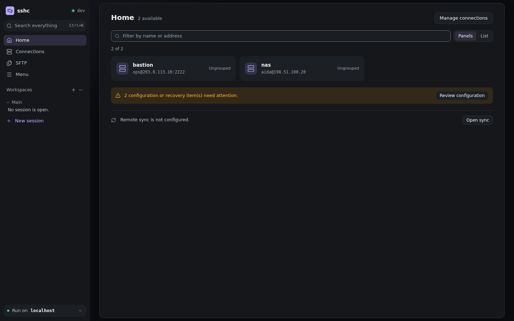

# sshc

OpenSSHの設定ファイルをそのまま使う、ローカルファーストのSSHクライアントです。接続管理、Terminal、SFTP、Workspace、スニペット、接続ごとのVPN、エンドツーエンド暗号化（E2EE）の同期を1つのUIとCLIから扱えます。

[日本語ドキュメント](https://aida0710.github.io/sshc/) · [English documentation](https://aida0710.github.io/sshc/en/) · [Releases](https://github.com/aida0710/sshc/releases)

[](https://aida0710.github.io/sshc/)

## インストール

macOS / Linux:

[Homebrew](https://brew.sh/)を未導入の場合は、公式サイトの手順でインストールします。

```sh
brew install aida0710/tap/sshc
```

Homebrewを使わない場合は、インストーラーとバイナリのバージョンを同じReleaseタグに固定してください。

```sh
SSHC_VERSION=v0.59.2 sh -c \
  'curl -fsSL https://raw.githubusercontent.com/aida0710/sshc/v0.59.2/install.sh | sh'
```

Windows PowerShell:

```powershell
powershell -NoProfile -ExecutionPolicy Bypass -Command "irm https://github.com/aida0710/sshc/releases/latest/download/install.ps1 | iex"
```

Windowsではユーザーの`PATH`の先頭へ追加し、「インストール済みアプリ」へ登録します。`install.ps1`で導入した場合は、`sshc update`とWeb画面から更新できます。削除は「インストール済みアプリ」から行い、`%USERPROFILE%\.ssh\sshc`のデータとSSH設定・鍵は残します。

FreeBSDとOpenBSDでは、curlの代わりに`fetch -qo -`（FreeBSD）か`ftp -Vo -`（OpenBSD）でインストールスクリプトを取得します（v0.59.1から）。手順は[インストールガイド](https://aida0710.github.io/sshc/guide/install#freebsd--openbsd)にあります。

Android APKと各OS向けのバイナリは[GitHub Releases](https://github.com/aida0710/sshc/releases)から取得できます。詳しい検証方法と更新手順は[インストールガイド](https://aida0710.github.io/sshc/guide/install)を参照してください。

## 起動

```sh
sshc
```

引数なしの`sshc`と`sshc open`は、sshcエンジンが停止中ならバックグラウンドで起動し、準備ができてから一度限りのURLを表示してブラウザで開きます。ターミナルを閉じても動き続けます。画面のないマシンでは`sshc open --no-browser`でURLだけを表示できます。停止するには`sshc stop`を実行します。

ログは`~/.ssh/sshc/logs/engine.log`（Windowsは`%USERPROFILE%\.ssh\sshc\logs\engine.log`）へ追記します。このログは暗号化同期の対象外です。

このターミナルで動かす場合は`sshc engine`を使います。ログイン時に自動起動するには、Linux・macOS・Windowsで`sshc service install`を実行してください。

WindowsではPowerShellのインストーラーで導入した実行ファイルを使い、タスクスケジューラに`sshc Startup Task-<ユーザーのSID>`という名前で登録します。管理者権限は不要です。状態の確認は`sshc service status`、再起動は`sshc service restart`、登録の削除は`sshc service disable`で行います。

初回はWeb UIまたはCLIでVaultを作成し、ロックを解除します。

```sh
sshc vault create
sshc vault unlock
```

マスターパスワードはWeb UIまたは`sshc vault`で入力します。CLIでは対話ターミナルからの入力だけを受け付け、引数や環境変数からは受け取りません。

パスワードを設定したVaultは既定で、Vault内のシークレットを最後に読み書きしてから12時間後に自動でロックされます。Settingsで1〜999分／時間に変更するか、自動ロックを無効にできます。パスワードなしのVaultは自動ではロックされず、sshcエンジンの起動時に自動でロックを解除します。

## CLIコマンド
```sh
sshc ssh                     # 接続先を選択
sshc ssh <接続先>            # 対話SSH
sshc ssh <接続先> --non-interactive -- <コマンド>
sshc info <接続先> --json    # sshcエンジンなしで実際に使われる設定を表示
sshc open --no-browser       # 必要なら起動し、URLだけを表示
sshc stop                    # sshcエンジンを停止
sshc status --json           # sshcエンジンの状態
sshc sync                    # 同期状態
sshc sftp get <接続先> /remote/file ./local-file
sshc sftp put <接続先> ./local-file /remote/file
sshc help                    # すべてのコマンド
```

## 主な機能

- OpenSSHのコメント、順序、空白、`Include`を保った設定管理
- 接続状態、検索、出力を引き継ぐ再接続、貼り付け前の確認、文字コード、クイックコマンドを備えたTerminal
- フォルダ転送、中断からの再開、バックグラウンドの転送キュー、エディタ、フォルダからのSSH・ローカルシェル起動を備えたSFTP
- SSHとローカルシェルのセッションをまとめ、表示・非表示を切り替えられるワークスペースと、複数のセッションを並べる分割表示
- sshcエンジンが止まる前に開いていたセッションの開き直しと、画面に出たファイルのパスのプレビュー
- SSHの接続先に常駐するsshcエンジンのターミナルを、このマシンのブラウザから使う実行先
- パスワード、鍵のパスフレーズ、TOTPのセットアップキーをVaultに保存し、Terminal、SFTP、CLIで再利用する認証情報の管理
- 選んだSSH接続だけを専用のVPN経由で接続する、接続ごとのVPN（WireGuard、L2TP/IPsec、OpenConnect、OpenVPN、IKEv2/IPsec。Dockerを使用）
- セッション、ホスト、ファイル、スニペット、設定を横断するコマンド検索（Search）
- S3互換ストレージを使った、エンドツーエンド暗号化（E2EE）のスナップショット同期。復号できるのは同じ同期キーを設定したマシンだけ
- SSH、SFTP、Serial、Telnet、同期、VPN、OTP、Terminal操作のCLI

機能とセキュリティ上の制限は[利用者向けドキュメント](https://aida0710.github.io/sshc/)にまとめています。内部設計は[docs/design.md](docs/design.md)を参照してください。

## 開発

Go 1.26とNode.js 22が必要です。

```sh
make build
make test
make verify-generated
make e2e
make integration-up
make integration
make integration-down
```

`make test`は、gofmt、go vet、Goのテスト（raceを含む）、Android向けのビルド、使われていない関数の検査、ESLint、Webの単体テストと型検査を実行します。`make verify-generated`は、生成物がコミット済みの内容と一致するかを確かめます。CIはこの2つの検査に加えて、Android APK、VPNのコンテナイメージ、統合テスト、利用者向けサイトのビルド、依存の脆弱性、主要画面のアクセシビリティを確かめます。E2Eの全体はCIでは実行しないため、画面を変えたときは`make e2e`も実行してください。

組み立てたWeb UI（`internal/ui/dist/app`）はリポジトリに入れていません。`make build`が組み立ててからバイナリに埋め込みます（画面だけなら`npm run build --prefix web`）。画面を組み立てずに作ったバイナリ（`go install`など）は、画面の代わりにそのことを知らせるだけなので、利用者にはリリースの成果物かHomebrewを案内してください。利用者向けサイトは`pages/`にあり、`npm run build`で検証できます。

## License

[Apache License 2.0](LICENSE)
