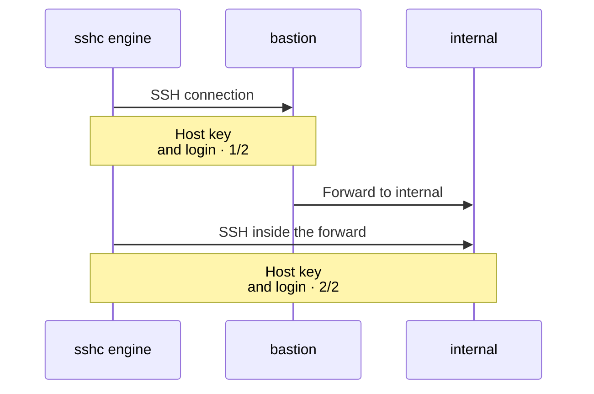

# Jump hosts

sshc follows `ProxyJump` in process and applies the same host-key and credential policy to every hop.

```ssh-config
Host bastion
  HostName 203.0.113.10
  User ops

Host internal
  HostName 10.0.0.20
  User deploy
  ProxyJump bastion
```

The SSH connection to the final host runs inside the SSH connection to the jump host. The sshc engine does the host-key check and the authentication of both.



The jump and final host are separate authentication targets. Save the appropriate key, key passphrase, or account password for each alias. Prompts that cannot be answered from saved values, such as 2FA, remain interactive.

Progress and diagnostics identify the exact hop and phase that failed.

## ProxyCommand

For a host configured with `ProxyCommand`, sshc runs the command on the local machine and uses its standard input and output as the SSH transport. It starts through `/bin/sh` on Unix systems or the command interpreter on Windows. The connection log shows the command before it runs.

`ProxyCommand` does not run in these cases:

- A host specifies both `ProxyJump` and `ProxyCommand`: sshc keeps whichever one OpenSSH reads first and ignores the later line, exactly as `ssh` does. The ignored line is shown in the host's **Resolved values** tab.
- A hop is reached through an earlier jump: the command would run locally rather than on that jump host.

`ProxyCommand` makes SSH configuration executable. Use it only with configuration that you have inspected and trust.
