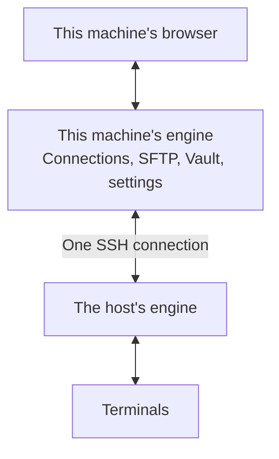

# Remote sessions

A remote session runs your terminals on the sshc engine of another machine. **Remote session** at the bottom of the sidebar chooses which engine.

Keep an sshc engine running on an SSH host (an always-on server, for example), and this machine's browser can use that engine's terminals. They keep running there after the browser or this machine is closed, which suits agents left running for a long time.

A regular SSH session differs in which engine holds the connection. This machine's engine holds it, so the session ends when this machine's engine stops. A remote session runs on the host's engine, so it stays connected when this machine's engine stops.

Only the terminals change: sessions and [workspaces](./workspace). Connections, SFTP, the vault and settings stay this machine's.

## Usage

1. Install sshc on the host and keep its engine running, for example with `sshc service install`. Using the same version as on this machine is the safest choice.
2. Connect to that host once from a terminal on this machine to confirm its host key. Save any passphrase or password it needs in Connections.
3. Open **Remote session** at the bottom of the sidebar and choose the host from **Add an engine…**.
4. Choose the host in the list: the workspaces and sessions become that engine's, and the terminal heading says it runs there.

Switching engines opens the session you last had open on that engine. If it has been closed, the session at the top of the sidebar opens instead (sessions in hidden workspaces are not picked). Only this browser tab remembers it; after a reload, the top of the sidebar opens first.

Each host's **…** offers **Engine information…**, **Open its full screen in a new tab** (the host engine's own screen, like `sshc open <alias>`) and **Remove from the list**. Removing it stops neither the host's engine nor its terminals.

If the chosen host's vault is locked, the terminal area shows a field for that vault's password. This machine's engine passes it to the host's engine inside the SSH connection and does not save it here.

## When the host cannot be reached

While the session list cannot be read from the chosen host's engine, the middle of the terminal area says what happened and what you can do. It is not a dialog: the sidebar, **Remote session** and the other screens stay usable.

It also shows when the list was last tried. The list is read again every few seconds, so this goes away by itself once the host can be reached.

- When the host cannot be reached: **Reconnect now** reads the list again at once.
- When the host's vault is locked: enter the vault password there and choose **Unlock**. If the host has no vault yet, create one with **Open its full screen in a new tab**.
- When sshc on the host does not work with this machine’s: both versions are shown side by side, and the update button there runs `sshc update --yes` on the host. While it runs, the seconds elapsed and what the host's `sshc` writes are shown as it is written; when it ends, the list is read again. Updating ends every session running on the host. Leaving the page does not stop the update on the host. If this machine's sshc is the older one, update it here instead.

In every case, **Switch back to localhost** returns to this machine's terminals. **Details** shows the error code and detail the engine returned, and **Engine information…** is also offered.

## Engine information

**Engine information…** shows the host engine's version, its vault state and how many sessions run on it. From there you can run the following. Each one ends every terminal on that host, so it asks first.

- **Update**: runs `sshc update --yes` on the host. Use it to bring the host up to this machine's version after updating this machine.
- **Restart**: runs `sshc service restart --yes` on the host. It works only for an engine running as the sshc-managed service.
- **Stop**: runs `sshc stop` on the host. To use it again, run `sshc open` or `systemctl --user start sshc` on the host.

After **Update** or **Restart**, a password-protected vault is locked. Unlock it with **Unlock…** in its vault row.

While an action runs, the dialog shows what the host's `sshc` writes as it is written. Leaving the page does not stop the action on the host.

## Requirements and limits

- sshc on the host can be a different version from this machine’s as long as both versions handle remote sessions the same way. When they differ, the version line in the engine information dialog also shows this machine’s version.
- When a release changes how remote sessions work between machines, update sshc on the host to that release or later too. The release notes of such a release say that hosts need updating. If sshc on the host does not work with this machine’s, update the host right from the terminal area.
- The host's SSH server must allow TCP forwarding to its `127.0.0.1` (`AllowTcpForwarding yes` or `local`).
- If the host has no vault yet, create it through **Open its full screen in a new tab**.
- SSH sessions opened in a remote session can use port forwarding. For Local and Dynamic forwards, this machine listens on its `127.0.0.1` and carries each connection to the remote sshc engine. A Remote forward's destination is resolved from the remote sshc engine. These forwards are temporary and cannot be saved to the connection's settings.
- Quick Commands and sending a command to several sessions also work in remote sessions. The snippets are this machine's, and variables and secrets are filled in on this machine. The confirmation shows the command with secrets hidden, and only the remote sshc engine receives the filled-in command. A command is sent only to sessions on the engine being shown (never across engines).
- Path preview and Open in SFTP for an SSH session opened in a remote session work only when this machine's settings have the same alias with the same destination (HostName, Port and User) as the remote sshc engine's.
- When a terminal on an engine that is not chosen sends a notification, the **Remote session** button and that engine's row get a mark. Only engines that this machine's engine is connected to get marks (sshc does not connect or ask for a password to show one). sshc checks every 15 seconds, so a mark can appear a little late.
- The host must run macOS or Linux.

## How it works

This machine's engine opens a single SSH connection to the host and forwards terminal operations and their input and output through it.

- Both machines listen on `127.0.0.1` only.
- It signs in to the host's engine the way that host's own `sshc` command does, without adding a browser registration there.
