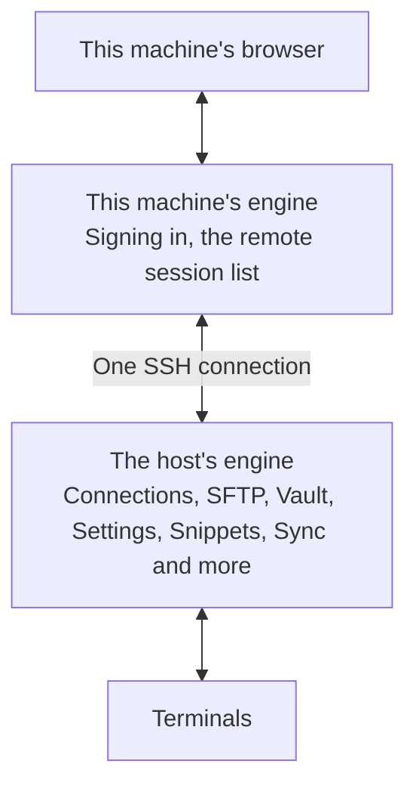

# Remote sessions

A remote session runs your terminals on the sshc engine of another machine. **Remote session** at the bottom of the sidebar chooses which engine.

Keep an sshc engine running on an SSH host (an always-on server, for example), and this machine's browser can use that engine's terminals. They keep running there after the browser or this machine is closed, which suits agents left running for a long time.

A regular SSH session differs in which engine holds the connection. This machine's engine holds it, so the session ends when this machine's engine stops. A remote session runs on the host's engine, so it stays connected when this machine's engine stops.

While a remote session is chosen, the whole screen is the remote engine's machine's:

- The terminals (sessions and [workspaces](./workspace))
- Home, Connections, SSH Config and History
- SSH Keys, Known Hosts and Remote Keys
- The vault (passwords, key passphrases, OTP and changing the master password)
- VPN and Diagnostics
- SFTP. "Local" is the files of the remote engine's machine. Uploads and downloads from the browser pass through this machine's engine to the remote engine.
- Snippets
- Settings (presets, appearance, shortcuts, the key bar and background images), the language and the theme. The screen is drawn with the remote engine's settings too.
- Sync, About and updating sshc

These stay this machine's whatever engine is chosen:

- Signing in to the screen
- The list in **Remote session** and which one is chosen
- The screen's layout (the SFTP tabs, folded workspaces and so on)

## Usage

1. Install sshc on the host and keep its engine running, for example with `sshc service install`. Using the same version as on this machine is the safest choice.
2. Connect to that host once from a terminal on this machine to confirm its host key. Save any passphrase or password it needs in Connections.
3. Open **Remote session** at the bottom of the sidebar and choose the host from **Add an engine…**. If it cannot be added, the reason appears above **Remote session**. When the sshc engine is not running on the host, **How to fix** lists the commands to run there, each with a button that copies it. Once the engine runs, choose **Try again**. **×** hides the reason.
4. Choose the host in the list: the workspaces and sessions become that engine's, and the terminal heading says it runs there.

The keyboard switches too. By default Alt+Shift+PageDown / Alt+Shift+PageUp go to the next and previous one, and Ctrl+1 to Ctrl+9 (Command+1 to Command+9 on a Mac) to the first to ninth in the list; the first is localhost. Typing "remote session" in the command search lists them by connection name as well. Change the keys in **Settings → Keyboard shortcuts**.

While a remote session is chosen, every screen has a frame around the whole window and a tag with the connection name at the top edge. They go away when you switch back to localhost. In the Android app, the frame's corners follow the rounded corners of the screen, so the frame is not cut off there.

The colour of the frame and its tag is the first of these:

1. The connection's colour: the **Colour** under **Display & terminal** of that connection in this machine's Connections. **Open connection settings** in the "…" of its row in **Remote session** opens it too. While a remote session is chosen, this switches back to localhost first, because Connections then shows the remote engine's connections
2. **Remote session frame colour** under **Settings → Appearance**
3. The accent colour

Switching engines keeps the terminals you were shown behind the new engine's. When you switch back, their scrollback, the size you zoomed the text to and what you were typing in a phone's text box are as you left them. What is kept is the terminals that were shown and as many more as the setting for terminals kept behind allows.

Switching engines opens the session you last had open on that engine. If it has been closed, the session at the top of the sidebar opens instead (sessions in hidden workspaces are not picked).

Which engine is chosen is saved as this machine's state, so it stays after a reload. Only the session you last had open is remembered by this browser tab alone: after a reload, the top of the sidebar opens first.

Each host's **…** offers **Engine information…**, **Open connection settings** and **Remove from the list**. Removing it stops neither the host's engine nor its terminals.

If the chosen host's vault is locked, the terminal area shows a field for that vault's password. Pressing the chosen row in **Remote session** again opens the unlock dialog too. This machine's engine passes the password to the host's engine inside the SSH connection and does not save it here. Once the vault is unlocked, the session the lock kept from opening opens.

## Which engine a session opens on

With a remote session chosen, every action that opens a session opens it on the chosen engine.

| Action | Opens on |
|---|---|
| **New session** in the sidebar | The chosen engine |
| **Connect** in Connections | The chosen engine |
| **Connect all** in Connections | The chosen engine |
| **Open a local shell** on Home | The chosen engine |
| A connection card on Home (double click, a tap on a touch screen, or **Connect** in its **…**) | The chosen engine |
| **Open Terminal here** in SFTP | The chosen engine |

Home, Connections and **New session** in the sidebar list the connections of the remote engine's machine. Adding, editing or removing a connection changes that machine's `~/.ssh/config`.

## Connection status

**Remote session** at the bottom of the sidebar shows how the connection is going, on every page.

| Shown | Meaning |
|---|---|
| ● Remote session | Connected, and the list can be read |
| Connecting | Waiting for the host. It appears once reading the list takes longer than 0.6 seconds |
| Loading | Reading this machine's session list |
| Can't connect (red) | The host could not be reached |
| Locked, Can't be used (red) | The host's vault is locked, or the two versions of sshc do not work together |

The list also marks each host **Connected** or **Not connected**. **Not connected** is not a failure: this machine just holds no SSH connection to it yet.

While it waits, the terminal area shows the step and the seconds elapsed.

- Connecting to the host: the SSH connection is being tried. If the host does not answer, this waits until the connection times out (`ConnectTimeout`, 30 seconds by default). Once authentication has begun, one attempt waits up to 5 minutes, which includes waiting for a host key answer or a password.
- Waiting for the sshc engine on the host: the SSH connection is up. If the engine does not answer, this gives up after 20 seconds.

**Switch back to localhost** works during the wait too. It stops the reads to the host, so this machine's screens do not wait for them.

## When the host cannot be reached

While the session list cannot be read from the chosen host's engine, the middle of the terminal area says what happened and what you can do. It is not a dialog: the sidebar, **Remote session** and the other screens stay usable.

It also shows when the list was last tried. The list is read again every few seconds, so this goes away by itself once the host can be reached.

- When the host cannot be reached: **Reconnect now** reads the list again at once. When the reason is known, the terminal area shows one of the sentences in the table below.
- When the host's vault is locked: enter the vault password there and choose **Unlock**. If the host has no vault yet, choose **Open Vault** and create it on the host's Vault page.
- When sshc on the host does not work with this machine’s: both versions are shown side by side, and the update button there runs `sshc update --yes` on the host. While it runs, the seconds elapsed and what the host's `sshc` writes are shown as it is written; when it ends, the list is read again. Updating ends every session running on the host. Leaving the page does not stop the update on the host. If this machine's sshc is the older one, update it here instead.

In every case, **Switch back to localhost** returns to this machine's terminals. **Details** shows the error code and detail the engine returned, and **Engine information…** is also offered. From any other page, pressing the chosen row in **Remote session** again takes you to the terminal area.

| Shown | What to do |
|---|---|
| The sshc engine on 〈name〉 is not running | Run one of the commands listed under it on the host: `sshc service install` (start it as a service) or `sshc open` (start it without a service) |
| The host key of 〈name〉 has not been confirmed. | Connect to it once from a terminal on this machine and accept its host key |
| The host key of 〈name〉 changed. | Find out why in Known Hosts before connecting again |
| The host key of 〈name〉 is marked as revoked, so sshc does not connect to it. | Check the entry in Known Hosts |
| Connecting to 〈name〉 needs a passphrase or password that is not saved. | Save it in Connections |
| The SSH server on 〈name〉 does not allow forwarding (AllowTcpForwarding). | Set `AllowTcpForwarding` to `yes` or `local` in the host's `sshd_config` |
| sshc is not installed on 〈name〉. | Install sshc on the host |
| The engine on 〈name〉 could not be verified. | Run `sshc status` on the host to check its engine |
| Could not connect to 〈name〉. | See the reason in **Details**, or connect from a terminal on this machine to find out |

## Engine information

**Engine information…** shows the host engine's version, its vault state and how many sessions run on it. From there you can run the following. Each one ends every terminal on that host, so it asks first.

- **Update**: runs `sshc update --yes` on the host. Use it to bring the host up to this machine's version after updating this machine.
- **Restart**: runs `sshc service restart --yes` on the host. It works only for an engine running as the sshc-managed service.
- **Stop**: runs `sshc stop` on the host. To use it again, run `sshc open` or `systemctl --user start sshc` on the host.

After **Update** or **Restart**, a password-protected vault is locked. Unlock it with **Unlock…** in its vault row.

While an action runs, the dialog shows what the host's `sshc` writes as it is written. Leaving the page does not stop the action on the host.

## Requirements and limits

- sshc on the host can be a different version from this machine’s as long as both versions handle remote sessions the same way. When they differ, the version line in the engine information dialog also shows this machine’s version.
- When a release changes how remote sessions work between machines, update sshc on the host to that release or later too. The release notes of such a release say that hosts need updating. If sshc on the host does not work with this machine’s, update the host right from the terminal area.
- The host's SSH server must allow TCP forwarding to its `127.0.0.1` (`AllowTcpForwarding yes` or `local`).
- If the host has no vault yet, create it on the Vault page while the remote session is chosen.
- SSH sessions opened in a remote session can use port forwarding. For Local and Dynamic forwards, this machine listens on its `127.0.0.1` and carries each connection to the remote sshc engine. A Remote forward's destination is resolved from the remote sshc engine. These forwards are temporary and cannot be saved to the connection's settings.
- Quick Commands and sending a command to several sessions also work in remote sessions. The snippets are the remote engine's, and the remote engine fills in their variables and secrets. A command is sent only to sessions on the engine being shown (never across engines).
- Path preview and **Open current directory in SFTP** for a session opened in a remote session use the files and connections of the sshc engine that runs the session.
- When a terminal on an engine that is not chosen sends a notification, the **Remote session** button and that engine's row get a mark. Only engines that this machine's engine is connected to get marks (sshc does not connect or ask for a password to show one). sshc checks every 15 seconds, so a mark can appear a little late. Choosing that engine clears the mark, and the rows of the sessions that sent notifications get their own unread marks.
- The host must run macOS or Linux.

## How it works

This machine's engine opens a single SSH connection to the host and forwards, through it, the terminals' input and output and the operations of the screens that belong to the remote engine.

- Both machines listen on `127.0.0.1` only.
- It signs in to the host's engine the way that host's own `sshc` command does, without adding a browser registration there.
