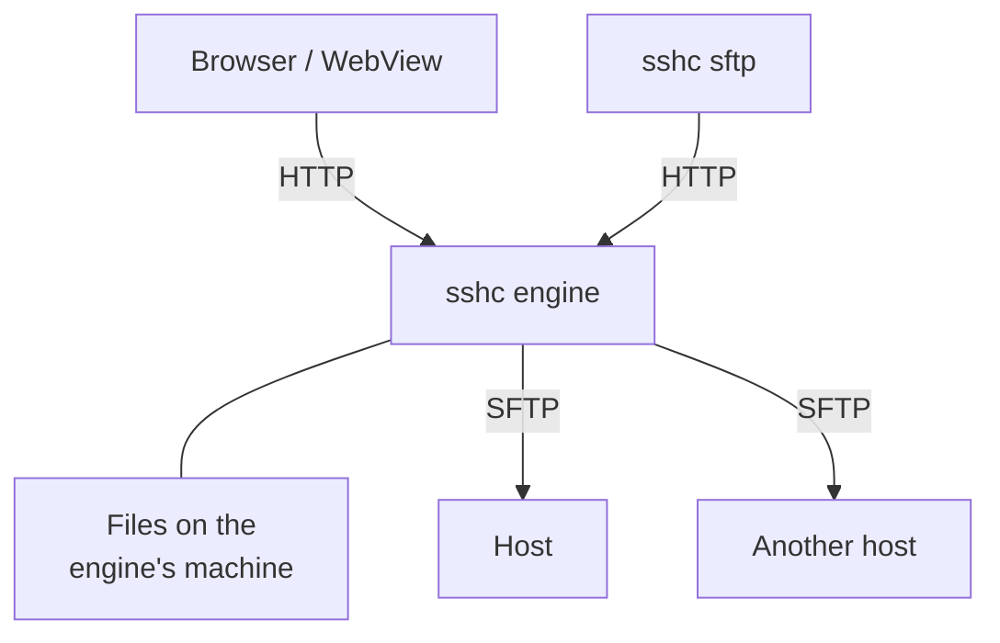

# SFTP

Browse, edit and compare remote files, and upload, download or copy them between hosts.

## How data travels

The sshc engine is what connects to a server over SFTP. The browser and the CLI ask the engine over HTTP.

The kind of transfer decides the path the data takes and what happens when the browser closes.

| Transfer | Path of the data | When the browser closes |
| --- | --- | --- |
| Upload | Browser → engine → host | Bytes stop |
| File download | Host → engine's spool → browser | Bytes stop |
| Folder ZIP download | Host → ZIP built by the engine → browser | Stops, and restarts from the beginning |
| Transfer with the engine's files | Engine's machine ↔ host | Continues |
| Remote-to-remote copy or move | Host → engine → another host | Continues |

The CLI's `get` and `put` use the same HTTP API of the engine as the browser. [How each transfer works](/en/sftp/transfers#how-each-transfer-works) has the steps of each one.

## Connecting

- Opening the SFTP screen does not connect to a saved server.
- Choosing a host in the host picker connects right away.
- Restored tabs show their saved host and path without reconnecting in the background, and connect when you press **Connect**.
- A first connection opens the login user's home directory reported by the SFTP server.
- It reuses the saved SSH configuration, host keys and credentials, as Terminal does.

The host picker searches aliases, groups, destination hosts and users, and switches between recently connected and SSH Config group views.

While the tab waits for the connection it shows the current stage, such as "connecting to bastion · 1/1", as Terminal does.

- When **Connection log** under Settings → Terminal is set to anything other than **None**, the log at that depth appears where the file list will be.
- A connection that fails always ends its log with the reason, whatever the setting.

### Reusing a connection

Operations on the same host (listing, details, preview, editing, transfers and the `sshc sftp` CLI) reuse the SFTP connection the previous operation used. Moving between folders therefore does not repeat the SSH handshake or ask for a one-time code again.

A connection that goes unused for 60 seconds is closed. As with an open Terminal, locking the vault leaves that recent connection alive for those seconds.

### Switching hosts

Switching hosts immediately clears the previous listing and open file. A delayed response from the previous host is discarded instead of being shown under the new selection.

## Tabs and panes

### Tabs

Each tab shows its folder and host side by side, or on separate lines on narrow screens.

| Action | How |
| --- | --- |
| Open a new tab | `+` opens the connection picker. Closing it without a choice adds no tab |
| Change the host | The destination button at the right of the selected tab. Disabled while that tab has unsaved edits |
| Choose a host for an empty tab | **Choose a connection** in its file list |
| Close a tab | A tab connected to an SSH host asks for confirmation. Hold Shift while closing to skip it |

Unsaved edits always require confirmation before discarding, even with Shift held.

Tabs share one width whatever the host name. They scroll horizontally when they exceed the pane width, and `+` stays at the right edge.

### Two panes

On desktop, drag a tab onto the file list to split the view into two panes. There are at most two panes, and the handle between them resizes the split. Both panes have their own tab strip and `+` action, with up to eight independent tabs per side.

| Where you drop | Result |
| --- | --- |
| With one pane, the left or right half of the list | The tab moves into a new pane on that side and leaves a blank tab behind |
| With two panes, the other pane | The tab moves there, and a pane whose last tab leaves closes |
| Along its tab strip | Reorders the tab |
| The other pane's tab strip | Puts the tab at that place |

From the keyboard:

| Key | Action |
| --- | --- |
| Select a tab, then `Shift`+`←` or `→` | The same moves as dragging onto the list |
| `Ctrl`+`Shift`+`←` or `→` | Reorders tabs |

The selected tab's **…** (also a right-click on any tab) offers:

- Move left, Move right
- Move to the other pane (Open in a new right pane while there is one pane)
- Swap the left and right panes

Reordering within a pane and swapping the panes keep the tabs connected.

Each tab remembers its host and location on the device, as does the split.

## The file list

You can filter the current list by name, and sort it by name, type, size or modified time.

- Sizes are shown in KiB, MiB or GiB. The details dialog also gives the exact byte count.
- Permissions appear below the entry name.
- The selected host and directory are reflected in navigation state, so a terminal remote-path action can open the same location.
- Below the remote listing (on phones, under **Folder actions**), the available disk space for the authenticated user and total capacity are shown in a unit that fits their size, such as MiB, GiB or TiB. A server without capacity reporting support still provides a usable directory listing.

### Moving between folders

| Destination | Desktop | Phone |
| --- | --- | --- |
| Parent folder | The leading `..` row | The upward button in the toolbar |
| Back, Forward | The navigation controls | Tap the path |
| Home, Root | **Folder actions** (three dots) | Tap the path |

Refresh and the sort order sit above the list. On desktop, **Folder actions** also offers Copy full path.

The current path is a clickable breadcrumb. Use its edit control when you need to type a path directly.

A path may start with `~` or `~/` (as may the destination of **Move to folder** on a remote host). After moving there, the pane shows the absolute path. The `~user` form is not supported.

- On a remote host, it starts at the directory the SFTP server logs you into (usually the home directory).
- On Local, it starts at the home directory of the user running the sshc engine.

Double-click or press Enter to open a folder or view file details.

### Selecting

Select one row, or use the checkboxes to select multiple entries (on phones, long press a row; the checkboxes appear only while selecting), to reveal download, rename, and the three-dot action menu in the selection toolbar.

| Action | Desktop key |
| --- | --- |
| Select a range | Shift-click |
| Add to the selection | Ctrl/Cmd-click |
| Select all displayed entries | Ctrl/Cmd+A |

The action menu can invert the displayed selection or copy selected names or full paths. Rename remains available for a single selection. Permissions can also be changed for multiple selected files and folders.

### Phones and narrow lists

Narrow desktop panes prioritize the name, modification time, size and type columns. Permissions and owner/group IDs remain available in Details, and wide panes also show them as columns.

On phones:

- All file tabs share one horizontally scrollable strip, with only the selected tab's directory visible. Hosts, paths and selections stay in their tabs, and returning to desktop restores the two-pane layout.
- Use **Compare** to choose any two configured tabs.
- The filename sits above wrapping metadata: permissions, available owner and group IDs, size, and modified date.
- Tab controls are at least 44px tall and file rows at least 56px tall.
- Selection and search controls replace the navigation row while in use, leaving more room for the file list.

## File operations

- Navigate, create, rename, chmod and delete remote entries
- Select or drag and drop files and folders for upload
- Download files or folders as ZIP archives
- Edit UTF-8 text files up to 2 MiB with Monaco Editor

Creation and uploads are grouped in the `+` menu at the upper left.

### Deleting

Choose Delete from the three-dot action menu. A confirmation modal shows the selected paths before deletion, and cancelling leaves the files unchanged. The Delete key opens the same confirmation.

### Dragging between tabs

Drag files or folders from the visible tab on one side to the visible tab on the other.

| Drop target | Result |
| --- | --- |
| Another host | You choose copy or move |
| Another directory of the same host | Moves, as it does in a desktop file manager |
| The directory the rows came from | Nothing |

Data streams directly between the two SFTP connections without a plaintext local spool file. A move within the same connection uses a server-side rename when possible.

### Attributes of uploaded files

- An uploaded file is given the modification time of its source (browser uploads, the CLI's `put`, host-to-host copies and transfers with the engine's disk).
- A newly created file gets the server's default permissions (its umask).
- A replaced file keeps its own permissions.

### Files on the engine's machine

Local panes work on the machine running the sshc engine. They support folder creation, rename, and deletion.

- Deletion bypasses the trash and recursively removes selected folders. Selecting a symlink removes only the link.
- Deletion and rename of the root, home directory, or folders containing them are refused.
- sshc temporary files and paths used by transfers are also protected.
- Deletion is refused if the selection changed after confirmation.
- Local rename is unavailable on Android.

### Opening a terminal from a folder

Use the terminal button beside the path, or **Folder actions → Open Terminal here**, to start a terminal in the displayed folder.

| Tab | What starts |
| --- | --- |
| Remote | An SSH session on its selected host |
| Local | The default shell profile on the machine running the sshc engine |

This also applies when you access the Web UI from another device: the shell runs on the engine machine.

A local shell starts with that folder as its working directory. Spaces and quotes in local folder names are preserved, and the shell does not start if the folder is unavailable.

In the other direction, a remote directory reported by OSC 7 can be opened in SFTP from the Terminal action menu.

## Editing text

Choose **Edit file** in the details dialog of a UTF-8 text file to open the editor. Closing the editor with unsaved changes asks before discarding them.

### Editor keys

| Action | Key |
| --- | --- |
| Save (the editor shows Saving and Saved) | `Ctrl/Cmd+S` |
| Find | `Ctrl/Cmd+F` |
| Replace | `Ctrl+H` (`Cmd+Option+F` on macOS) |
| Go to line | `Ctrl+G` |
| Toggle line comment | `Ctrl/Cmd+/` |
| Indent | `Tab`, and `Shift+Tab` to outdent |
| Toggle the mode in which `Tab` moves focus | `Ctrl+M` (`Ctrl+Shift+M` on macOS) |
| Suggestions (they do not appear on their own while you type) | `Ctrl+Space` |
| The editor's command palette (also in the right-click menu) | `F1` |

The editor's command palette lists the other commands, such as folding and multiple cursors, with their keys. Pressing `Esc` closes Find or the command palette and leaves the editor open. Find, the command palette and the right-click menu are shown in English.

### The Tab key and focus

In the editor, `Tab` indents and focus stays in the editor. To move to **Save** or **Close** with the keyboard:

1. Switch to the mode in which `Tab` moves focus (the command palette's "Toggle Tab Key Moves Focus" also toggles it).
2. Press `Tab`. Focus moves only within the editor's dialog.
3. Toggle the mode again to make `Tab` indent again.

The mode lasts until the editor is closed, and the next file you open starts with `Tab` indenting.

### When the remote file changed

If the remote file changed after it was opened in the editor, the editor refuses the save and says so. You can then choose either action:

- **Reload from remote** discards your unsaved changes and reads the current contents. It asks before discarding them.
- **Overwrite** asks before discarding the changes made on the remote, then writes the editor's contents over the remote file. If the remote file changes again while you confirm, the editor does not overwrite it and says so.

### Editing files on the engine's machine

Engine-local regular UTF-8 files up to 2 MiB can be edited, and their text or raster images previewed in Details. Selected symlinks are refused.

Saving checks both contents and file identity, refuses external changes or replacements, and protects paths used by transfers.

Saving also retains the owner, group, access controls and extended attributes. It is refused when:

- These cannot be read or retained
- Metadata exceeds 16 MiB
- The file carries privileged execution attributes

On Windows:

| Attributes | Result |
| --- | --- |
| Owner, group, DACL, integrity label, resource attributes, named streams, extended attributes, creation time and ordinary file attributes | Retained |
| Unsupported attributes such as encryption, compression and read-only state | Saving is refused |
| Ordinary audit SACLs | Outside the preservation guarantee |

## Thumbnails and the grid

Image rows in the list carry a small thumbnail. **List | Grid** above the list switches to a grid of larger pictures, and each tab remembers its choice.

In the grid, a tap, a long press, a click, a right click and the keyboard do what they do in the list, and the arrow keys move to the neighbour on each side.

### How thumbnails are made

The sshc engine reads an image and shrinks it.

- It does so only for PNG, JPEG and GIF files in rows in view, and a row that scrolls out of view cancels its read.
- Files are read one at a time on the SFTP connection already in use, so no connection is added. If that connection has closed after going unused, one is opened (never for a host answered with a one-time code).
- A photo with a small picture in its Exif header costs its first 68 KiB or so, and any other image is read whole, up to 4 MiB.
- Thumbnails stay in memory only.

These keep the icon of their kind:

- Files over 4 MiB with no picture in their Exif header
- Images that would take more than 128 MiB of memory to decode
- SVG, WebP, BMP, HEIC and every other format but PNG, JPEG and GIF, and video and audio
- Symlinks
- Images in a folder of more than 1000 of them

In the phone app the sshc engine runs on the phone, so what it reads for thumbnails counts as mobile data. **Show thumbnails of images** in Settings > SFTP turns them off. It is a preset's setting, so it can be off on the phone alone.

## Symbolic links

Symlinks are listed as `name → target`, also in a pane showing the engine's disk. A link whose target cannot be found is marked `(not found)` and cannot be opened.

| Action | What it acts on |
| --- | --- |
| Open a link to a directory | That directory |
| Details, preview, edit and download of a link to a file | The file the link points to |
| Save an edited file | Rewrites the file the link points to and leaves the link in place |
| Copy, move, delete, compare and transfers with the engine's disk | The link itself, never followed |

On the engine's disk, a link opens even when its target is an absolute path, but the link itself cannot be transferred with the engine.

### Creating and changing links

The remote creation menu offers **Create symbolic link**. Enter a name and a target.

- The target may be relative or absolute, and may not exist yet.
- Existing entries are never overwritten.

**Change link target** in the details dialog replaces only the link itself and leaves the target contents unchanged. Servers without safe link replacement support refuse this change.

## Owner and group

The listing and details show owner UID and group GID when supplied by the server. **Change owner and group** in the details dialog accepts numeric UID/GID values from 0 to 4294967295 for regular files and directories.

- The server must support the no-follow `lsetstat@openssh.com` extension.
- Account names, recursive changes and changes through symbolic links are not supported.
- Missing attributes, unsupported operations, and insufficient permissions are reported.
- If the entry changes during confirmation, refresh the listing and reopen the dialog.

## Change permissions for selected remote entries

1. Select remote files and folders with their checkboxes.
2. Choose **Change selected permissions** from the selection toolbar's three-dot menu.
3. Enter separate octal modes for files and folders. The defaults are `644` and `755`.
4. To apply them below selected folders too, choose **Apply to folder contents recursively**. Each type gets its own mode.
5. Choose **Review changes** to validate the targets and open a confirmation modal.
6. Check the selection count, the file and folder target counts including recursive contents, both modes and the recursive setting, then choose **Apply**.

Cancelling either modal changes no permissions. Single-entry changes and applying one mode recursively to a single folder remain available.

### Limits and conditions

| Item | Limit or condition |
| --- | --- |
| Selection | Up to 200 entries |
| Recursive walk | All selected trees share a 20,000-entry budget, with a depth limit of 32 |
| Server | `lsetstat@openssh.com` version 1 for no-follow attribute changes. Unsupported servers refuse permission changes, including single-entry changes |
| Symbolic links | Never followed or changed. A selection containing a link has no permissions action. Links found inside recursive folders are skipped and counted in the confirmation |
| Local panes | Do not offer chmod |

### When something changes on the way

- Changes detected before execution refuse the entire selection.
- Connection or permission failures after execution starts can leave partial changes. The dialog reports the count of confirmed changes, and partial changes are not rolled back automatically. Refresh the listing, inspect permissions, and select only the entries that still need changes.
- SFTP cannot atomically compare an entry type and change its permissions, so concurrent changes made by other clients remain a best-effort boundary.

## Search file names or contents

In a remote pane, open the settings button beside the search field to choose **Name** or **Content**. Enter a query and press Enter to search below the current directory.

| Search | How it matches |
| --- | --- |
| **Name** | Case-insensitive, on file names |
| **Content** | Exact, case-sensitive text across files. Not available for local tabs |

Each content match shows its path, line number and a short snippet. Select a match to open that line in the editor. If the file changed after the search, search again. Use **Stop search** to cancel the request.

### What content search reads

It reads regular UTF-8 files only. These are skipped, and results explain unreadable entries and other omissions:

- Files with missing type, size or modification-time attributes
- Links and binary files
- Files over 2 MiB

| Limit of one search | Value |
| --- | --- |
| File contents read in total | 64 MiB |
| Matching lines | 200 |
| Entries | 20,000 |
| Directory levels | 32 |

## Compare folders

**Compare** sits in the bar at the top of the screen. It appears only while at least two tabs are connected (a local tab counts) and the selected tab is one of them.

- When both panes of a split view are connected, it recursively inspects the directories in the currently selected left and right tabs.
- Otherwise you first choose the two tabs to compare.

It compares metadata such as size, modification time, permissions, and type, and distinguishes left-only, right-only, changed, and type-mismatched entries.

| Tabs compared | What you can do |
| --- | --- |
| Two remote tabs | Select only the entries you want, then copy left to right or right to left. Comparison never deletes entries that exist only on the destination |
| A local tab | See differences without modifying files |

### Text differences

View text differences opens a read-only line comparison.

- An absent side is displayed as empty.
- Each text file is limited to 2 MiB and pinned to the listed revision. Changed files must be compared again.
- Narrow screens use an inline diff.

## Compare contents even when size and modification time match

**Compare** defaults to **Metadata**. Choose **Content (SHA256)** to stream regular files from both sides and compare their SHA256 hashes. Different bytes are detected even when size and modification time match. File content comparison ignores modification time and permissions. Both local-to-remote and remote-to-remote comparisons are supported.

Reading both sides uses network traffic and takes longer than metadata comparison.

| Item | Limit or behaviour |
| --- | --- |
| File-content reads | 256 MiB in total |
| Traversal | 20,000 entries |
| Links | Not followed |
| Over-budget and unsupported files | Shown as **Not compared**. These entries prevent the result from confirming a whole-folder match |
| Closing the dialog or changing modes | Cancels the current reads |

Changes detected before or after reading end the comparison as a conflict. SFTP servers do not necessarily expose file identities, so a replacement preserving all observable metadata may be undetectable. The operation does not take a simultaneous snapshot of the whole directory.

## Transfer Manager

The Transfer Manager is docked below the file list, and files and folders share one queue. Its compact state shows the active count, aggregate progress, and speed.

Expand it for per-file progress, speed, remaining time, and controls. Its action menu can pause, resume or cancel all transfers, and failed files in a batch can be retried independently. The engine persists the queue, so queued, paused, and recoverable jobs are restored after an engine restart.

See [Transfer Manager](/en/sftp/transfers) for paths, states, recovery, and cancellation.
