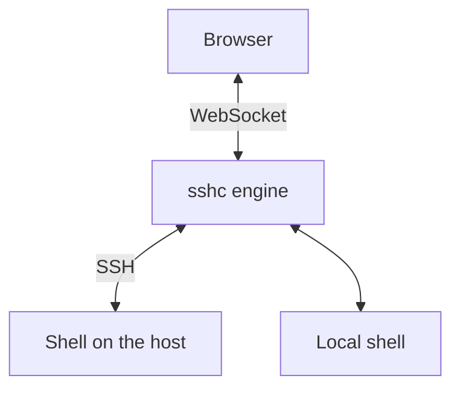
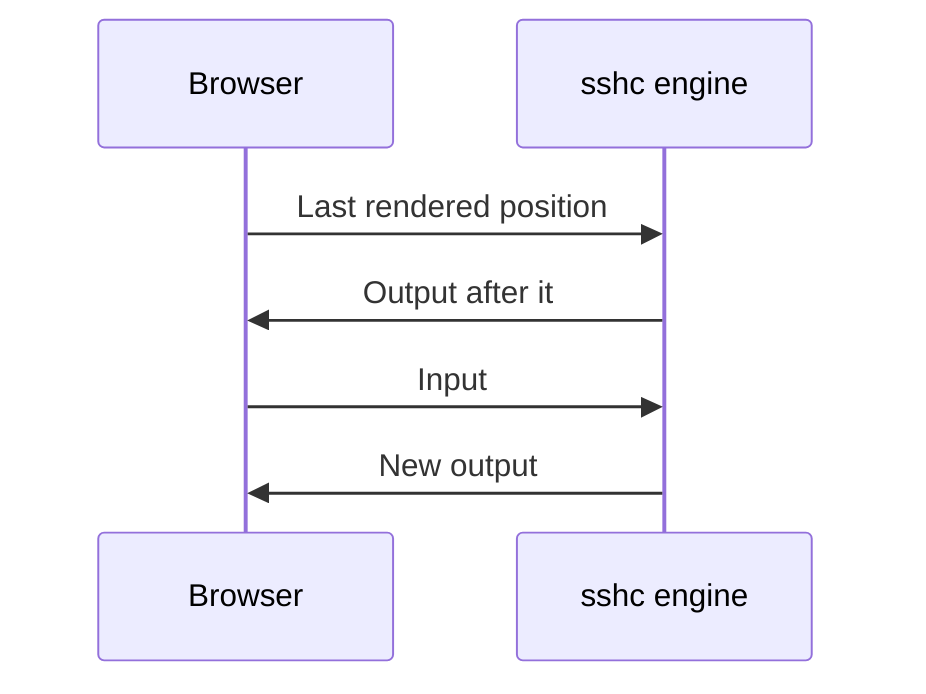
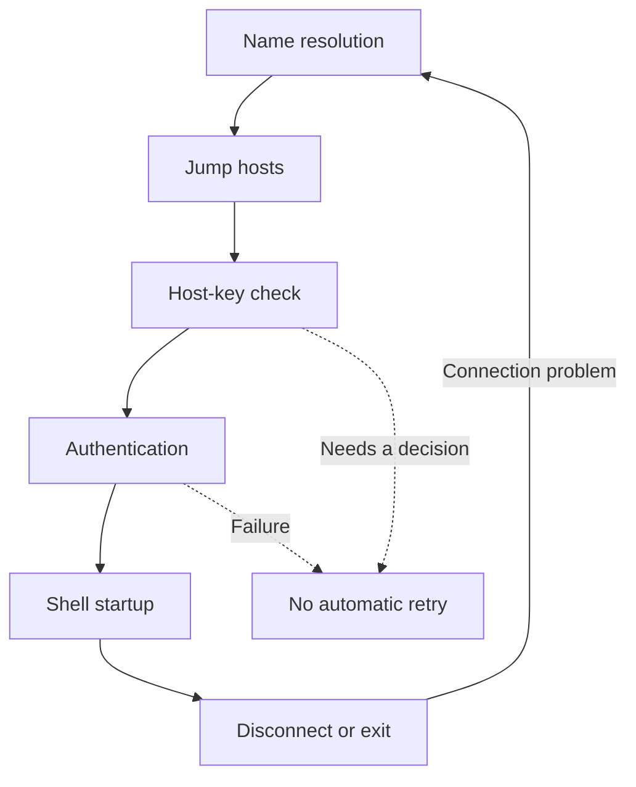
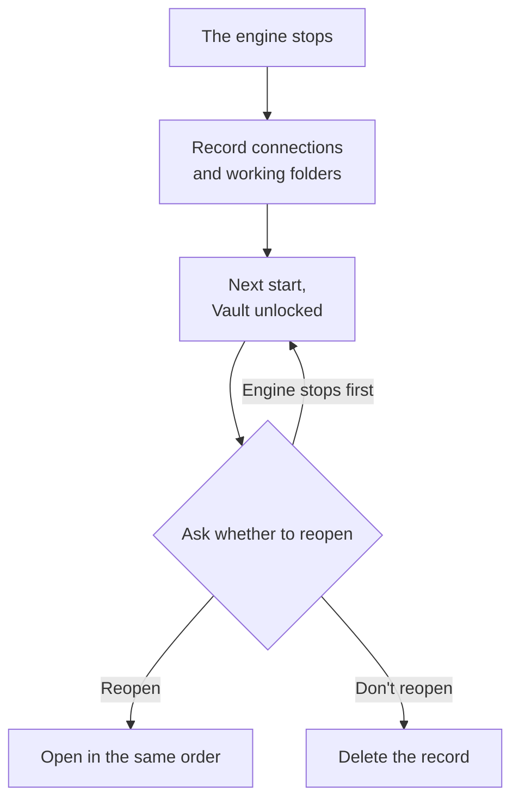
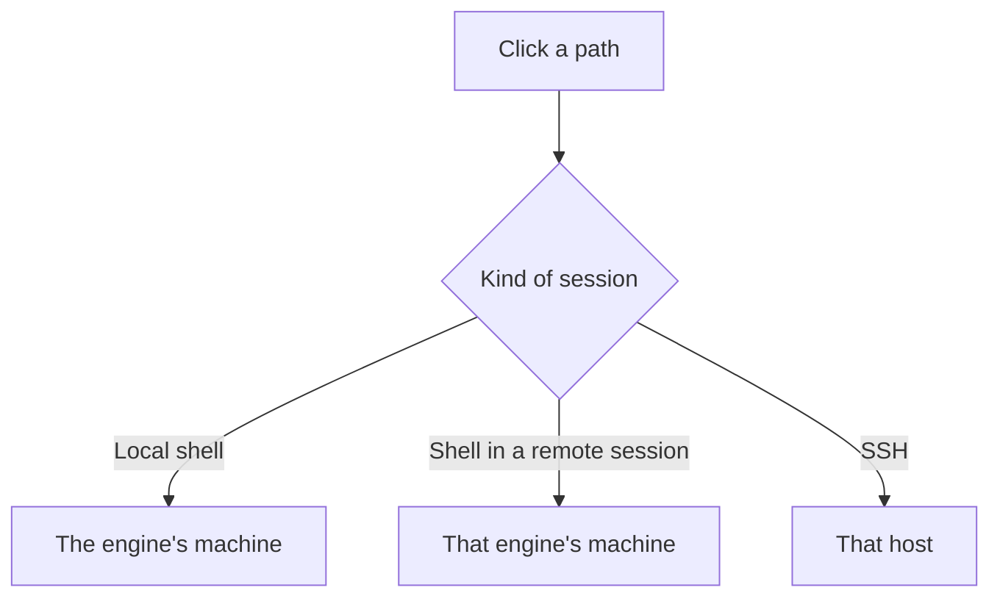

# Terminal

Open SSH and local shells in the same interface, with search, Quick Commands, and port forwarding. Use [Split view](./split-view) to operate several sessions side by side.


## How data travels

The sshc engine runs the shell. The browser receives the output over a WebSocket, draws it, and sends your input. When the browser's connection drops, the session keeps running in the engine.



### When the browser reconnects

On reconnect, sshc replays only bytes after the browser's last rendered position.



- Existing output is not duplicated, and older scrollback retained only by the browser is not cleared.
- If a long disconnect let required output fall out of the engine buffer, the terminal reports the gap.
- Both buffers stay in memory and are not written to the vault, backups, or sync snapshots. Terminal output reaches a file only when **Save a log of each session to a file** is on ([Session logs](#session-logs)).

## See connection progress

sshc shows each stage of an SSH connection. It does not blindly retry host-key or authentication failures that need a decision.



### Typing secrets

When SSH needs an unsaved password, key passphrase, or hidden keyboard-interactive answer, each typed character appears as `*` instead of the value. Backspace and `Ctrl+U` update the mask without leaving the plaintext in scrollback.

### Connection log

**Settings → Terminal → Connection log** shows diagnostics for newly opened connections at the depth of OpenSSH's `-v`, `-vv` and `-vvv`. Each line carries the depth that produced it, such as `[sshc][debug1]`.

- **Basic details (-v)**: the target, each hop as it connects, the server banner and the session start
- **Keys, hops and timings (-vv)**: **Basic details (-v)**, plus:
  - The candidate authentication methods and why one is skipped
  - Each key's type, SHA256 fingerprint and how it was unlocked (no passphrase, saved or typed), and keys that could not be read
  - The server host key fingerprint and which known_hosts line matched (or which lines hold a different key)
  - Where the password came from and which method authenticated
  - The terminal request (columns × rows), and the names of environment variables sent and refused
  - The keepalive interval and count, and settings that are read but not applied
- **Everything (-vvv)**: **Keys, hops and timings (-vv)**, plus:
  - The host key algorithms, key exchanges, ciphers and MACs that sshc offers to the server
  - The TCP local and remote addresses
  - The agent keys by fingerprint
  - Each keyboard-interactive question

Passwords, passphrases, TOTP codes, setup keys and environment variable values are never logged. `sshc ssh <alias> --non-interactive` uses the same setting.

### Disconnects and reconnects

A dropped SSH session retries automatically with a growing delay.

| Action | Result |
| --- | --- |
| **Stop reconnecting** at the top of the pane, while it waits | Abandons the loop. The session stays listed as exited so you can reconnect by hand or close it |
| Reconnect an exited SSH session | Reconnects in the same pane while retaining its scrollback |
| Enter in a session that ended because of its connection | Reconnects. Other keys are dropped |
| The send button on a phone | Reconnects and keeps what you typed in the text box |
| Close an SSH or local shell explicitly | Stops it immediately and removes it from the list |

While there is no network, reconnecting waits without using up an attempt and tries as soon as the network is back.

| Where | How it learns about the network |
| --- | --- |
| The Android app | From the system |
| A desktop | Looks for failures such as `network is unreachable` and tries again every five seconds |

On Android, when Wi-Fi and mobile data switch, sshc checks that each connection still answers and reconnects after ten seconds of silence. That reconnect tries at once and does not add to the reconnect attempts so far.

A reconnect or reopening that starts a new shell has lost the programs of the previous one. If Claude Code was running there, the terminal and a notice suggest `claude --continue`, and a button in the notice runs it. When the working directory is known, the command moves there first.

### Open in tmux

To return to the same screen after a disconnect, select **Open in tmux** under **Display & terminal** in Connections. sshc then starts `tmux new -A -s sshc-<alias>` instead of a shell.

- Reconnecting or reopening returns to the same tmux session. Returning types neither a startup snippet nor a change of directory into it.
- A second session to the same connection uses `sshc-<alias>-2`.
- If the server has no tmux, the terminal says so and opens a normal shell.
- Closing the sshc session leaves the tmux session on the server, and the next one returns to it. Run `exit` inside tmux to end it.
- The setting is not written to `~/.ssh/config`, so `ssh` and `scp` are not affected, and a `RemoteCommand` in the Host block takes precedence.
- The status of programs inside tmux (OSC 7501) does not reach the sidebar, except that a Claude Code question visible on screen is shown ([Titles and notifications](/en/terminal/notifications#claude-codes-permission-prompts-and-questions)).
- `sshc ssh` does not use tmux.

## Reopen sessions after a stop

When the sshc engine stops (an update, a restart of the computer, a manual stop), it records the connection, workspace and working folder of each open session on this machine only.



After the next start, once the Vault is unlocked, sshc asks whether to reopen them.

- **Reopen** opens them again in the same order, each in its working folder when that is known.
- **Don't reopen** deletes the record, and sshc does not ask again.
- If the engine stops before you answer, it asks again on the next start.

A [remote session](./remote-session) works the same way: after the engine on the host restarts, sshc asks the first time you choose that engine with its Vault unlocked.

### What is not reopened

- Sessions in the agents workspace are not reopened.
- A crash or power loss skips the record.

### Reading the working folder

| Session | Where the working folder comes from |
| --- | --- |
| SSH | OSC 7, or a title of the form `user@host: ~/dir`, which bash sets by default on Debian and Ubuntu |
| Local shell on Linux | The engine reads it directly |

An SSH session with neither, or with a folder whose name contains quotes, `\`, `&` or similar symbols, is reopened in the home directory, because some login shells would read those symbols as part of a command.

### What the record holds

The record holds connection names and folder paths only, never passwords or output, and is never synchronized to other machines.

**Duplicate session** also starts in the working folder of the original session.

## Terminal controls

### Scrollback and search

- Scrollback search with `Ctrl/Cmd+F`, with case, regex, match highlighting, and result navigation
- 1,000–100,000 lines of browser scrollback
- A 16 KiB–4 MiB engine replay buffer
- Clearing the screen with `Ctrl+L` in bash or zsh keeps the cleared output in the scrollback (`clear` empties the scrollback too)
- **Save scrollback to a file** in the terminal's **…** menu saves the whole scrollback, screen included, as a text file, with wrapped rows joined (**Copy recent terminal context** takes up to 200 rows)

### Session logs

Turning on **Save a log of each session to a file** under **General** in Settings keeps writing the lines the terminal showed, as text, to one file per session. It is off by default.

- The lines written are those that scroll off the top of the screen and those on a screen that is erased. A line still on the screen is written once it scrolls off or the session ends; when the session ends, the lines still on the screen are written too.
- A program that redraws the same rows (Claude Code, for instance) leaves only what it drew last. What a full-screen program such as vim draws is not written, nor what tmux draws for a connection opened in tmux.
- For an SSH session, only the shell's output after authentication is written: neither the password prompt nor what was typed at it. The values of secret Snippet variables are replaced with `[secret]`.
- Connecting, disconnecting, reconnecting and the end of the session are written as lines starting with `[sshc]`, with the time.
- A file is named `<connection>-<time opened>-<first 8 characters of the session ID>.log`; a local shell's starts with `local-`. One file holds up to 100 MiB, and nothing past that is written.

Each machine keeps its logs in the place below, and they do not sync to other machines. A remote session's log is written on the machine the session runs on. Android keeps no logs.

| OS | Place |
|---|---|
| Linux and BSD | `~/.local/state/sshc/session-logs` (`sshc/session-logs` under `XDG_STATE_HOME` when it is set) |
| macOS | `~/Library/Logs/sshc/sessions` |
| Windows | `%LOCALAPPDATA%\sshc\session-logs` |

To use another folder, choose **Change where logs are kept…** from that machine's … under **Machines** in Settings.

**Connections not logged** takes the connection name patterns whose sessions are not logged, one per line as in a .gitignore. With none, every session is logged.

```text
# Production hosts are not logged
prod-*
# but prod-web is
!prod-web
# nor are local shells
@local
```

- Patterns may use `*` and `?`, and are matched regardless of case.
- A line starting with `!` logs those again, and a later line wins.
- A change applies to the sessions opened after it.

### Input and encodings

- URL and path context actions, including previews and downloads of paths, and OSC 8 links
- Quick Commands and snippets
- Pre-send review for pastes containing line breaks or control characters
- OSC 52 clipboard, Kitty keyboard protocol and JIS keyboards (every OSC sequence sshc takes is listed in [Supported escape sequences](/en/reference/escape-sequences))
- Per-connection UTF-8, Shift_JIS, EUC-JP and ISO-2022-JP

### Text size

Besides the configurable font size, pinching two fingers on a terminal, or turning the wheel with Ctrl held (a trackpad pinch does the same), changes that terminal's text size between 8 and 32 px.

- The page does not zoom.
- The size applies only to that terminal's display and is not saved.
- Changing the font size in the settings returns to the configured size.

### Rendering and display

| Feature | Behaviour |
| --- | --- |
| WebGL rendering | Falls back to the DOM renderer automatically when unavailable or when a background image is active. An option disables WebGL permanently |
| JetBrains Mono ligatures (`->`, `!=` and so on) | Only when turned on in the settings, with every character kept in its own cell position |
| Background image library | Uncompressed, with search, selection, rename, delete, a 1–1024 MiB capacity (**Settings → General**), and atomic updates to preset and per-connection references |
| Cursor | Static in Terminal and the SFTP text editor when the operating system requests reduced motion |

### Keep screen on

**Keep screen on** under **All terminals** in a terminal's "…" menu keeps the screen from turning off while Terminal is shown (Screen Wake Lock API). It applies to every terminal and is saved in the preset this machine uses. It appears only when the browser opened sshc over HTTPS or `localhost`.

### Visibility reports and the status line

Visibility reports (mode 2033): a program that asks is told whether any browser shows the terminal, so it can stop drawing while nobody sees it. A program on the server therefore learns whether someone is looking at the terminal. sshc answers "not visible" when:

- No browser shows the session
- Its tab is in the background
- It is out of the split view or off the screen

The VT320 status line (DECSSDT, DECSASD): when a program shows it, it appears as one line under the terminal, and the program is told the terminal has one row fewer. Only the line a program writes (DECSSDT 2) is supported. The indicator line the terminal writes (DECSSDT 1) is not shown.

## Input and clipboard

### Selecting and copying

Normal text-selection copying stays inside the browser and does not require OSC 52. Configure automatic copy-on-select and right-click paste under **Settings → Terminal**.

Inside a program that uses the mouse, such as Claude Code, vim or tmux, a drag goes to that program. Hold Shift (Option on a Mac) while dragging to select the terminal text instead.

**Copy with colors** in the terminal's **…** menu also copies the selection as HTML that keeps its colors and the terminal's background. A document keeps the colors when pasted into, and a place that takes only text gets the text. OSC 8 links stay as their text.

### Reviewing a paste

A paste containing line breaks, a final Enter, or terminal control characters is not sent immediately. sshc shows the target, logical line count, and a bounded preview with control characters made visible. Edit the text in the review dialog, and the line count and warnings update with it.

You can choose:

- Cancel
- Paste the edited text
- Remove exactly one final Enter first

Neither the preview nor the original paste is stored. The review stays open while the terminal display changes, and is withdrawn when a reconnect replaces the shell.

### OSC 52

OSC 52 lets remote software write to the device clipboard. It is off by default. Turn it on only while you use connections you trust.

Turned on, it applies to every terminal, whatever the connection. Switch it under **Settings → General** or under **All terminals** in a terminal's "…" menu.

- It also lets a program write images and HTML through the Kitty clipboard protocol (OSC 5522).
- A program that turns on paste events (mode 5522) can also be given what is pasted, images included.
- Replaying past output does not repeat OSC 52 copies or copy notifications. New copy requests are processed even when they contain the same text.

### Keyboards

Kitty keyboard mode answers the remote application's query and follows its requests, including the levels that report key releases. A JIS option sends the yen key as backslash.

Mobile adds a special-key row for Ctrl, Alt, Esc, Tab, and arrows. Ctrl and Alt work like this:

| Tap | Result |
| --- | --- |
| One tap | Applies to the next key only |
| A quick double tap | Locks it until you tap it again. A locked key is shown in the accent colour |

### Command boundaries (OSC 133)

When the shell reports where each command starts and ends through OSC 133 (shell integration), a line left of the command and its output shows how it ended (faint grey for success, red for failure, yellow while it runs).

- Pointing at the line (tapping it on mobile) shows the exit code, the time taken, when and in which folder it started, and **Copy output** and **Save output to a file**.
- While you scroll back through long output, its command and result stay at the top of the terminal. Pressing them goes to the command's line.
- The scrollbar marks where the commands are, in the same colours.

Each of these can be turned off under **Settings → Terminal → Behaviour**. The sshc engine times the commands, so the times are right for the history of a session reopened later, too.

### Click to move the cursor

When the shell reports where typing begins through OSC 133, clicking the line you are typing at a prompt (tapping it on mobile) moves the cursor there. sshc sends one left or right arrow key for each character between the cursor and the click, as Ghostty's `cursor-click-to-move` does.

It does nothing once the typed line wraps, or while a program that uses the mouse is running.

### The mobile text box

On mobile, a text box below the special keys is always shown. Japanese conversion finishes inside the box, and only the finished text reaches the terminal.

| Action | Result |
| --- | --- |
| Enter | Starts a new line. The Enter that confirms a conversion does not send |
| **Send** beside the box | Sends the text the way a paste does, then presses Enter |
| Sending an empty box | Presses Enter alone, for example to confirm a choice in Claude Code |
| “Send with Enter in the phone's text box” on, in **Settings → Terminal** | Enter sends, and Shift+Enter starts a new line |
| Ctrl+Enter (⌘+Enter on a Mac) on a hardware keyboard, with it off | Sends |
| The key bar's **Type into the terminal** key | Hides the box to type straight into the terminal. Pressing it again brings the box back |

Text with line breaks is sent as one paste when the program in the terminal uses bracketed paste. Otherwise, and whenever the text has control characters, it opens the same review as a paste and is sent only when you accept it.

While the line holding the cursor ends in a question such as `Password:` or `パスワード:`, a password field takes the place of the box. What you type is hidden, is not stored, and is sent with Enter, and what you were writing comes back when the question is over.

## Links and remote paths

### Opening links

OSC 8 links and detected URLs open in the system browser. Ctrl-click (⌘-click on a Mac) opens one at once, except an OSC 8 link whose text is a different address from where it goes: that opens a menu showing the real destination first.

A long URL that wraps at the right edge opens as one URL however many rows it takes, including when a program such as Claude Code breaks it at the edge itself and indents the rest.

URLs and paths on the screen are underlined in the accent colour.

| Where | What is underlined |
| --- | --- |
| A PC | Only the one under the pointer |
| A touch screen | Every one that a tap opens, all the time, because a finger cannot point at a link to find it. Turn it off with **Always underline links** under **Settings → Terminal → Behaviour** |

### Going to and from SFTP

- A path an SSH session printed (from the preview's “…”) or the current working directory reported through OSC 7 (OSC 9;9 from PowerShell or cmd on Windows) can open SFTP at the same host and directory.
- SFTP can also open a terminal at its displayed directory: an SSH session for a remote tab, or a local shell on the engine machine for a local tab.

### Previewing a path

Click a path starting with `/` to show that file over the terminal at once, with no menu to choose from first.

| File | Limit | How it is shown |
| --- | --- | --- |
| PNG, JPEG, GIF, WebP, BMP and SVG images | 8 MiB | As an image |
| UTF-8 text | 2 MiB | In a read-only editor, colored by its file name. Markdown is shown as source |
| Audio (`.mp3`, `.wav`, `.m4a`, `.ogg`, `.flac` and more) | | In the browser's own player |
| Video (`.mp4`, `.webm`, `.mov` and more) | | In the browser's own player. The engine reads only the parts the player asks for, so seeking in a long video starts at once |

- Which formats play depends on the browser (HEVC in a `.mov`, for example, may not play in Chrome). When a file cannot play, the reason and **Download** are shown.
- A file that cannot be previewed, or is too large, still opens with the reason.
- Any file can be saved to the browser's machine with **Download**. A file from an SSH session joins the transfer list like any other download.
- The image line Claude Code prints when it sends one (`[image] /tmp/….png`) opens the same way.
- The preview's “…” has **Copy full path**, and for an SSH session also **Browse in SFTP**, **Edit with SFTP** and **Download with SFTP**.

### Where the file is read from

The file is read only when you click its path. The kind of session decides where from.



An SSH session opened in a remote session is read from this machine with the same alias only when this machine has that alias and it takes it to the same destination (HostName, Port and User) as the remote sshc engine does. Otherwise, so that no other machine's file is shown, clicking the path opens a menu with **Copy link** only.

### Which paths become links

Long paths that programs such as Claude Code split at the right edge and continue on indented lines are recognized as a single path. Names may contain Unicode characters, including Japanese.

| Form | Example | How it opens |
| --- | --- | --- |
| Absolute path | `/tmp/x.png` | As it is |
| Path with spaces | `"/tmp/画面 1.png"`, `'/tmp/画面 1.png'`, `/tmp/画面\ 1.png` | Enclosed in quotes, or with a backslash before the space |
| Inside backticks | `` `/tmp/x.png` `` | The path part |
| After a label or symbol | `Saved to:/tmp/x.png`, `保存しました：/tmp/x.png`, `→/tmp/x.png` | The path part |
| In a tool line or Japanese text | `Read(src/app.ts)`, `画像は~/shots/a.pngに保存しました` | The path alone |
| `file:` URL | `file:///tmp/画面%201.png` | The decoded path |
| Relative path | `artifacts/shot.png`, `report.md` | From the working folder of the program that printed it |
| From the home folder | `~/shots/a.png`, `$HOME/shots/a.png`, `${HOME}/shots/a.png` | From the session's home folder |
| Windows form | `C:\Users\aida\x.png`, `C:/Users/aida/x.png` | In a local shell, once the engine is confirmed to run Windows |

Trailing `:line:column` and sentence punctuation, including `。`, `、` and `）`, are removed from the path.

These are not linked:

- Ambiguous unquoted output, to avoid opening only part of a path
- File URIs with a host, such as `file://host/…`
- The `~user/` form
- Windows paths in SSH sessions or shells in a remote session

### Relative paths and the home folder

A relative path can be clicked when its name ends in a common extension: images, text and source code, PDF, audio, video and archives (for example `.png`, `.svg`, `.md`, `.py`, `.json`, `.mp3`, `.mp4` and `.zip`).

| Session | Working folder | Home folder |
| --- | --- | --- |
| Local shell on Linux | The engine looks it up | The engine machine's home |
| Shell in a remote session | On Linux, the engine looks it up | The home returned by SFTP |
| Local shell on macOS or Windows | The folder the shell reported through OSC 7. It cannot open the path when the shell reports none | The engine machine's home |
| SSH session | The folder the shell reported through OSC 7. It cannot open the path when the shell reports none | The home returned by SFTP |

If the home folder cannot be read, sshc explains why the path cannot be opened.

### Moving between previews

While a preview is open, the left and right arrow keys, or **Previous** and **Next**, move to the other files the same terminal printed (paths ending in the extensions above).

- While text is shown, the arrow keys inside the editor move its cursor.
- In an SSH session opened in a remote session, it works only when the file can be read as above.

## Images and character widths

### Which images are shown

Images are drawn inside the terminal. Try them with `chafa`, `img2sixel`, `timg`, or `imgcat`.

| Format | What is shown |
| --- | --- |
| SIXEL | Everything |
| iTerm2 inline images (OSC 1337 File=) | PNG, JPEG, and GIF, also when the file size in bytes (`size=`) is omitted. It does not animate |
| The kitty graphics protocol (experimental) | Only images sent as data |

Sending a kitty image by file path or shared memory is not supported, and sshc says so when a program asks.

### Image limits

| What | Limit | Beyond it |
| --- | --- | --- |
| Images kept by each terminal | 32 MB | The oldest are dropped |
| Size of a single image | 4096 × 4096 pixels | Not shown |
| Kitty image as sent | About 7.5 MB | Not accepted |
| Kitty images sent only to be stored (`a=t`) | Another 32 MB | The next one is refused |
| Placing a stored kitty image (`a=p`) | Four 4096 × 4096 images a second | The rest are refused |
| zlib-compressed image (`o=z`) | Inflates to its declared size | Not shown when it inflates past it |

Placements are limited because each one decodes the image again.

### When images are cleared or skipped

- When an image sent in chunks is refused partway through, the images already shown in that terminal are cleared as well.
- Reopening a session redraws images from the retained output. An image the engine could only keep part of is skipped instead of printed as text.

### Character widths

Character widths follow the Unicode 17 tables. Emoji, including recent ones, take two cells, so programs that print emoji (Claude Code, for example) stay aligned with the text after them.

Emoji joined with ZWJ (👨‍👩‍👧), flags (🇯🇵), emoji with a skin tone (👍🏽) and characters with VS16 (❤️) are counted according to the program's mode 2027 (grapheme clusters).

| Mode 2027 | How they are counted | Width of the family |
| --- | --- | --- |
| On | As one character | Two cells |
| Off | Each character, as wcwidth counts it | Six cells |

With it off, the cursor stays where programs counting with wcwidth expect it.

In a local shell on Windows, mode 2027 and the VT320 status line have no effect: Windows' ConPTY sends these sequences ahead of the text around them. They work on hosts reached over SSH from an sshc engine on Windows.

## Local shells

### Opening one

**New session** in the session list opens the same picker SFTP uses for its destination.

| Choose | What opens |
| --- | --- |
| **Local shell** at the top | The shell chosen in **Default local shell** under **Settings** → **Terminal**, or the system login shell when none is chosen |
| Search, recent connections and groups | An SSH host |
| Type `user@host[:port]` in the search, then **Connect** | Connects without saving |
| Type `user@host[:port]` in the search, then **Save as a connection and connect** | Writes a Host block and connects (not offered in a [remote session](./remote-session#which-engine-a-session-opens-on)) |

A session opened without saving has no connection name, so SFTP, startup Snippets and saving a forward to the connection are not available for it.

Local shells use the same subsystem as SSH: search and Quick Commands both apply.

### Environment variables

On macOS and Linux, sshc supplies the terminal information needed by line editors such as zsh and fish even when the engine was started as a background service.

| To | What is passed |
| --- | --- |
| Local shells | `TERM=xterm-256color`, `COLORTERM=truecolor`, `TERM_PROGRAM=sshc` and `TERM_PROGRAM_VERSION` |
| SSH hosts | `COLORTERM=truecolor`, which the host receives when its sshd lists it in `AcceptEnv`. A `COLORTERM` in `SetEnv` is sent instead |

Local shells do not get the variables the terminal that started the engine set for itself (`TERM_PROGRAM`, the `GHOSTTY_` ones, Windows Terminal's `WT_SESSION` and so on).

### Windows

On Windows the default local shell is PowerShell 7 when it is installed, otherwise Windows PowerShell.

PSReadLine 2.0, which comes with Windows PowerShell 5.1, can show the line being typed away from its prompt after the terminal's width changes. Install PowerShell 7, or update PSReadLine from the terminal:

```powershell
Install-Module PSReadLine -Scope CurrentUser -Force -SkipPublisherCheck
```

## Titles and notifications

| What shells and programs send | Where it appears |
| --- | --- |
| Titles through OSC 0/1/2 | The pane header and the session list name. While a command runs for a second or longer in a local shell, its name goes in front (engines on Linux and macOS only) |
| Notifications through OSC 9/99/777 | Unread marks, and browser notifications with a sound while the sshc tab is in the background |
| Progress through OSC 9;4 | A line along the bottom edge of the pane header, and a ring at the start of its session list row, even while you are viewing another session |

See [Titles and notifications](/en/terminal/notifications) for details, including the Claude Code and Codex settings.

sshc never infers program state from ordinary shell output or reruns arbitrary commands on its own.

## Port forwarding

Manage Local forwarding, Remote forwarding and Dynamic SOCKS per SSH connection.

| Kind | Direction |
| --- | --- |
| Local forwarding | Opens a port on the engine side and connects from the SSH server |
| Remote forwarding | Opens a port on the SSH server and connects from the engine |
| Dynamic forwarding | Opens a local SOCKS endpoint |

See [Port forwarding](/en/terminal/port-forwarding) for setup details.

Closing a connection initially focuses **Keep it open**. Press Tab to focus **Close**, then Enter to confirm.
