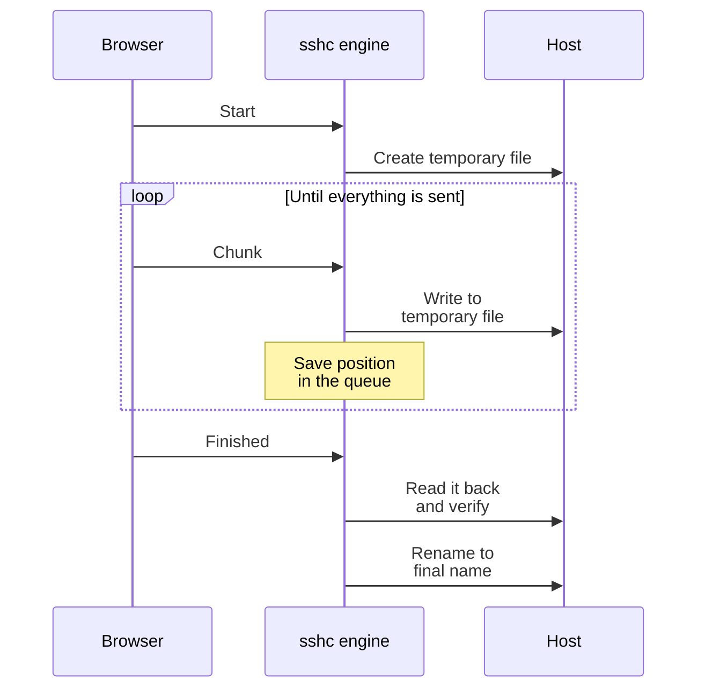
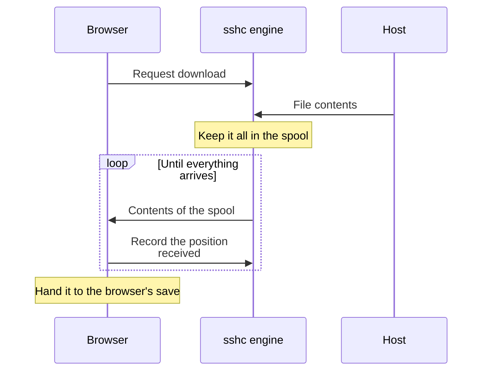
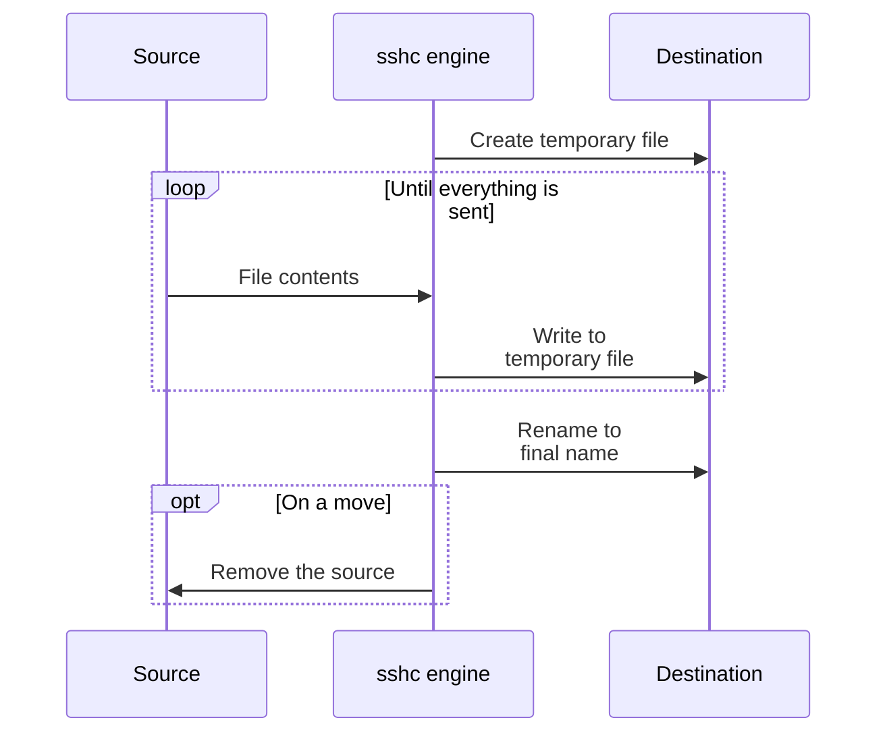
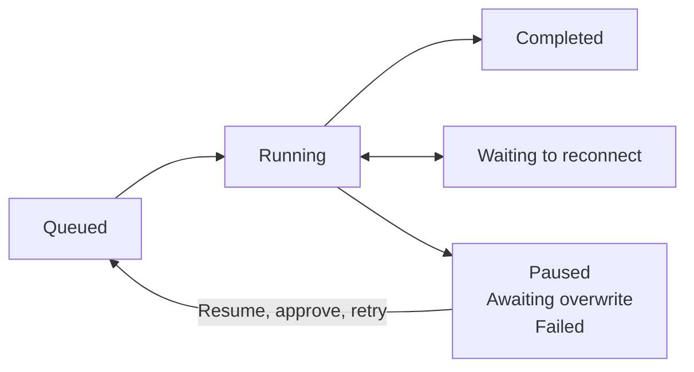
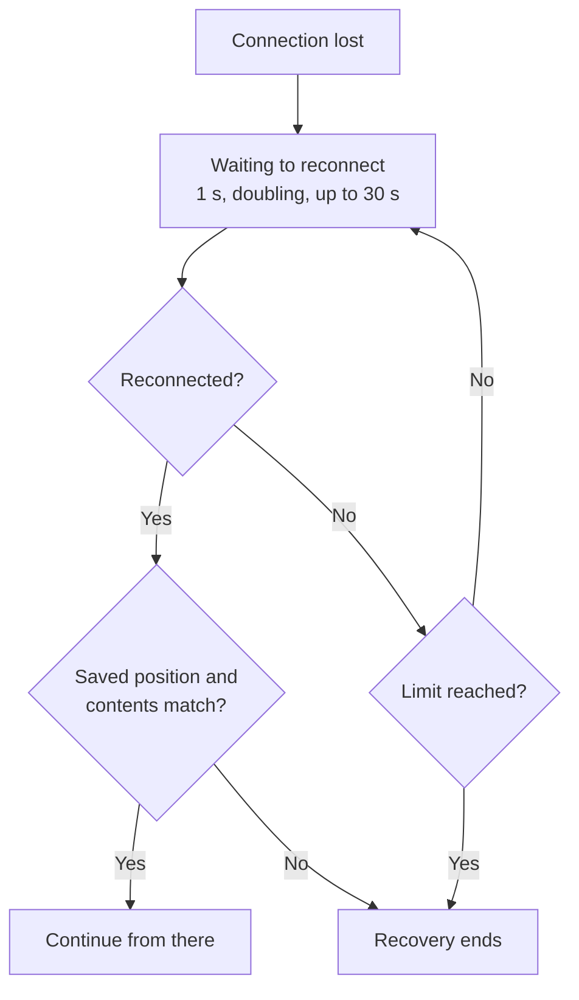

# Transfer Manager

File upload, folder upload, file download, folder download, and remote-to-remote copy or move share one queue. Two transfers run concurrently by default, with a configurable limit from one to eight.


## What it shows

The Transfer Manager is docked below the SFTP view and normally shows only the active count, aggregate progress, and speed. Expand it for per-file status and controls.

- Name and source → destination
- Progress, transferred and total bytes
- Speed and remaining time
- Status and available actions

Paused, reconnecting, confirmation-needed, and failed jobs are counted separately from running transfers. Open the row's details for full paths, the exclusions captured when it started, and failure information.

| Where | The list |
| --- | --- |
| Desktop | Drag the upper grip of the expanded list to resize it. With the grip focused, the arrow, Home, and End keys do the same |
| Phone | Tap the bottom bar showing counts and progress to open the queue in a separate sheet |

Height and folded state are saved in the browser.

## Transfer settings

**Transfer settings** in the Transfer Manager opens the settings page, even when the queue is empty or folded. It groups speed and recovery, queue and finished transfers, split transfers, and exclusions.

| Where | What |
| --- | --- |
| **Settings → SFTP** | Settings chosen for each preset |
| **Settings → General** | Settings that are the same on every machine |

The page has two sections: Transfers and Transfer exclusions.

- Number fields and exclusion rules apply when focus leaves them.
- Selections and checkboxes apply when changed.
- Exclusion rules apply only when every line is a valid rule.

## How each transfer works

The path of the data depends on the kind of transfer. The overall picture is in [How data travels](/en/features/sftp#how-data-travels).

### Upload

Data goes from the browser through the engine into a temporary file in the target directory. The engine verifies the complete contents, then atomically renames the file, so a partial file never appears under the final name.



- Existing destinations require confirmation before the transfer.
- After a lost connection, the upload resumes from the positions saved by the engine.
- After a reload, select the same local file again. If its name, size, and modified time match and the remote temporary file is still usable, the upload skips ranges already recorded as complete and continues with the remainder.

### Download

The engine first prepares the entire file in its private spool, so that retries use the same contents.



File downloads resume through HTTP Range when the browser retains the downloaded prefix and its revision still matches the remote file.

The free space and location of the spool are in [Split transfers and the spool](#split-transfers-and-the-spool).

### Folder ZIP download

For a remote folder, the engine builds a ZIP and delivers it to the browser.

- A ZIP cannot resume from the middle. After a pause, failure, or reload it restarts at byte zero.
- Android hands the completed ZIP to the system file picker.

A folder cannot be packaged as a ZIP, and its download fails, if the folder itself or anything inside it has one of these names:

| Name | Engine's platform | Why |
| --- | --- | --- |
| Contains `:` | Windows | Selects a drive or an alternate data stream |
| A Windows reserved name such as `CON`, `NUL`, or `COM1` | Windows | Refers to a device |
| Contains `\` | Any | |

On Windows, downloads to a folder on the engine's disk and `sshc sftp get` refuse the same names. An engine on Linux or macOS does not refuse them.

### Remote-to-remote copy or move

The engine streams the data through two SFTP connections. The browser is not on the path, so the transfer continues after the browser closes.



## Actions

| Action | What it does | What stays |
| --- | --- | --- |
| Pause | Stops new reads and writes | Recovery state, such as the upload's temporary file and the downloaded position |
| Resume | Continues from the verified position when source and destination still match. Otherwise an overwrite confirmation or a new file selection is needed | |
| Retry | Reruns failed files only, from the recovery state if usable, otherwise from the beginning | |
| Cancel | Ends the job and removes the temporary files sshc created for resuming | Existing complete files |
| Clear finished | Removes completed and canceled entries from the view | Transferred files |
| Remove from list | Dismisses one completed, canceled, or failed entry | |
| Clear failed | Dismisses failed entries without clearing successful history | |
| **Stop starting new transfers** | Running transfers finish, and queued entries show as Held and do not start. **Resume processing the transfer queue** reverts it | |
| ↑↓ on a row | Reorders queued entries. Running and finished entries stay where they are | |

States move like this:



You can cancel from any state except completed and canceled. A cancel request that races with completion is idempotent and keeps the completed result.

The overflow menu only appears when at least one bulk action is currently available.

**Finished transfers** set to anything but Keep (clear after 30 seconds, 5 minutes, 1 hour) removes completed entries that long after they finish. It is set under **Settings → General** and is the same on every machine and every screen.

### When a temporary file stays behind

If sshc cannot remove an upload's remote temporary file, it keeps the failed entry visible with an explanation, so that you can retry cancel or removal after restoring the connection.

With automatic recovery disabled, when a remote-to-remote copy or move, or an upload from a pane that shows the engine's files, is paused or canceled, sshc opens a new SFTP connection to remove the temporary file it was writing at the destination. The file can stay behind when:

- The connection is lost
- The host authenticates with a one-time code and refuses a second connection

The same applies to a temporary file left behind when an editor save is cut off. It is not shown in the listing, but while it remains, these fail with `sftp_conflict`:

- Deleting the folder that holds it, or any folder above it
- Moving such a folder to another host

A temporary file that has not been written for a day is treated as abandoned and removed together with the folder on the next delete or move, so the failures last one day at most. Only sshc's own temporary files are removed this way. Nothing else is deleted.

## Split transfers and the spool

Regular files up to 512 GiB can be uploaded or downloaded. The stream count starts at one, so large uploads and downloads initially use a single SFTP connection without splitting.

With two or more streams, files at or above the split threshold are divided into chunks and processed over up to that many independent SFTP connections.

| Setting | Initial value | Allowed integers |
| --- | --- | --- |
| Split threshold | 100 MiB | 16 to 1024 MiB |
| Streams | 1 | 1 to 128 |
| Chunk size | 32 MiB | 8 to 4096 MiB |

- The actual connection count is capped by the number of unfinished chunks.
- A host that authenticates with a one-time code transfers over one connection whatever the setting.
- These settings are kept in the preset and shared by the Web UI and CLI of the machines that use it.
- A file already being transferred keeps the settings it started with when the defaults change.
- `sshc sftp settings` displays or saves the defaults, while the same options on `get` or `put` override one invocation.

A split upload preallocates a remote temporary file and writes non-overlapping ranges through independent connections. The engine persists completed ranges in its transfer queue.

### The download spool

Keep roughly the file size available.

| Platform | Location |
| --- | --- |
| Linux | `$XDG_CACHE_HOME/sshc/sftp-spool` (`~/.cache/sshc/sftp-spool` when the variable is unset) |
| macOS | `~/Library/Caches/sshc/sftp-spool` |
| Windows | `%LocalAppData%\sshc\sftp-spool` |
| Android | `sftp-spool` in the app's cache directory |

| Error | When |
| --- | --- |
| `sftp_spool_unavailable` | The spool cannot be used, for example because no user cache directory is known. The download fails instead of waiting, and the engine logs the reason when it starts |
| `sftp_spool_full` | The spool has less free space than the file size plus 64 MiB, or runs out while the file is written |

Folder downloads packaged as ZIP use a separate limit.

## When folder transfers and deletes fail

Folder transfers the engine runs itself (copy or move between hosts, and transfers with a pane that shows the engine's files) and folder deletes fail in these cases:

| Error | When |
| --- | --- |
| `sftp_traversal_limit` | A source folder holds more than 20,000 entries |
| `sftp_traversal_limit` | A folder to delete holds more than 200,000 entries, or is nested deeper than 128 levels. Nothing is removed |
| `sftp_name_collision` | On a case-insensitive destination (the APFS and NTFS defaults on macOS and Windows), source names that differ only in case or Unicode normalization, such as `README.md` and `readme.md`, become one name. Also when overwriting was approved |
| `sftp_conflict` | An entry of a different kind is at the destination, such as a file where a folder goes. An approved overwrite does not replace it |
| `sftp_target_inside_source` | A remote-to-remote destination is the source folder itself or inside it. Nothing is left at the destination |
| `sftp_target_is_source` | A remote-to-remote destination is the source file itself. Neither is changed |

### When destination and source overlap

`sftp_target_inside_source` and `sftp_target_is_source` also apply when:

- The same server is saved as two hosts. If an entry with the same name is at the destination, you are first asked to approve the overwrite, and the transfer fails after you approve it.
- The destination's path reaches the source through a symbolic link on the way. This is detected on servers that follow the links on the way when they check a path, such as the OpenSSH SFTP server.

When the destination itself is a symbolic link to the source file, the transfer does not fail: an approved overwrite replaces the link with a file, and the contents of the file it pointed at are not lost.

::: warning Overlaps that cannot be detected
A destination that overlaps the source is not detected when the two hosts see the same place under different paths. Approving the overwrite of such a move may then lose the source.

- A chroot or a bind mount gives each host a different view
- A path differs only in case on a case-insensitive server (such as the APFS and NTFS defaults on macOS and Windows)
:::

## When you leave the screen

The engine Transfer Manager owns the queue and atomically persists it in `~/.ssh/sshc/transfers.json`. Registration, ordering, progress, concurrency, overwrite approval, and recovery checkpoints survive browser or WebView reloads and are restored after an engine restart. Views reconcile with the engine every two seconds, so multiple open views converge on the same queue.

| Transfer | When the screen closes | When you come back |
| --- | --- | --- |
| Upload of a local file | The browser or WebView performs local file I/O because only it can access files on the device, so bytes stop. The job stays with the engine | Appears as waiting to resume, and sends no data until the original local file is selected again |
| Download to a local file | Bytes stop. The job stays with the engine | |
| Remote-to-remote | Continues | |

Moving away from SFTP within the same application does not stop a transfer.

### When the engine shuts down

A remote job interrupted by an engine shutdown returns to the queue and is automatically retried after startup. Each file is written to a temporary sibling and atomically published when complete.

It is not retried when the copy or move may already have published the target or removed the source but its terminal result could not be recorded in the device-local queue. Such an entry reports **Check the destination** and offers cancel as its only action, so you can verify the result before dismissing it.

A damaged queue file does not stop the engine from starting. The damaged contents are preserved on the device for diagnosis, the queue starts empty, and the preserved copy is never synced.

## Speed limit

**Speed limit** under **Settings → SFTP** uses KiB/s: 1 KiB/s is 1,024 bytes per second, and 0 is unlimited.

- The setting is kept in the preset and applies to running transfers.
- All jobs, range connections, browser windows and CLI transfers share one budget.
- The budget counts file payload rather than SSH headers or metadata requests.
- Bounded read-ahead and SSH buffers mean instantaneous network usage and displayed progress speed can differ from this setting.

| Transfer path | Limited payload |
| --- | --- |
| Browser/CLI uploads | Sequential chunks and parallel ranges written to SFTP |
| Browser/CLI file downloads | Sequential/ranged SFTP preparation and HTTP delivery from the spool |
| Engine-local files ↔ remote | SFTP reads/writes and recovery verification |
| Remote copy/move | Received and sent payload when copying content, and verification reads before a resume. Rename-only moves use metadata |
| ZIP downloads | Uncompressed file content during preparation and completed ZIP bytes during HTTP delivery |

Sequential upload requests receive the bounded HTTP chunk before writing it to SFTP. That incoming browser/CLI-to-engine HTTP traffic itself is not limited; SFTP writes are. Parallel range uploads stream their input into the limited SFTP writer.

## Automatic recovery

Under **Settings → General**, enable **Resume automatically** under **When the connection drops** and set **Reconnect limit** to 1–10. Recovery is disabled by default.



The queue shows **Waiting to reconnect** and the attempt count. Pause and cancel stop the wait and connection attempt. Stopping queue processing, disabling recovery or shutting down the engine also ends automatic recovery.

| Transfer path | Recovery |
| --- | --- |
| Single engine-local files ↔ remote; remote copy | Recreate SSH connections. Check source metadata and content hash, destination revision and the partial file's entire prefix before copying the suffix. These jobs continue with the browser closed |
| Browser uploads | Recover while the page still holds the original file, using persisted positions/completed ranges and destination revision. Reloading requires selecting the same source again |
| Browser file downloads | Resume from a checkpoint of the same immutable spool. If SSH failed during spool preparation, prepare it again from the beginning. Changed content stops automatic recovery |
| Browser ZIP downloads | Restart from the beginning |
| CLI `get`/`put` | Share the speed limit. The CLI does not automatically retry its own connection failures |
| Engine folder transfers, moves and deletes | No automatic retry. Inspect partial results before a manual resume or retry |

These are not retried:

- Authentication and host-key refusals, permission failures and revision conflicts
- A lost acknowledgement of the publication rename, because the destination may already be complete. Inspect the destination before cancelling
- Files with missing type, size or modification-time attributes, which report an error
- In the browser, a page that cannot reach the engine API or cannot confirm its job state

### Recovery details

- Paused engine jobs retain their temporary files. Cancellation or removal cleans up only the unpublished file, and a failed cleanup keeps its queue record visible.
- Resumable engine jobs require regular files: the source, destination and temporary file cannot themselves be symlinks.
- Contents are streamed through fixed-size buffers for verification, which can take time and uses the same speed budget.
- An engine shutdown leaves a job that was waiting to reconnect paused after the next startup. A manual resume verifies its saved content and continues from that checkpoint.

### Changing the settings from the CLI

`--speed-limit` is KiB/s and changes the speed limit of the preset this machine uses. `--reconnect-attempts` is a global setting, and `0` disables recovery. Changes also affect other transfers.

```sh
sshc sftp settings --speed-limit 2048 --reconnect-attempts 3
sshc sftp settings --speed-limit 0 --reconnect-attempts 0
```

## Excluding entries from folder transfers

Open **Transfer exclusions** under **Settings → SFTP** and save one pattern per line. No entries are excluded by default.

| Pattern | Matches |
| --- | --- |
| `.git`, `node_modules`, `*.log` | That name at any depth inside the selected folder. A matching directory and its contents are omitted without entering it |
| `build/cache` (contains `/`) | A path starting at the selected folder |

| Wildcard | Meaning |
| --- | --- |
| `*` | Any sequence within one path segment |
| `?` | One character |

`**`, negation with `!`, brackets, backslashes, absolute paths and `.` or `..` segments are unsupported. You can save up to 64 patterns, each up to 512 bytes.

### What the rules apply to

| Applied to | Not applied to |
| --- | --- |
| Browser folder uploads | Explicit single-file selections |
| Folder copies between hosts | Moves |
| Folder transfers between a host and the engine's local disk | Deletion |
| Folder ZIP downloads | |
| CLI `get --recursive` / `put --recursive` | |

Omitted entries are not created at the destination and are not part of a successful transfer. Browser uploads report the omitted entry count, and engine folder jobs show their captured exclusion rules.

### When the rules change

The rules are kept in the preset. A queued folder job retains the rules captured when it was registered, including after settings changes or a restart. Prepared ZIP contents stay unchanged on retry.

The CLI snapshots the rules at invocation start, and `sshc sftp settings` also displays the current rules.
