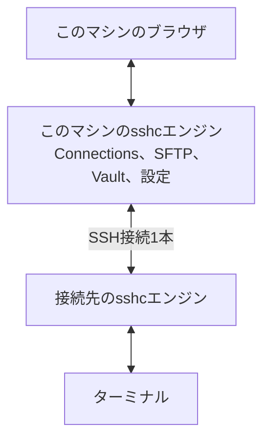

# リモートセッション

リモートセッションはターミナルを別のマシンのsshcエンジンで動かす機能です。どのsshcエンジンで動かすかは、サイドバーの下の［リモートセッション］で選べます。

SSHの接続先（たとえば常時動いているサーバー）でsshcエンジンを常駐させておくと、このマシンのブラウザからそのsshcエンジンのターミナルを使えます。ブラウザやこのマシンを閉じても、ターミナルは接続先で動き続けます。エージェントを長時間動かしておく使い方に向いています。

ふつうのSSHのセッションとは、接続を持つsshcエンジンが違います。ふつうのSSHのセッションは、このマシンのsshcエンジンが接続を持つので、このマシンのsshcエンジンが止まると切れます。リモートセッションは接続先のsshcエンジンで動くので、このマシンのsshcエンジンが止まっても切れません。

変わるのはターミナル（セッションと[ワークスペース](./workspace)）だけです。Connections、SFTP、Vault、設定はこのマシンのままです。

## 使い方

1. 接続先にsshcを入れ、`sshc service install`などでsshcエンジンを常駐させます。このマシンと同じバージョンにしておくと確実です。
2. このマシンのターミナルで、一度その接続先へ接続してホスト鍵を確認します。パスフレーズやパスワードが要る場合は、Connectionsで保存しておきます。
3. サイドバーの下の［リモートセッション］を開き、［sshcエンジンを追加…］から接続先を選びます。
4. 一覧で接続先を選ぶと、ワークスペースとセッションがそのsshcエンジンのものに替わります。ターミナルの見出しには、どの接続先で実行中かを表示します。

sshcエンジンを切り替えると、そのsshcエンジンで最後に開いていたセッションを開きます。そのセッションが閉じていれば、サイドバーの一番上のセッションを開きます（非表示のワークスペースのものは選びません）。

どのsshcエンジンを選んでいるかは、このマシンの状態として保存されるので、読み込み直しても残ります。最後に開いていたセッションを覚えるのは、このブラウザのタブだけです。読み込み直すと、最初はサイドバーの一番上を開きます。

一覧の［…］から、［sshcエンジンの情報…］、［別タブで画面をまるごと開く］（接続先のsshcエンジンの画面を別のタブで開く。`sshc open <alias>`と同じ）と、［一覧から外す］を選べます。一覧から外しても、接続先のsshcエンジンとそのターミナルは止まりません。

選んだ接続先のVaultがロックされていると、ターミナルの領域にパスワードの欄を表示します。［リモートセッション］で選んでいる行をもう一度押しても、解除のダイアログを開けます。パスワードは、このマシンのsshcエンジンがSSH接続の中で接続先のsshcエンジンへ渡すだけで、このマシンには保存しません。解除すると、ロックで開けなかったセッションを開きます。

## どのsshcエンジンで開くか

リモートセッションを選んでいても、操作によっては、このマシンでセッションを開きます。

| 操作 | 開く場所 |
|---|---|
| サイドバーの［新しいセッション］ | 選んでいるsshcエンジン |
| セッションが無いときの［セッションを開く］ | 選んでいるsshcエンジン |
| Connectionsの［接続］ | 選んでいるsshcエンジン |
| Connectionsの［すべて接続］ | 選んでいるsshcエンジン |
| Homeの［ローカルシェルを開く］ | 選んでいるsshcエンジン |
| Homeの接続先のカード（ダブルクリック、タッチ画面では1回タップ、［…］の［接続］） | このマシン。［リモートセッション］はlocalhostに戻ります |

リモートセッションでSSHのセッションを開くときは、接続名をこのマシンの一覧から選びます。どこへ接続するかは、リモートのsshcエンジンが、自分のマシンの`~/.ssh/config`で決めます。そちらに同じ接続名が無いと開けません。

新しいセッションの検索欄に`user@host[:port]`を入力したときは、［接続する］だけが表示されます。リモートのsshcエンジンの設定ファイルには書き込めないので、［接続先として保存して接続する］は表示されません。

## 接続の状態

サイドバーの下の［リモートセッション］は、どの画面でも今の接続の状態を表示します。

| 表示 | 意味 |
|---|---|
| ● リモートセッション | 接続できていて、一覧を読めています |
| 接続中 | 接続先の応答を待っています。一覧の読み取りが0.6秒を超えたときに出ます |
| 読み込み中 | このマシンのセッションの一覧を読んでいます |
| 接続できません（赤） | 接続先に届きませんでした |
| ロック中・使えません（赤） | 接続先のVaultのロック、またはsshcのバージョンの組み合わせで使えません |

一覧を開くと、接続先ごとに「接続済み」か「未接続」かも分かります。「未接続」は失敗ではなく、まだSSHの接続を持っていないという意味です。

応答を待っている間は、ターミナルの領域に段階と経過した秒数を表示します。

- 〈接続名〉に接続しています: SSHの接続を試しています。接続先が応答しないときは、接続の上限時間（`ConnectTimeout`、既定は30秒）まで待ちます。認証の段階に入ったあとは、ホスト鍵やパスワードの入力待ちを含めて、1回の試みを最長5分まで待ちます。
- 〈接続名〉のsshcエンジンの応答を待っています: SSHの接続はできています。応答が無いときは20秒で打ち切ります。

待っている間も［localhostに戻す］で戻せます。戻すと、接続先への読み取りを中止するので、このマシンの画面は待たされません。

## 接続できないとき

選んだ接続先のsshcエンジンからセッションの一覧を読めない間は、ターミナルの領域の中央に、何が起きたかと次の操作を表示します。ダイアログではないので、サイドバー、［リモートセッション］、ほかの画面はそのまま使えます。

最後に一覧を読もうとした時刻も表示します。押さなくても数秒ごとに読み直しているので、接続先に届くようになれば表示は自動で消えます。

- 接続先に届かないとき: ［今すぐ再接続］で、すぐに一覧を読み直します。理由が分かるときは、下の表の文を表示します。
- 接続先のVaultがロックされているとき: その場でVaultのパスワードを入力して［解除］します。接続先にVaultがまだ無いときは、［別タブで画面をまるごと開く］で作ってください。
- 接続先のsshcが、このマシンのsshcと組み合わせて使えないバージョンのとき: 両方のバージョンを並べて表示します。その場の更新のボタンで、接続先で`sshc update --yes`を実行します。実行中は、経過した秒数と接続先の`sshc`の出力が表示されます。出力は、接続先の`sshc`が書いたそばから追加されます。終わると一覧を読み直します。更新すると、接続先で動いているセッションはすべて終了します。画面を離れても、更新は接続先で最後まで続きます。このマシンのほうが古いときは、このマシンを更新してください。

どの場合も、［localhostに戻す］でこのマシンのターミナルに戻せます。［詳しく］では、sshcエンジンが返したエラーの種類と内容を表示します。［sshcエンジンの情報…］も開けます。ほかの画面にいるときは、［リモートセッション］で選んでいる行をもう一度押すと、ターミナルの領域へ移ります。

| 表示 | 対処 |
|---|---|
| 〈接続名〉でsshcエンジンが動いていません。 | 接続先で`sshc service install`か`sshc open`を実行します |
| 〈接続名〉のホスト鍵を確認していません。 | このマシンのターミナルで一度接続して、ホスト鍵を受け入れます |
| 〈接続名〉のホスト鍵が変わりました。 | Known Hostsで変わった理由を確かめてから、接続し直します |
| 〈接続名〉のホスト鍵は失効済みとして登録されているため、接続できません。 | Known Hostsで登録を確かめます |
| 〈接続名〉への接続に、保存していないパスフレーズかパスワードが要ります。 | Connectionsで保存します |
| 〈接続名〉のSSHサーバーが転送を許可していません（AllowTcpForwarding）。 | 接続先の`sshd_config`で`AllowTcpForwarding`を`yes`か`local`にします |
| 〈接続名〉にsshcが入っていません。 | 接続先にsshcを入れます |
| 〈接続名〉のsshcエンジンを確かめられませんでした。 | 接続先で`sshc status`を実行して、sshcエンジンの状態を確かめます |
| 〈接続名〉へ接続できませんでした。 | ［詳しく］で理由を見るか、このマシンのターミナルで接続して確かめます |

## sshcエンジンの情報

［sshcエンジンの情報…］では、接続先のsshcエンジンのバージョン、Vaultの状態、動いているセッションの数を表示します。ここから次の操作ができます。どれも接続先のターミナルをすべて終了させるので、実行の前に確認します。

- ［更新］: 接続先で`sshc update --yes`を実行します。このマシンを先に更新したあと、接続先をそろえるのに使います。
- ［再起動］: 接続先で`sshc service restart --yes`を実行します。sshcが管理するserviceとして動いているsshcエンジンに限ります。
- ［停止］: 接続先で`sshc stop`を実行します。もう一度使うには、接続先で`sshc open`か`systemctl --user start sshc`を実行します。

［更新］と［再起動］のあと、パスワードを設定したVaultはロックされます。Vaultの行の［ロックを解除…］から解除できます。

操作の実行中は、接続先の`sshc`の出力がダイアログの中に順に表示されます。画面を離れても、操作は接続先で最後まで続きます。

## 条件と制限

- 接続先のsshcのバージョンがこのマシンと違っても、リモートセッションのやり取りの形が同じバージョンどうしなら、そのまま使えます。違うときは、sshcエンジンの情報ダイアログのバージョンの行に、このマシンのバージョンも表示します。
- やり取りの形を変えたリリースでは、接続先のsshcもそのリリース以降に更新してください。そのリリースのリリースノートに、接続先の更新が必要なことを書きます。接続先が組み合わせて使えないバージョンのときは、ターミナルの領域からそのまま接続先を更新できます。
- 接続先のSSHサーバーが、接続先の`127.0.0.1`へのTCP転送を許可している必要があります（`AllowTcpForwarding`が`yes`か`local`）。
- 接続先にVaultがまだ無いときは、［別タブで画面をまるごと開く］で作ってください。
- リモートセッションで開いたSSHのセッションでも、ポート転送を使えます。ローカル転送とダイナミック転送は、このマシンの`127.0.0.1`で待ち受け、届いた接続をリモートのsshcエンジンへ取り次ぎます。リモート転送の転送先は、リモートのsshcエンジンから見たホストです。リモートセッションの転送は一時的なもので、接続先の設定には保存できません。
- クイックコマンドとコマンドの一括送信は、リモートセッションでも使えます。スニペットはこのマシンのもので、変数やシークレットの展開もこのマシンでします。確認の画面にはシークレットを伏せた形を出し、展開したコマンドはリモートのsshcエンジンへだけ送ります。一括送信の宛先は、表示しているsshcエンジンのセッションどうしです（sshcエンジンをまたぎません）。
- リモートセッションで開いたSSHのセッションのパスのプレビューとSFTPで開くは、このマシンの設定に同じ接続名があり、行き先（HostName・Port・User）がリモートのsshcエンジンの設定と同じときだけ使えます。
- 選んでいないsshcエンジンのターミナルが通知を出すと、［リモートセッション］のボタンとそのsshcエンジンの行に印が付きます。印を付けるのは、このマシンのsshcエンジンが今接続しているsshcエンジンだけです（印のために接続を始めたり、パスワードを求めたりしません）。15秒ごとに確かめるので、印は少し遅れて付きます。そのsshcエンジンを選ぶと印は消え、通知を出したセッションの行に、それぞれの未読の印が付きます。
- 接続先はmacOSかLinuxに限ります。

## しくみ

このマシンのsshcエンジンが、接続先へSSH接続を1本だけ開き、その中でターミナルの操作と入出力を取り次ぎます。

- どちらのマシンでも、待ち受けは`127.0.0.1`だけです。
- 接続先のsshcエンジンへは、接続先の`sshc`コマンドと同じ方法で入り、ブラウザの登録は増やしません。
