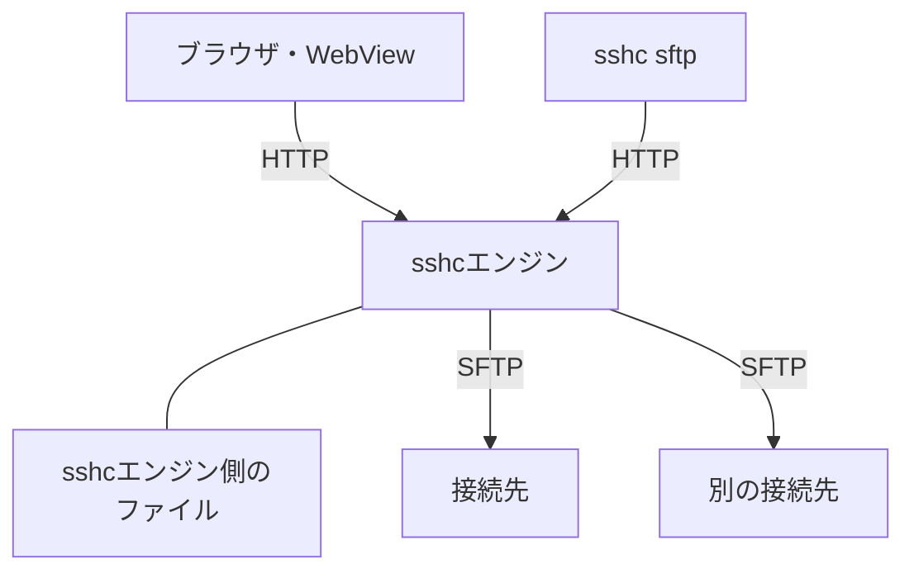

# SFTP

リモートのファイルを一覧、編集、比較し、アップロード、ダウンロード、接続先どうしのコピーができます。

## 通信の流れ

接続先のサーバーへSFTPで接続するのはsshcエンジンです。ブラウザとCLIは、sshcエンジンへHTTPで依頼します。

転送の種類によって、データの流れと、ブラウザを閉じたときの動作が変わります。

| 転送 | データの流れ | ブラウザを閉じると |
| --- | --- | --- |
| アップロード | ブラウザ → sshcエンジン → 接続先 | 送受信が止まる |
| ファイルのダウンロード | 接続先 → sshcエンジンの一時領域 → ブラウザ | 送受信が止まる |
| フォルダのZIPダウンロード | 接続先 → sshcエンジンで作るZIP → ブラウザ | 止まり、先頭からやり直す |
| sshcエンジン側のファイルとの転送 | sshcエンジンのマシン ↔ 接続先 | 続く |
| Remote→Remoteのコピー・移動 | 接続先 → sshcエンジン → 別の接続先 | 続く |

CLIの`get`／`put`も、ブラウザと同じようにsshcエンジンのHTTP APIで転送します。各転送の手順は[転送の流れ](/sftp/transfers#転送の流れ)にあります。

## 接続

- SFTP画面を開いただけでは、保存済みのサーバーへ接続しません。
- 接続先の選択画面で接続先を選ぶと、その場で接続します。
- 保存済みのタブを復元した場合は、接続先と前回のパスだけを表示します。［接続］を押すと接続します。
- 初めて接続する場合は、SFTPサーバーが返すログインユーザーのホームフォルダを開きます。
- Terminalと同じSSH設定と保存済みの認証情報を使い、接続先のホスト鍵を検証します。

接続先の選択画面では、名前、グループ、接続先ホスト、ユーザーで検索できます。表示は、最近接続した順かSSH Configのグループ別です。

接続を待つあいだは、Terminalと同じく「bastionへ接続中 · 1/1」のように今の段階を表示します。

- Settingsの［Terminal］にある「接続のログ」を「表示しない」以外にすると、その深さの接続ログも一覧の場所に表示します。
- 接続できなかったときは、設定に関わらず失敗の理由をログの最後に表示します。

### 接続の再利用

同じ接続先への操作（一覧、詳細、プレビュー、編集、転送、CLIの`sshc sftp`）は、直前に使ったSFTP接続を再利用します。フォルダを移動するたびにSSHの接続とワンタイムコードの入力をやり直すことはありません。

使わなくなった接続は60秒で閉じます。Vaultをロックしても、開いているTerminalと同様に、直前の接続は最大60秒残ります。

### 接続先の切り替え

接続先を切り替えると、前の接続先の一覧と開いていたファイルをすぐに閉じます。切り替え前の通信が遅れて完了しても、その内容を新しい接続先の画面には表示しません。

## タブとペイン

### タブ

タブにはフォルダ名と接続先を横に並べ、狭い画面では上下に表示します。

| 操作 | 方法 |
| --- | --- |
| 新しいタブを開く | `+`で接続先の選択画面を開いて選ぶ。選ばずに閉じるとタブは増えない |
| 接続先を変更する | 選択中のタブの右端にある接続先変更ボタン。保存していない編集があるタブでは変更できない |
| 接続先を選ぶ（未選択のタブ） | 一覧の［接続先を選択］ |
| タブを閉じる | SSHの接続先に接続中なら確認を表示する。Shiftを押しながら閉じると確認を省略する |

保存していない編集がある場合は、Shiftを押していても破棄してよいかを確認します。

タブの幅は接続先名の長さに関わらず一定です。ペインの幅を超えると横へスクロールでき、`+`は右端に残ります。

### 2つのペイン

デスクトップでは、タブをファイル一覧の上へドラッグして左右2つのペインに分けられます。ペインは最大2つで、境界をドラッグして幅を変えられます。左右に独立したタブ列と`+`があり、それぞれ最大8タブまで別の接続先やフォルダを開けます。

| ドロップする場所 | 結果 |
| --- | --- |
| ペインが1つのとき、一覧の左半分または右半分 | タブがその側の新しいペインに移り、元のペインには空のタブが残る |
| ペインが2つのとき、もう一方のペイン | タブがそこへ移り、タブがなくなったペインは閉じる |
| タブ列の上 | タブを並べ替える |
| もう一方のペインのタブ列 | その位置に入る |

キーボードでは次のキーを使います。

| キー | 操作 |
| --- | --- |
| タブを選んで`Shift`+`←`／`→` | ドラッグでペインを分けるのと同じ操作 |
| `Ctrl`+`Shift`+`←`／`→` | タブを並べ替える |

選んでいるタブの「…」（タブの右クリックでも開きます）からは、次の操作を選べます。

- 左へ移動、右へ移動
- もう一方のペインへ移動（ペインが1つのときは右に新しいペインで開く）
- 左右のペインを入れ替え

同じペインの中での並べ替えと左右の入れ替えでは、タブは接続したままです。

各タブの接続先と開いていた場所、並べ替え、リストとグリッドのどちらで見ているか、ペインの分け方は、マシンごとの状態として保存します。

## ファイル一覧

一覧は名前で絞り込めます。名前、種類、サイズ、更新日時で並べ替えられます。

- サイズはKiB、MiB、GiBに換算して表示します。正確なバイト数は詳細ダイアログで確認できます。
- 権限は名前の下に表示します。
- 選択中の接続先とフォルダはURLに反映されます。Terminalの操作メニューはこのURLを使い、使用中の接続先とリモートパスをSFTPで開きます。
- リモートの一覧の下（スマートフォンでは［フォルダ操作］の下）には、ログイン中のユーザーが使えるディスク空き容量と合計容量を、大きさに応じてMiB、GiB、TiBなどの単位で表示します。サーバーが空き容量取得に対応しなくても、一覧は通常どおり使えます。

### フォルダの移動

| 移動先 | デスクトップ | スマートフォン |
| --- | --- | --- |
| 親フォルダ | 一覧の先頭の`..` | 上部の上向きボタン |
| 戻る、進む | 上部のボタン | パスを押すと出る |
| ホーム、ルート | ［フォルダ操作］（三点リーダー） | パスを押すと出る |

更新と並べ替えは一覧の上にあります。デスクトップで現在のパスをコピーするときは、三点リーダーの［フォルダ操作］を使います。

現在のパスは階層ごとに移動できるbreadcrumbとして表示し、編集ボタンを押すとパスを直接入力できます。

`~`と`~/`で始まるパスも入力できます（リモートの［フォルダへ移動］の移動先も同じです）。移動すると絶対パスで表示します。`~user`の形には対応していません。

- リモート: SFTPサーバーのログイン先（通常はホームフォルダ）から数えます。
- ローカル: sshcエンジンを動かしているユーザーのホームフォルダから数えます。

フォルダをダブルクリックするか、選択してEnterキーを押すと、そのフォルダへ移動します。ファイルに同じ操作をすると詳細が開きます。

### 選択

行を1回選ぶか、チェックボックスを使うと（スマートフォンでは行を長押しすると）、選択ツールバーにダウンロード、名前変更、三点リーダーの操作メニューが表示されます。チェックボックスは、スマートフォンでは選んでいる間だけ出ます。

| 操作 | デスクトップのキー |
| --- | --- |
| 範囲選択 | Shift+クリック |
| 追加選択 | Ctrl/Cmd+クリック |
| すべて選択 | Ctrl/Cmd+A |

操作メニューでは選択を反転し、名前またはフルパスをまとめてコピーできます。名前変更は1件だけ選んだときに利用できます。権限変更は複数選択にも対応しています。

### スマートフォンと狭い一覧の表示

デスクトップの2ペインでは、狭い一覧を名前・更新日時・サイズ・種別の列にまとめます。権限や所有者・グループは詳細から確認でき、広い一覧では列にも表示します。

スマートフォンでは次のように表示します。

- すべてのファイルタブを一列にまとめ、選んだタブの一覧を表示します。接続先、フォルダ、選択状態を保持し、PCへ戻ると元の左右配置に戻ります。
- ［比較］では比較する2つのタブを選べます。
- ファイル名の下には権限、取得できた所有者・グループ、サイズ、更新日を折り返して表示します。
- タブの操作領域は44px以上、ファイル行は56px以上の高さです。
- 選択中は移動欄を選択操作へ、検索中は検索欄へ切り替え、一覧の表示場所を確保します。

## ファイル操作

- リモートフォルダの移動、作成、名前変更、`chmod`、削除
- ファイルやフォルダを、選択またはドラッグ＆ドロップでアップロード
- ファイルのダウンロード、フォルダのZIPダウンロード
- 2 MiB以下のUTF-8テキストを画面内で編集

作成とアップロードは左上の`+`メニューにまとめています。

### 削除

削除は三点リーダーの操作メニューから選びます。削除前には対象のパスを示す確認モーダルが開き、キャンセルするとファイルは変更されません。Deleteキーからの削除も、同じ確認を経由します。

### タブの間のドラッグ

ファイルやフォルダを、表示している一方のタブから反対側のタブへドラッグできます。

| ドロップ先 | 動作 |
| --- | --- |
| 別の接続先 | コピーまたは移動を選ぶ |
| 同じ接続先の別のフォルダ | デスクトップのファイルマネージャーと同じくそのまま移動する |
| 元のフォルダ | 何もしない |

データは2つのSFTP接続間で直接転送され、ローカルマシンに平文の一時ファイルを作りません。同じ接続先の移動では、可能な場合はサーバー上のrenameを使います。

### アップロードしたファイルの属性

- 元の更新日時を付けます（ブラウザからのアップロード、CLIの`put`、ホスト間コピー、ローカルとの転送）。
- 新しく作られるファイルの権限はサーバーの既定（umask）に従います。
- 上書きしたファイルは元の権限を保ちます。

### sshcエンジン側のファイル

ローカルのペインの対象は、sshcエンジンが動いているマシンのファイルです。フォルダ作成、名前変更、削除ができます。

- 削除はゴミ箱に移動せず、フォルダを選ぶと中の項目も削除します。リンクを選んだ場合はリンク自体だけを削除します。
- ルートやホーム自体、それらを含むフォルダの削除・名前変更は拒否します。
- sshcの一時ファイルや転送で使っているパスも保護します。
- 確認後に対象が変更されていた場合も削除を拒否します。
- Androidではローカルの名前変更に対応していません。

### フォルダからターミナルを開く

現在のパスの横にあるターミナルボタン、または［フォルダ操作］の［ここでターミナルを開く］で、そのフォルダからターミナルを開けます。

| ペイン | 起動するもの |
| --- | --- |
| リモート | 選択中の接続先へのSSHセッション |
| ローカル | sshcエンジンが動いているマシンのシェル |

別のマシンからWeb画面を開いた場合も、ローカルシェルが動くのはブラウザ側ではなくsshcエンジン側です。

ローカルシェルは設定した既定のプロファイルを使い、表示中のフォルダを開始場所にします。フォルダ名の空白や引用符もそのまま扱い、フォルダが利用できない場合は起動しません。

反対に、SSH TerminalがOSC 7で通知した現在のフォルダは、Terminalの操作メニューからSFTPで開けます。

## テキストの編集

ファイルの詳細から［ファイルを編集］を選ぶと、UTF-8テキストを編集できます。保存していない変更がある状態で閉じると、破棄してよいかを確認します。

### エディタのキー

| 操作 | キー |
| --- | --- |
| 保存（保存中・保存済みを画面に表示します） | `Ctrl/Cmd+S` |
| 検索 | `Ctrl/Cmd+F` |
| 置換 | `Ctrl+H`（macOSでは`Cmd+Option+F`） |
| 行へ移動 | `Ctrl+G` |
| 行のコメントの切り替え | `Ctrl/Cmd+/` |
| インデント | `Tab`（`Shift+Tab`で戻します） |
| `Tab`でフォーカスを移すモードの切り替え | `Ctrl+M`（macOSでは`Ctrl+Shift+M`） |
| 補完（入力中に自動では表示されません） | `Ctrl+Space` |
| エディタのコマンドパレット（右クリックのメニューからも開けます） | `F1` |

折りたたみや複数カーソルなど、そのほかの操作とキーは、エディタのコマンドパレットで確認できます。検索欄やエディタのコマンドパレットを`Esc`で閉じても、エディタは閉じません。検索欄、エディタのコマンドパレット、右クリックのメニューは英語で表示されます。

### Tabキーとフォーカス

エディタの中の`Tab`はインデントに使い、フォーカスはエディタから移りません。キーボードで［保存］や［閉じる］へ移るときは、次の手順で操作してください。

1. `Tab`でフォーカスを移すモードに切り替えます（エディタのコマンドパレットの「Toggle Tab Key Moves Focus」でも切り替えられます）。
2. `Tab`を押します。フォーカスはエディタのダイアログの中だけを移ります。
3. もう一度切り替えると、`Tab`でインデントする動作に戻ります。

切り替えたモードはエディタを閉じるまで続きます。次に開いたファイルは、`Tab`でインデントする動作から始まります。

### リモートのファイルが変更されていたとき

エディタで開いたあとにリモートのファイルが変更されていた場合は保存せず、エディタにそのことを表示します。次のどちらかを選べます。

- ［リモートから再読み込み］: 保存していない変更を破棄して、最新の内容を読み込み直します。破棄する前に確認します。
- ［上書き保存］: リモートでの変更を破棄してよいかを確認してから、エディタの内容でリモートのファイルを上書きします。確認しているあいだにリモートのファイルがまた変更された場合は上書きせず、そのことを表示します。

### ローカルのファイルの編集

ローカルでも2 MiB以下のUTF-8テキストを編集でき、詳細からテキストや画像をプレビューできます。編集・プレビューでは、選択したシンボリックリンクは辿りません。

保存時はファイルの内容と同一性を確認します。外部で変更・差し替えられていた場合や転送中の場合は上書きしません。

所有者・グループ・アクセス制御・拡張属性も保持します。次のファイルは保存しません。

- 属性を取得・保持できないファイル
- 属性が16 MiBを超えるファイル
- 特権実行属性を持つファイル

Windowsでは次のように扱います。

| 属性 | 動作 |
| --- | --- |
| 所有者・グループ・アクセス権（DACL）、整合性ラベル、リソース属性、名前付きストリーム、拡張属性、作成日時、通常のファイル属性 | 保持する |
| 暗号化・圧縮・読み取り専用など、保持できない特殊属性 | 保存を拒否する |
| 通常の監査設定（SACL） | 保持の対象外 |

## サムネイルとグリッド

一覧の画像の行には小さいサムネイルが付きます。一覧の上の［リスト］と［グリッド］で、画像を大きく並べて見る形に切り替えられます。どちらの表示かはタブごとに残ります。

グリッドでも、タップ、長押し、クリック、右クリック、キーボードの操作は一覧と同じです。矢印キーは上下左右の項目へ移ります。

### サムネイルの作り方

サムネイルはsshcエンジンが画像を読んで縮めて作ります。

- 作るのはPNG、JPEG、GIFのうち、一覧に見えている行だけです。スクロールで見えなくなった行の読み込みは取り消します。
- 読むのは使っているSFTP接続の上で1つずつで、接続を増やしません。使わなくなって閉じていたときは1本だけ開きます（ワンタイムコードで認証する接続先では開きません）。
- Exifに縮小画像を持つ写真は先頭の約68 KiBだけを読み、それ以外は4 MiBまでのファイルを全部読みます。
- 作ったサムネイルはメモリにだけ置きます。

次のものは種類のアイコンのままです。

- 4 MiBを超え、Exifに縮小画像が無いもの
- デコードに128 MiBを超えるメモリが要るもの
- SVG、WebP、BMP、HEICなど、PNG、JPEG、GIF以外の形式。動画と音声も含みます
- シンボリックリンク
- 画像が1000枚を超えるフォルダの画像

スマートフォンのアプリでは、sshcエンジンがスマートフォンの中で動きます。サムネイルのために読む分はモバイル回線の通信になるので、Settingsの［SFTP］にある「画像のサムネイルを出す」で止められます。プリセットの設定なので、スマートフォンだけ止めることもできます。

## シンボリックリンク

一覧には「名前 → リンク先」の形で表示します。sshcエンジン側のファイルを開いたペインでも同じ形です。リンク先が見つからないリンクは「（見つかりません）」と表示し、開けません。

| 操作 | 対象 |
| --- | --- |
| フォルダへのリンクを開く | フォルダとして開く |
| ファイルへのリンクの詳細、プレビュー、編集、ダウンロード | リンク先のファイル |
| 編集して保存 | リンク先のファイルが書き換わり、リンク自体は残る |
| コピー、移動、削除、比較、sshcエンジンとの転送 | リンクを辿らず、リンク自体 |

リンク先が絶対パスでも開けますが、リンクそのものはsshcエンジンとの転送に使えません。

### リンクの作成と変更

リモートの作成メニューの［シンボリックリンクを作成］で、名前とリンク先を入力します。

- リンク先は相対パス・絶対パスのどちらでもよく、まだ存在しなくても作成できます。
- 同じ名前の項目は上書きしません。

詳細ダイアログの［リンク先を変更］は、リンク自体だけを置き換え、参照先の内容は変更しません。サーバーが安全なリンク置換に対応しない場合は変更できません。

## 所有者とグループ

所有者のUIDとグループのGIDは、サーバーから取得できる場合に一覧と詳細へ表示します。通常ファイルとフォルダは、詳細の［所有者・グループを変更］から数値のUID/GID（0〜4294967295）を指定できます。

- リンクを追わない`lsetstat@openssh.com`拡張が必要です。
- ユーザー名・グループ名の指定、再帰変更、リンク経由の所有者変更には対応しません。
- 属性を取得できない場合やサーバーが非対応の場合は変更できません。権限が不足する場合はサーバーが拒否します。
- リンク先や所有者の確認中に項目が変わった場合は、最新の一覧から開き直してください。

## リモートの権限をまとめて変更する

1. リモートのファイルやフォルダをチェックボックスで選びます。
2. 選択欄の三点メニューから［選択項目の権限変更］を開きます。
3. ファイルとフォルダの権限を別々に指定します。初期値はファイルが`644`、フォルダが`755`です。
4. 配下にも適用するときは、［フォルダ配下にも適用する］を選びます。配下のファイルとフォルダに種類別の権限を適用します。
5. ［変更内容を確認］を押すと、対象を検証して確認モーダルを開きます。
6. 選択件数、配下を含むファイル・フォルダの対象数、権限、再帰設定を確かめて［適用］を押します。

入力画面や確認モーダルでキャンセルした場合、権限は変更しません。単一項目の権限変更と、1つのフォルダに同じ権限を再帰適用する操作も残っています。

### 上限と条件

| 項目 | 上限・条件 |
| --- | --- |
| 選択 | 200件まで |
| 再帰走査 | 全選択を合わせて2万項目・深さ32まで |
| サーバー | リンクを追わずに属性を変える`lsetstat@openssh.com`拡張のバージョン1。非対応のサーバーでは、単一変更を含めて権限変更を拒否する |
| シンボリックリンク | 追わず、変更しない。リンクを選択している場合、権限変更はメニューに表示しない。再帰適用で見つかったリンクは対象外とし、確認モーダルに件数を表示する |
| ローカルのペイン | 権限変更はできない |

### 途中で変わったとき

- 確認後に対象が変わった場合は、実行前に全件を拒否します。
- 実行開始後の通信断や権限エラーでは、一部だけ変更される場合があります。変更を確認できた件数を表示し、自動で元には戻しません。一覧を更新して権限を確認し、必要な項目を選び直してください。
- SFTPには対象の種類と変更を一度に照合する仕組みがないため、別のクライアントによる実行中の変更を完全には防げません。

## ファイルの名前・内容を検索する

リモートの一覧で検索欄の設定ボタンを押すと、［検索対象］を［名前］または［内容］に切り替えられます。文字列を入力してEnterを押すと、開いているフォルダの配下を検索します。

| 検索対象 | 検索の方法 |
| --- | --- |
| ［名前］ | 大文字と小文字を区別せず、ファイル名を検索する |
| ［内容］ | 大文字と小文字を区別した固定文字列検索。ローカルのタブには対応していない |

内容検索の結果は、複数ファイルの一致をパス、行番号、短い本文で表示します。一致を選ぶとエディタの該当行を開きます。検索後にファイルが変わっていた場合は再検索してください。［検索を停止］で通信を中止できます。

### 内容検索の対象と上限

対象はUTF-8の通常ファイルです。次のものは省略し、読み取れなかった項目や上限による省略は、結果とともに理由を表示します。

- 種類・サイズ・更新日時を取得できないファイル
- リンクとバイナリ
- 2 MiBを超えるファイル

| 1回の検索の上限 | 値 |
| --- | --- |
| 読み取るファイル内容の合計 | 64 MiB |
| 一致 | 200行 |
| 走査する項目 | 2万項目 |
| 走査する深さ | 32段 |

## フォルダを比較する

［比較］は画面の上の帯にあります。接続しているタブ（ローカルのタブを含みます）が2つ以上あり、選んでいるタブも接続しているときだけ表示します。

- 2ペインで左右のタブのどちらも接続しているとき: 左右で現在選択している2つのタブのフォルダを再帰的に調べます。
- それ以外のとき: 比較する2つのタブを選んでから調べます。

サイズ、更新日時、権限、種類などを基準に、「左のみ」「右のみ」「変更あり」「種別が異なる」へ分類して表示します。

| 比較するタブ | できること |
| --- | --- |
| リモート同士 | 必要な項目だけを選んで、左から右または右から左へコピーする。コピー元にないファイルがコピー先に存在しても、自動では削除しない |
| ローカルを含む | 差分の確認だけ。ファイルを変更しない |

### 行ごとの差分

比較一覧の［行ごとの差分］から、左右のUTF-8ファイルを読み取り専用のエディタで並べて確認できます。

- 片側にないファイルは空として表示します。
- 各ファイルは2 MiBまでです。
- 比較一覧を取得したあとに変更されていた場合は開き直しを求めます。
- 狭い画面では差分を縦に表示します。

## 同じサイズ・更新日時でも内容の違いを確認する

［比較］の既定は［メタデータ］です。［内容（SHA256）］を選ぶと、両側の通常ファイルを読み取り、内容から計算したSHA256を比べます。同じサイズ・更新日時でも内容が異なれば差分になります。ファイルの内容比較では更新日時と権限を使いません。ローカルとリモート、リモート同士のどちらも比較できます。

両側からファイル内容を読み取るため、メタデータ比較より時間と通信量がかかります。

| 項目 | 上限・動作 |
| --- | --- |
| 読み取り量 | 両側合計256 MiB |
| 走査 | 2万項目 |
| シンボリックリンク | 辿らない |
| 上限を超えるファイル、対応していない種類 | 「未比較」と表示する。「未比較」があれば、フォルダ全体の一致は確認できていない |
| 比較画面を閉じる、方式を切り替える | 実行中の読み取りを中止する |

読み取りの前後に変更を検出すると、結果を確定せず競合として終了します。SFTPサーバーがファイルの識別情報を返さない場合、サイズ・更新日時・権限などが同じまま差し替わる変更を検出できないことがあります。内容比較はフォルダ全体の同時点のスナップショットではありません。

## 転送マネージャー

ファイル一覧の下部にある転送マネージャーでは、ファイルとフォルダを1つのキューで管理します。通常は転送件数、全体の進捗、速度だけを表示します。

展開すると、ファイルごとの進捗、速度、残り時間を確認し、すべての転送の一時停止、再開、キャンセルや、失敗したファイルの再実行を行えます。キューと状態はsshcエンジンが保存するので、sshcエンジンを再起動しても、待機中、一時停止中、再開可能な転送は復元されます。

データの流れ、操作、再開できる条件は、[転送マネージャー](/sftp/transfers)を参照してください。
