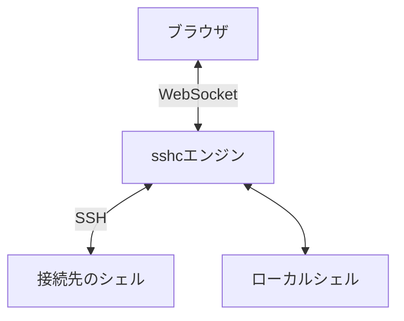
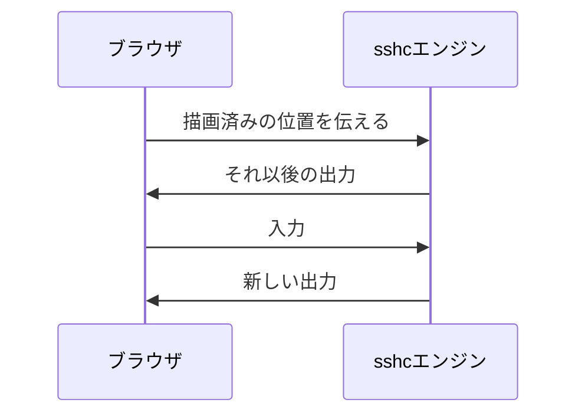
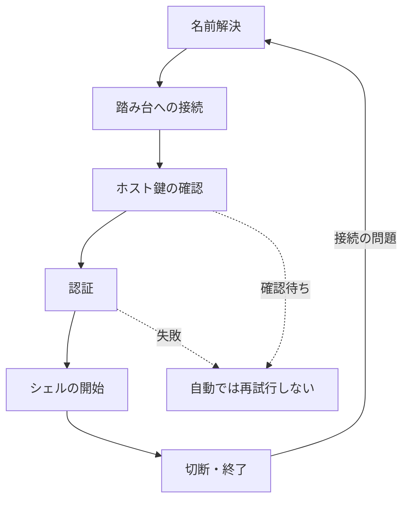
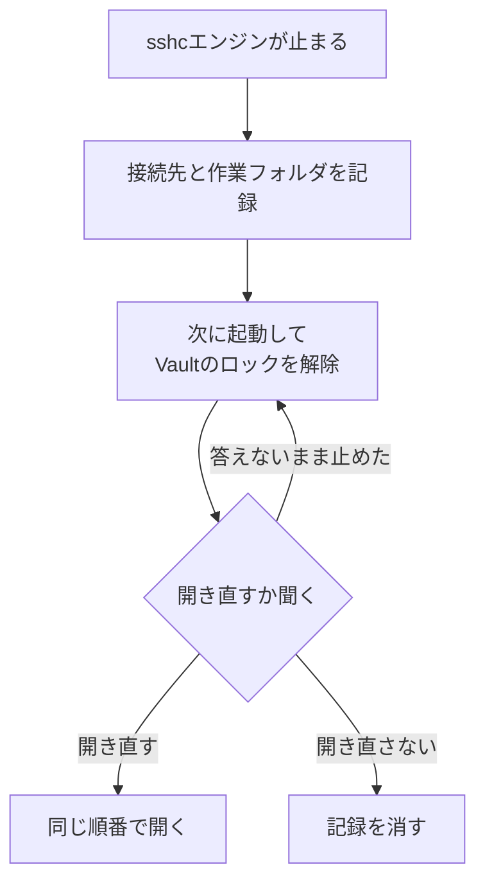
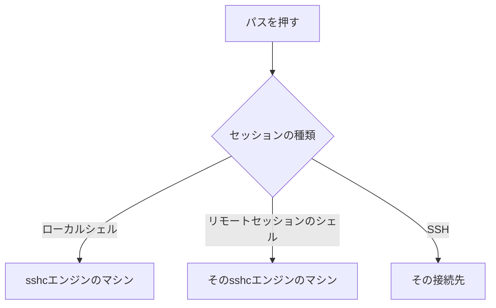

# Terminal

SSHとローカルシェルを同じ画面で開き、検索、クイックコマンド、ポート転送を利用できます。複数のセッションを並べて操作するには[分割表示](./split-view)を使います。


## 通信の流れ

シェルを動かしているのはsshcエンジンです。ブラウザはWebSocketで出力を受け取って描画し、入力を送ります。ブラウザとの接続が切れても、セッションはsshcエンジンで動き続けます。



### ブラウザの再接続

再接続時は、ブラウザが描画済みの位置以後だけをsshcエンジン側のバッファから復元します。



- 表示済みの出力を重複させず、ブラウザ側だけに残る古いスクロールバックも消しません。
- 切断が長く、必要な出力がバッファから既に押し出されていた場合は画面で知らせます。
- どちらのバッファもメモリにだけ保持し、Vault、バックアップ、同期スナップショットには保存しません。ターミナルの出力をファイルに書くのは、［セッションのログをファイルに保存する］をオンにしたときだけです（[セッションのログ](#セッションのログ)）。

## 接続の進行状況を表示する

SSHの接続は、段階ごとに表示します。ホスト鍵の確認待ちや認証失敗が発生した場合、接続を自動では再試行しません。



### シークレットの入力

保存されていないSSHパスワード、鍵パスフレーズ、keyboard-interactiveでシークレットの入力が必要な場合は、入力した値を表示せず、1文字ごとに`*`を表示します。Backspaceや`Ctrl+U`で修正しても平文はスクロールバックに残りません。

### 接続のログ

［Settings］→［Terminal］の［接続のログ］では、新しく開く接続について、OpenSSHの`-v`／`-vv`／`-vvv`に相当する診断をターミナルに表示できます。各行には`[sshc][debug1]`のように、その行の詳細レベルが付きます。

- ［基本情報（-v）］: 接続先、踏み台ごとの接続完了、サーバーのバナー、セッションの開始
- ［鍵・経由ホスト・所要時間（-vv）］: ［基本情報（-v）］の内容に加えて、次の項目
  - 認証方式の候補と、試さなかった理由
  - 鍵ごとの種類、SHA256フィンガープリント、復号の方法（パスフレーズなし／保存済み／入力）、読み込めなかった鍵
  - サーバーのホスト鍵のフィンガープリントと、known_hostsの何行目と一致したか（一致しない場合は、どの行にどの鍵があるか）
  - パスワードの取得元と、どの方式で認証されたか
  - ターミナルサイズの要求（列×行）、送った環境変数の名前と拒否されたもの
  - keepaliveの間隔と回数、適用しない設定
- ［すべて（-vvv）］: ［鍵・経由ホスト・所要時間（-vv）］の内容に加えて、次の項目
  - sshcがサーバーへ提示するホスト鍵アルゴリズム、鍵交換、暗号、MACの一覧
  - TCPのローカル／リモートアドレス
  - ssh-agentの鍵のフィンガープリント一覧
  - keyboard-interactiveのプロンプトごとの文

パスワード、パスフレーズ、TOTPコード、セットアップキー、環境変数の値はログへ出しません。`sshc ssh <接続先> --non-interactive`も同じ設定を使用します。

### 切断と再接続

接続が切れたSSHセッションは、待ち時間を伸ばしながら自動で再接続を試みます。

| 操作 | 結果 |
| --- | --- |
| 待っている間にペイン上部の［再接続を停止］ | 打ち切る。セッションは終了状態のまま一覧に残り、［再接続］で手動で開き直すか、閉じるかを選べる |
| 終了したSSHセッションの［再接続］ | 同じペインとスクロールバックを残したまま再接続する |
| 接続の問題で終わったセッションでEnter | 再接続する。ほかのキーは捨てる |
| スマホで入力欄の送信 | 再接続する。打った文は残る |
| SSH／ローカルシェルを明示的に閉じる | すぐに停止し、一覧からも削除する |

回線が無い間は再接続の回数に数えずに待ち、回線が戻ったらすぐ試します。

| 環境 | 回線の確かめ方 |
| --- | --- |
| Androidのアプリ | OSの知らせで回線の有無を知る |
| PC | `network is unreachable`などの失敗を見て5秒ごとに確かめる |

Androidでは、Wi-Fiとモバイル回線が切り替わったときに接続が応答するかを確かめ、10秒応答が無ければ再接続します。このときの再接続は待たずに試し、それまでの再接続の回数に足しません。

再接続や開き直しで新しいシェルになると、前のシェルのプログラムは終わっています。前のシェルでClaude Codeが動いていたときは、`claude --continue`をターミナルの行とお知らせで案内し、お知らせのボタンで実行できます。作業フォルダが分かれば、そこへ移動するコマンドも付けます。

### tmuxで開く

切断のあとも同じ画面に戻りたい接続先は、Connectionsの［表示とターミナル］で［tmuxで開く］を選びます。シェルの代わりに`tmux new -A -s sshc-<接続名>`を起動します。

- 再接続・手動の再接続・開き直しは同じtmuxのセッションに戻ります。戻ったときは、起動スニペットも作業フォルダへの移動も打ち込みません。
- 同じ接続先の2本目は`sshc-<接続名>-2`になります。
- サーバーにtmuxが無いときはターミナルで知らせて、ふつうのシェルで開きます。
- sshcのセッションを閉じてもtmuxのセッションはサーバーに残り、次に開くとそこへ戻ります。終えるにはtmuxの中で`exit`します。
- この設定は`~/.ssh/config`に書かないので、`ssh`や`scp`には影響しません。Hostブロックに`RemoteCommand`があるときは、そちらに従います。
- tmuxの中のプログラムの状態（OSC 7501）はサイドバーに届きませんが、画面に見えているClaude Codeの許可待ちと回答待ちは出します（[タイトルと通知](/terminal/notifications#claude-codeの許可待ちと回答待ち)）。
- `sshc ssh`はtmuxを使いません。

## 止めたあとにセッションを開き直す

sshcエンジンが止まるとき（更新、PCの再起動、手動の停止）、開いていたセッションの接続先、ワークスペース、作業フォルダを、このマシンだけに記録します。



次に起動してVaultのロックを解除すると、「前回のセッションを開き直しますか」と聞きます。

- ［開き直す］: 同じ順番で開き直し、作業フォルダが分かるセッションはそこへ移動します。
- ［開き直さない］: 記録を消して、二度と聞きません。
- 答えないまま止めた場合: 次の起動でもう一度聞きます。

[リモートセッション](./remote-session)も同じです。接続先のsshcエンジンが起動し直したあと、最初にそのsshcエンジンを選んでVaultのロックが解除されているときに聞きます。

### 開き直せないもの

- agentsワークスペースのセッションは開き直しません。
- 異常終了や電源断のように、sshcエンジンが止まる処理を通らなかった場合は記録されません。

### 作業フォルダの読み取り

| 種類 | 作業フォルダの読み取り |
| --- | --- |
| SSHセッション | シェルがOSC 7で知らせた場所か、Debian・Ubuntuのbashが既定で付ける`user@host: ~/dir`の形のタイトル |
| Linuxのローカルシェル | sshcエンジンが直接読み取る |

どちらも無いSSHセッションと、引用符や`\`、`&`などの記号を含むフォルダのSSHセッションは、接続だけを開き直してホームフォルダから始めます。接続先のシェルの種類によっては、記号をコマンドの一部と読むためです。

### 記録するもの

記録には接続先の名前とフォルダの場所だけを書き、パスワードや出力は書きません。同期でほかのマシンへ運ぶこともありません。

［セッションを複製］で開くセッションも、複製元の作業フォルダから始まります。

## Terminal操作

### スクロールバックと検索

- `Ctrl/Cmd+F`によるスクロールバック検索。大文字／小文字、正規表現、該当箇所の強調、検索結果の移動
- 1,000〜100,000行のスクロールバック
- ブラウザの再接続時に直前の出力を復元する16 KiB〜4 MiBのバッファ
- bash・zshの`Ctrl+L`で画面を消したときは、消した出力をスクロールバックに残す（`clear`はスクロールバックごと消す）
- ターミナルの「…」の［スクロールバックをファイルに保存］で、画面を含むスクロールバック全体をテキストファイルに保存（折り返した行はつなぐ。［直近のターミナル出力をコピー］は200行まで）

### セッションのログ

Settingsの［General］で［セッションのログをファイルに保存する］をオンにすると、セッションごとに1つのファイルへ、ターミナルに出た行を文字で書き続けます。既定はオフです。

- 書くのは、画面の上へ流れた行と、消す前の画面の行です。まだ画面に残っている行は、流れるかセッションが終わるまで書きません。セッションが終わると、そのとき画面に残っていた行も書きます。
- 同じ所を描き直す画面（Claude Codeなど）は、描き直したあとの形だけが残ります。vimのような全画面のプログラムの中身は書きません。tmuxで開く接続先も、tmuxが全画面で描くので中身を書きません。
- SSHのセッションでは、認証が済んだあとのシェルの出力だけを書きます。パスワードの問いと、そこへ打った値は書きません。スニペットのシークレット変数の値は`[secret]`に置き換えます。
- 接続・切断・再接続とセッションの終わりは、`[sshc]`で始まる行に日時を付けて書きます。
- ファイル名は`<接続名>-<開いた日時>-<セッションIDの先頭8文字>.log`で、ローカルシェルは`local-`で始まります。1つのファイルは100 MiBまでで、超えるとそこから先は書きません。

置く場所は、マシンごとに次の場所です。ほかのマシンへは同期しません。リモートセッションのログは、そのセッションが動いているマシンに書きます。Androidではログを保存しません。

| OS | 置く場所 |
|---|---|
| Linux・BSD | `~/.local/state/sshc/session-logs`（`XDG_STATE_HOME`があればその下の`sshc/session-logs`） |
| macOS | `~/Library/Logs/sshc/sessions` |
| Windows | `%LOCALAPPDATA%\sshc\session-logs` |

別のフォルダにするときは、Settingsの［Machines］で、そのマシンの「…」から［ログの保存先を変更…］を選びます。

［保存しない接続先］には、ログを書かない接続名のパターンを、.gitignoreと同じように1行に1つ書きます。何も書かなければ、すべてのセッションのログを書きます。

```text
# 本番の接続先は書かない
prod-*
# ただし prod-web は書く
!prod-web
# ローカルシェルは書かない
@local
```

- パターンには`*`と`?`を使えます。大文字と小文字は区別しません。
- `!`で始めた行は、書く側へ戻します。あとの行が勝ちます。
- 設定を変えると、次に開くセッションから効きます。

### 入力と文字コード

- URLとパスのコンテキスト操作（パスのファイルのプレビューとダウンロードを含む）、OSC 8リンク
- クイックコマンドとスニペット
- 改行や制御文字を含む貼り付けの送信前レビュー
- OSC 52クリップボード、Kitty keyboard protocol、JISキーボード（受け取るOSCの一覧は[対応しているエスケープシーケンス](/reference/escape-sequences)）
- 接続ごとのUTF-8、Shift_JIS、EUC-JP、ISO-2022-JP

### 文字の大きさ

設定のフォントサイズに加えて、ターミナルの上で2本の指を開閉する（ピンチ）か、Ctrlを押しながらホイールを回す（トラックパッドのピンチも同じ）と、そのターミナルの文字の大きさを8〜32pxの間で変えられます。

- ページは拡大しません。
- 変えた大きさはそのターミナルの表示だけに効き、保存しません。
- 設定のフォントサイズを変えると、設定の大きさに戻ります。

### 描画と表示

| 機能 | 動作 |
| --- | --- |
| WebGLによる描画 | 利用できない場合や背景画像を使用する場合はDOM描画へ自動で切り替える。設定から常時無効化もできる |
| JetBrains Monoの合字（`->`、`!=`など） | 設定で有効にしたときだけ使い、1マス1文字の位置は保つ |
| 背景画像ライブラリ | 圧縮・変換しない。検索、選択、名前変更、削除と1〜1024 MiBの容量（［Settings］→［General］）に対応し、プリセットと接続別設定の参照も同時更新する |
| カーソル | OSで視差効果・アニメーションを減らす設定が有効な場合は、TerminalとSFTPのテキストエディタで静止表示する |

### 画面を常にオン

ターミナルの「…」の［すべてのターミナル］にある［画面を常にオン］で、Terminalを表示している間は画面を消しません（Screen Wake Lock API）。すべてのターミナルに効き、設定はこのマシンが使うプリセットに保存します。ブラウザがHTTPSか`localhost`で開いているときだけ表示します。

### プログラムへの知らせとステータス行

見えているかの知らせ（mode 2033、visibility reports）: プログラムが求めると、ターミナルがどこかのブラウザに表示されているかを知らせ、見えない間の描画を止められるようにします。接続先のプログラムには、誰かがこのターミナルを見ているかが伝わります。次のときは、見えていないと答えます。

- どのブラウザでも表示していないとき
- タブが裏にあるとき
- 分割表示や画面から外れているとき

VT320のステータス行（DECSSDT、DECSASD）: プログラムが出すと、ターミナルの下に1行で表示し、プログラムへ伝える行数を1つ減らします。プログラムが書く行（DECSSDT 2）だけに対応し、ターミナルが状態を出す行（DECSSDT 1）は表示しません。

## 入力とクリップボード

### 文字の選択とコピー

通常の文字選択によるコピーはブラウザ内で完結し、OSC 52を必要としません。選択時の自動コピーと右クリックでの貼り付けは、［Settings］→［Terminal］で切り替えられます。

Claude Code、vim、tmuxのようにマウスを使うプログラムの中では、ドラッグはそのプログラムへ送られます。Shift（MacではOption）を押しながらドラッグすると、ターミナルの文字を選択できます。

ターミナルの「…」の［色つきでコピー］は、選んだ範囲を、色とターミナルの背景を保ったHTMLとしてもコピーします。文書に貼ると色が残り、文字しか受け取らない所には文字だけが入ります。OSC 8のリンクは文字として残ります。

### 貼り付けの確認

改行、末尾のEnter、またはターミナル制御文字を含む内容はすぐに送信せず、接続先、行数、制御文字を可視化したプレビューを表示します。確認画面で内容を編集でき、行数と警告も編集内容に合わせて更新されます。

次の3つから選べます。

- キャンセル
- 編集内容の貼り付け
- 末尾のEnterを1個だけ除いて貼り付け

プレビューと貼り付け原文は保存しません。確認中にターミナルの表示が変わっても、確認は開いたままです。再接続で新しいシェルに替わった場合は、確認を取り消します。

### OSC 52

OSC 52は、リモート側のソフトウェアがローカルのクリップボードへ書き込むための機能です。既定では無効です。信頼できる接続先だけを使うときに有効にしてください。

有効にすると、すべてのターミナル（どの接続先でも）に効きます。［Settings］→［General］か、ターミナルの「…」の［すべてのターミナル］で切り替えられます。

- 画像やHTMLも書き込めるKitty clipboard protocol（OSC 5522）の書き込みも受け付けます。
- プログラムが貼り付けの知らせ（mode 5522）を有効にしていると、貼り付けた画像などもそのプログラムへ渡せます。
- 過去の出力を復元するときは、OSC 52によるコピーとコピー通知を再実行しません。新しく届いたコピー命令は、同じ文字列でも処理します。

### キーボード

Kitty keyboard protocolは、リモートアプリケーションからの問い合わせと、要求に応じた切り替え（離したときの報告などの段階を含む）に対応しています。JISキーボードでは、円記号キーをバックスラッシュとして送るよう設定できます。

モバイルでは、Ctrl、Alt、Esc、Tab、矢印などの特殊キーを画面に表示しています。CtrlとAltの動作は次のとおりです。

| 押し方 | 動作 |
| --- | --- |
| 1回押す | 次の1キーだけに効く |
| 素早く2回押す | 押したままに固定し、もう一度押すまで続けて効く。固定中のキーは、さし色で表示する |

### コマンドの区切り（OSC 133）

シェルがOSC 133（シェル統合）でコマンドの始まりと終わりを知らせていれば、コマンドと出力の左に、結果の色の線を出します（成功は薄い灰色、失敗は赤、実行中は黄色）。

- 線に乗せる（モバイルではタップする）と、終了コード、かかった時間、始めた時刻、フォルダと、［出力をコピー］［出力をファイルに保存］を出します。
- 長い出力をさかのぼっている間は、そのコマンドと結果をターミナルの上に表示し、押すとコマンドの行へ移ります。
- スクロールバーにも、履歴のどこにコマンドがあるかを結果の色で出します。

どれも［Settings］→［Terminal］の［操作］で個別に切り替えられます。始めた時刻とかかった時間はsshcエンジンが測るので、あとから開き直したセッションの履歴でも正しく出ます。

### クリックでカーソルを移動する

シェルがOSC 133で入力の始まりを知らせていれば、プロンプトで打っている行をクリック（モバイルではタップ）すると、その位置へカーソルを動かします。カーソルとクリックした位置のあいだの文字の数だけ左右の矢印キーを送る仕組みで、Ghosttyの`cursor-click-to-move`と同じです。

打っている行が折り返したときと、マウスを使うプログラムが動いているときは動かしません。

### モバイルの入力欄

モバイルでは、特殊キーの下に送る文の入力欄を常に表示します。日本語の変換は入力欄の中で終わらせ、確定した文だけをターミナルへ送ります。

| 操作 | 動作 |
| --- | --- |
| Enter | 改行する。変換を確定するEnterでは送らない |
| 入力欄の横の［送信］ | 文を貼り付けと同じ扱いで送り、続けてEnterを送る |
| 何も入力せずに送る | Enterだけを送る（Claude Codeの選択肢を確定するときなど） |
| ［Settings］→［Terminal］の「スマホの入力欄でEnterを押したら送信する」をオン | Enterで送り、Shift+Enterで改行する |
| オフのときに外付けのキーボードでCtrl+Enter（Macでは⌘+Enter） | 送る |
| キーバーの［ターミナルへ直接入力］ | 入力欄を隠し、ターミナルへそのまま入力する。もう一度押すと戻る |

改行を含む文は、ターミナルのプログラムがbracketed pasteを使っていれば、そのまま1つの貼り付けとして送ります。使っていないときと、制御文字を含むときは、貼り付けと同じ確認画面を出し、確認したときだけ送ります。

カーソルの行が`Password:`や`パスワード:`のような問いで終わっている間は、入力欄が伏せ字のパスワードの欄に替わります。打った文字は保存せずにEnterで送り、書きかけの文は問いが終わると戻ります。

## リンクとリモートパス

### リンクを開く

OSC 8リンクと画面上のURLは、OS標準のブラウザで開けます。Ctrl（Macでは⌘）を押しながらクリックすると、すぐに開きます。ただし、OSC 8リンクの表示の文字が行き先と違うアドレスのときは、すぐには開かず、行き先を表示したメニューを開きます。

長いURLが右端で折り返したときは、何行に分かれても1つのURLとして開きます。Claude Codeなどのプログラムが右端で改行し、字下げして続きを表示した場合も同じです。

画面上のURLとパスには、さし色の下線を引きます。

| 環境 | 下線を引くもの |
| --- | --- |
| PC | マウスを乗せたものだけ |
| タッチで操作する画面 | 押せるものすべてにいつも。指では乗せて確かめられないため。［Settings］→［Terminal］の［操作］にある［リンクにいつも下線を引く］をオフにすると消える |

### SFTPと行き来する

- SSHのセッションに出たパス（プレビューの「…」から）と、OSC 7（WindowsのPowerShellやcmdではOSC 9;9）で通知された現在の作業フォルダは、Terminalで使用中の接続先を選択したSFTP画面で直接開けます。
- SFTP側の［ここでターミナルを開く］では、リモートなら現在のフォルダを指定したSSH Terminal、ローカルなら表示中のフォルダを開始場所にしたローカルシェルを開けます。ローカルシェルが動くのはsshcエンジンのマシンです。

### パスを押してプレビューする

画面に出た`/`で始まるパスを押すと、確認を挟まずに、そのファイルをターミナルの上に表示します。スマホでは画面いっぱいに表示し、画像と動画は黒い地の上に、パスと操作を重ねて表示します。

| ファイル | 上限 | 表示 |
| --- | --- | --- |
| 画像（PNG、JPEG、GIF、WebP、BMP、SVG） | 8 MiB | そのまま表示する |
| UTF-8のテキスト | 2 MiB | 読み取り専用のエディタで表示し、名前に合わせて色を付ける。Markdownは整形しない |
| 音声（`.mp3`、`.wav`、`.m4a`、`.ogg`、`.flac`など） | | ブラウザの再生画面で再生する |
| 動画（`.mp4`、`.webm`、`.mov`など） | | ブラウザの再生画面で再生する。sshcエンジンは再生画面が求めた部分だけを読むので、大きな動画でも途中へすぐ移れる |

- 再生できるかどうかはブラウザによります（たとえば、HEVCの`.mov`はChromeでは再生できないことがあります）。再生できないときは、その理由と［ダウンロード］を表示します。
- プレビューできない形式や大きすぎるファイルでも画面は開き、プレビューできない理由を表示します。
- どのファイルも［ダウンロード］でブラウザのマシンへ保存できます。SSHのセッションのファイルは、ほかのダウンロードと同じく転送の一覧に並びます。
- Claude Codeが送った画像の行（`[image] /tmp/….png`）も、この方法で開けます。
- プレビューの「…」には［フルパスをコピー］があり、SSHのセッションでは［SFTPで表示］［SFTPで編集］［SFTPでダウンロード］もあります。

### ファイルを読む場所

ファイルは、パスを押したときだけ読みます。読む場所はセッションの種類で決まります。



リモートセッションで開いたSSHのセッションは、このマシンの設定に同じ接続名があり、行き先（HostName・Port・User）がリモートのsshcエンジンの設定と同じときだけ、このマシンからその接続名で読みます。違うときや確かめられないときは別のマシンのファイルを見せないよう、パスを押すと［リンクをコピー］だけのメニューを開きます。

### リンクにするパスの形

Claude Codeなどのプログラムが長いパスを右端で改行し、字下げして続きを表示した場合も、複数行を1つのパスとして拾います。日本語などのUnicode文字を含む名前にも対応しています。

| 形 | 例 | 開き方 |
| --- | --- | --- |
| 絶対パス | `/tmp/x.png` | そのまま開く |
| 空白を含むパス | `"/tmp/画面 1.png"`、`'/tmp/画面 1.png'`、`/tmp/画面\ 1.png` | 引用符で囲むか、空白の前に`\`を付けたものを開く |
| バッククォートで囲まれたパス | `` `/tmp/x.png` `` | パスの部分を開く |
| 文に続くパス | `Saved to:/tmp/x.png`、`保存しました：/tmp/x.png`、`→/tmp/x.png` | パスの部分を開く |
| ツールの行や日本語に続くパス | `Read(src/app.ts)`、`画像は~/shots/a.pngに保存しました` | パスの部分だけを拾う |
| `file:`のURL | `file:///tmp/画面%201.png` | `%20`などのエンコードを戻して開く |
| 相対パス | `artifacts/shot.png`、`report.md` | それを出したプログラムの作業フォルダから開く |
| ホームからのパス | `~/shots/a.png`、`$HOME/shots/a.png`、`${HOME}/shots/a.png` | そのセッションのホームフォルダから開く |
| Windowsの形式 | `C:\Users\aida\x.png`、`C:/Users/aida/x.png` | Windowsのローカルシェルで、sshcエンジンがWindowsと確認できた場合だけ開く |

末尾の`:行:桁`や句読点（`。`、`、`、`）`を含む）はパスから除きます。

次のものはリンクにしません。

- 区切りが曖昧な出力。一部だけを開かないようにするためです
- ホスト名付きの`file://host/…`
- `~user/`形式
- SSHのセッションとリモートセッションのシェルでのWindows形式

### 相対パスとホームの扱い

相対パスは、よく使われる拡張子（画像、テキストとソースコード、PDF、音声、動画、圧縮ファイル。`.png`、`.svg`、`.md`、`.py`、`.json`、`.mp3`、`.mp4`、`.zip`など）で終わる名前のときに押せます。

| セッション | 作業フォルダの取得 | ホームフォルダの取得 |
| --- | --- | --- |
| Linuxのローカルシェル | sshcエンジンが調べる | sshcエンジンのマシン |
| リモートセッションのシェル | Linuxならsshcエンジンが調べる | そのsshcエンジンのマシン |
| macOS・Windowsのローカルシェル | シェルがOSC 7で知らせたフォルダ。知らせていなければ開けない | sshcエンジンのマシン |
| SSHのセッション | シェルがOSC 7で知らせたフォルダ。知らせていなければ開けない | 接続先のSFTP |

ホームフォルダを取得できない場合は、開けない理由を表示します。

### プレビューの移動

プレビューを開いている間は、←→キーか［前へ］［次へ］で、同じターミナルに出たほかのファイル（上の拡張子で終わるパス）へ移れます。

- テキストを表示している間、エディタの中の←→キーはカーソルを動かします。
- リモートセッションで開いたSSHのセッションでは、上の条件で読めるときだけ使えます。

## 画像と文字幅

### 表示できる画像

ターミナル内に画像を表示できます。`chafa`、`img2sixel`、`timg`、`imgcat`などで試せます。

| 形式 | 表示するもの |
| --- | --- |
| Sixel | すべて |
| iTerm2のインライン画像（OSC 1337 File=） | PNG、JPEG、GIF。ファイルのバイト数（`size=`）を省略した画像も表示する。アニメーションは表示しない |
| kittyの画像形式（試験的な対応） | データとして送られた画像だけ |

kittyの画像形式で、ファイルの場所や共有メモリで送る方法には対応していません。プログラムからの問い合わせにもそう答えます。

### 画像の上限

| 対象 | 上限 | 超えたとき |
| --- | --- | --- |
| 1つのターミナルが保持する画像 | 32 MB | 古いものから消す |
| 1枚の画像の大きさ | 4096×4096ピクセル | 表示しない |
| kittyの画像形式の1枚のデータ | 約7.5 MB | 受け取らない |
| kittyの表示せずに送るだけの画像（`a=t`） | 合わせて32 MB | 次の画像を断る |
| kittyの保存した画像の置き直し（`a=p`） | 1秒に4096×4096ピクセルの画像4枚分 | 超えた分を断る |
| zlibで圧縮した画像（`o=z`） | 指定した大きさまで展開 | 超えて展開されるものを表示しない |

置き直しに上限があるのは、そのたびに画像を解読し直すためです。

### 画像が消える・飛ばされるとき

- 分割して送られた画像を受け取りの途中で断ったときは、そのターミナルに表示していた画像も消えます。
- セッションを開き直したときは、残っている出力から画像も描き直します。sshcエンジンが保持しきれず途中で切れた画像は、文字として表示せず読み飛ばします。

### 文字の幅

文字の幅はUnicode 17の表で数えます。新しい絵文字も2マス分になり、絵文字を使うプログラム（Claude Codeなど）の表示が後ろの文字とずれません。

ZWJでつないだ絵文字（👨‍👩‍👧）、国旗（🇯🇵）、肌の色を付けた絵文字（👍🏽）、VS16を付けた文字（❤️）の数え方は、プログラムのmode 2027（書記素クラスタ）で変わります。

| mode 2027 | 数え方 | 家族の絵文字の幅 |
| --- | --- | --- |
| 有効 | 1つの文字として数える | 2マス |
| 無効 | wcwidthと同じに1文字ずつ数える | 6マス |

無効の間に1文字ずつ数えるのは、wcwidthで数えるプログラムとカーソルの位置がずれないようにするためです。

Windowsのローカルシェルでは、mode 2027とVT320のステータス行は効きません。WindowsのConPTYが、これらの列を文字より先にまとめて送るためです。WindowsのsshcエンジンからSSHで接続した先では効きます。

## ローカルシェル

### 開き方

セッション一覧の［新しいセッション］を選ぶと、SFTPの接続先選択と同じ画面が開きます。

| 選ぶもの | 開くもの |
| --- | --- |
| 先頭の［ローカルシェル］ | ［Settings］→［Terminal］の［既定のローカルシェル］で選んだシェル。選んでいなければシステムのログインシェル |
| 検索・最近使った接続・グループ | SSHホスト |
| 検索欄に`user@host[:port]`を入力して［接続する］ | 保存せずに接続する |
| 検索欄に`user@host[:port]`を入力して［接続先として保存して接続する］ | Hostブロックを書いて接続する（[リモートセッション](./remote-session#どのsshcエンジンで開くか)では出ません） |

保存せずに開いたセッションには接続名が無いので、SFTP、起動スニペット、転送を接続先へ保存する操作は使えません。

ローカルシェルも、SSHと同じTerminalの仕組みで動作しています。［Settings］→［Terminal］ではシェルプロファイルを選べ、検索とクイックコマンドを同じように利用できます。

### 渡す環境変数

macOSやLinuxでsshcエンジンを常駐起動した場合も、zshやfishの行編集に必要なTerminal情報をsshcが設定します。

| 宛先 | 渡すもの |
| --- | --- |
| ローカルシェル | `TERM=xterm-256color`、`COLORTERM=truecolor`、`TERM_PROGRAM=sshc`、`TERM_PROGRAM_VERSION` |
| SSHの接続先 | `COLORTERM=truecolor`（接続先のsshdが`AcceptEnv`で受け入れる場合。`SetEnv`に`COLORTERM`があればその値） |

sshcエンジンを起動したターミナルが置いた変数（`TERM_PROGRAM`、`GHOSTTY_`で始まるもの、Windows Terminalの`WT_SESSION`など）は渡しません。

### Windows

Windowsのローカルシェルは、PowerShell 7が入っていればPowerShell 7を、無ければWindows PowerShellを既定で開きます。

Windows PowerShell 5.1に付属するPSReadLine 2.0は、ターミナルの幅を変えたあと、入力した行をプロンプトから離れた位置に表示することがあります。PowerShell 7を入れるか、ターミナルで次のコマンドを実行してPSReadLineを更新してください。

```powershell
Install-Module PSReadLine -Scope CurrentUser -Force -SkipPublisherCheck
```

## タイトルと通知

| シェルやプログラムが送るもの | 表示 |
| --- | --- |
| OSC 0／1／2のタイトル | ペインの見出しとセッション一覧の表示名。ローカルシェルでコマンドが1秒以上動いているあいだは、その名前を前に付ける（LinuxとmacOSで動くsshcエンジンだけ） |
| OSC 9／99／777の通知 | 未読の印。sshcのタブがバックグラウンドにあるときはブラウザ通知と通知音 |
| OSC 9;4の進み具合 | ペインの見出しの下端の線と、セッション一覧の行の先頭の輪。別のセッションを見ている間も、一覧で確認できる |

Claude CodeやCodexの通知設定を含む詳細は[タイトルと通知](/terminal/notifications)を参照してください。

sshcが通常のシェル出力からプログラムの状態を推測したり、コマンドを自動的に再実行したりすることはありません。

## ポート転送

SSH接続ごとにLocal forwarding、Remote forwarding、Dynamic SOCKSを管理できます。

| 種類 | 転送の向き |
| --- | --- |
| Local forwarding | ローカルのポートからSSH接続先へ |
| Remote forwarding | SSH接続先のポートからsshcエンジン側へ |
| Dynamic forwarding | ローカルにSOCKSエンドポイントを開く |

設定方法は、[ポート転送](/terminal/port-forwarding)を参照してください。

接続を閉じる確認画面では、最初に［開いたままにする］へフォーカスが移ります。Tabで［閉じる］へ移動し、Enterで決定できます。
