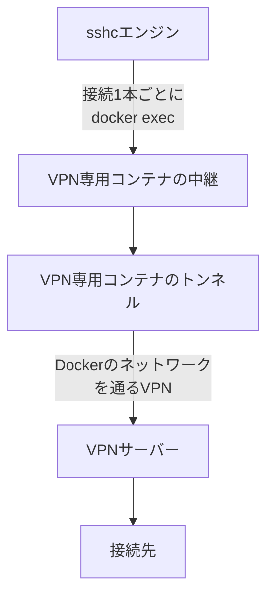
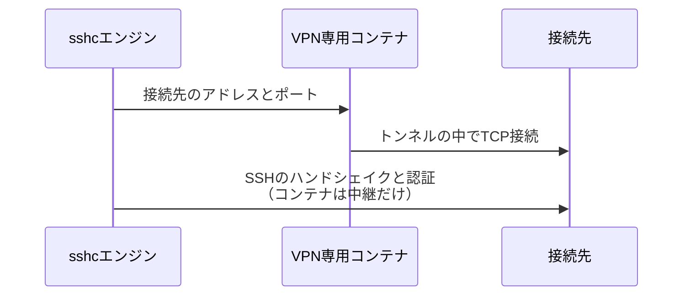
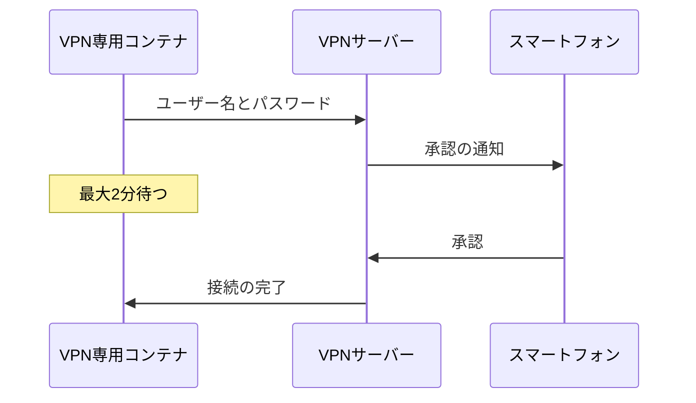
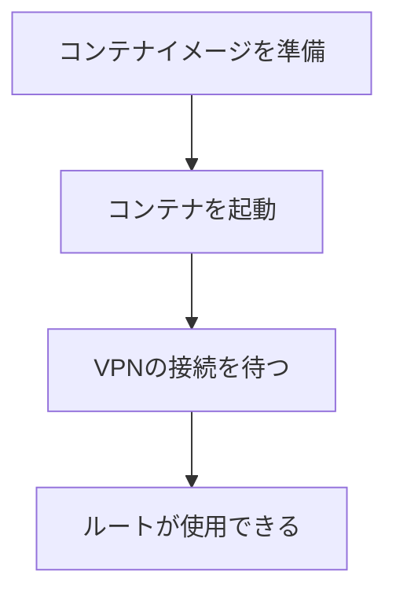
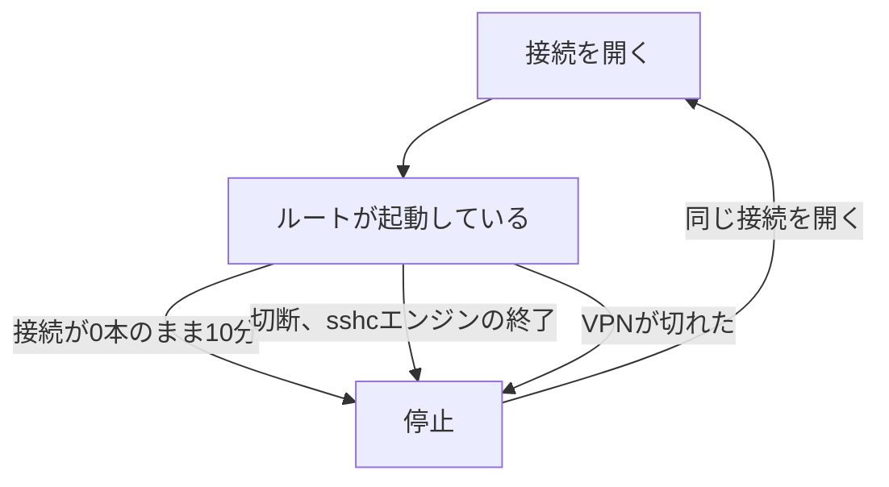

# 接続ごとのVPN

選んだSSH接続だけを、その接続専用のVPN経由で接続します。このマシンのルーティング、DNS、VPNクライアントの設定は変わらないので、別のVPNに接続したままでも、そのVPNの外にあるホストへ接続できます。

VPNプロファイルには、VPNへ接続するための設定とシークレットだけを保存します。接続先は持ちません。パスワードと同じように、Connectionsで接続にVPNプロファイルを付けると、その接続の`HostName`と`Port`へVPN経由で接続します。1つのプロファイルを複数の接続に付けられます。

この機能はDockerが動いているマシンで使用できます。Dockerは20.10以上が必要です（コンテナの起動に`docker run --pull never`を使います）。Dockerが無い場合や起動していない場合は、その理由を表示して処理を中止します。

## 仕組み



SSHのハンドシェイク、認証、ホスト鍵の照合、ssh-agentの利用は、コンテナの中ではなく、このマシンのsshcエンジンが行います。コンテナへ渡すのは接続先のアドレスとポートだけで、SSH秘密鍵もVaultの鍵も渡しません。



sshcエンジンは、接続を1本開くたびに`docker exec`でコンテナの中継を起動し、その標準入出力を接続として使います。このマシンとコンテナのあいだでソケットを共有しないため、LinuxでもmacOSやWindowsのDocker Desktopでも同じ仕組みで動く設計です。ただし、動作を確認しているのは、現在はLinuxだけです。

コンテナは、接続に使われた接続先へのネットワークルートとパケットフィルタだけを作ります。VPNの先のネットワーク全体は取り込みません。

接続先への通信はfail closedです。トンネル以外から接続先へ出ようとする通信は、コンテナ内で拒否します。VPNが切断されているあいだ、接続先への通信がDockerの通常のネットワークへ流れることはありません。

## このマシンへの影響

このマシンのルーティング、DNS、NetworkManager、接続中のVPNの設定は変更しません。`--privileged`と`--network host`も使いません。コンテナへ渡すデバイスと権限は、方式によって次のように違います。

| 方式 | デバイス | 権限 |
|---|---|---|
| WireGuard | `/dev/net/tun` | `CAP_NET_ADMIN`・`CAP_NET_RAW`・`CAP_DAC_OVERRIDE`以外をすべて外す |
| OpenVPN | `/dev/net/tun` | `CAP_NET_ADMIN`・`CAP_NET_RAW`・`CAP_DAC_OVERRIDE`以外をすべて外す |
| OpenConnect | `/dev/net/tun` | Dockerの既定の権限に`CAP_NET_ADMIN`を足す |
| L2TP/IPsec | `/dev/ppp` | Dockerの既定の権限に`CAP_NET_ADMIN`を足す |
| IKEv2/IPsec | なし（カーネルのXFRMインターフェースを使う） | Dockerの既定の権限に`CAP_NET_ADMIN`を足す |

L2TP/IPsec、OpenConnect、IKEv2/IPsecは、必要な権限をまだ確認できていないため、既定の権限のまま渡します。

ただし、このマシンとまったく無関係ではありません。

- Dockerのbridgeとカーネルのトンネル機能を使います。
- Dockerを操作できるユーザーは、一般にこのマシンに対する強い権限を持ちます。

分離されるのは、VPNのルーティング・DNS・接続状態と、VPNへ送るアプリケーションの通信です。

## プロファイルを作成する

VPN画面、または`sshc vpn add <名前>`で作成します。

名前の決まりは次のとおりです。

- 空白や日本語も使えます（48文字まで）。
- 前後の空白、`/`、`\`、改行などの制御文字は使えません。
- CLIで空白を含む名前を指定する場合は、`sshc vpn up "研究室 VPN"`のように引用符で囲みます。

| 項目 | 内容 |
|---|---|
| 方式 | WireGuard、L2TP/IPsec、OpenConnect（Cisco AnyConnect、ocserv、GlobalProtect、FortiGate、Ivanti Connect Secureなど）、OpenVPN、IKEv2/IPsec |
| VPN内のDNSサーバー | `HostName`をホスト名で書いた接続に使う場合だけ入力します。IPv4アドレスを3件まで。WireGuardでは設定ファイルの`DNS`で指定します |
| VPNサーバー | L2TP/IPsec、OpenConnect、IKEv2/IPsecはホスト名またはIPアドレス。WireGuardは設定ファイルの`Endpoint`、OpenVPNは設定ファイルの`remote`から読み取ります |
| シークレット | WireGuardは設定ファイル全体、L2TP/IPsecはVPNのパスワードとIPsecの事前共有鍵、OpenConnectはVPNのパスワード、OpenVPNは設定ファイル（.ovpn）と、必要な場合はVPNのパスワード、IKEv2/IPsecはVPNのパスワードまたはIPsecの事前共有鍵 |

### シークレットの保存と表示

シークレットはVaultに暗号化して保存します。

- VPN画面で「編集」を開くと、保存済みのシークレットをVaultから取り出して各欄に表示します。パスワードなどの欄は「表示」を押すまで伏せ字にします。
- Vaultがロックされている場合は取り出しません。
- 一覧、保存、ログなど、それ以外の画面とAPIの応答にはシークレットは現れません。

### 作成と編集

作成と編集は別の操作です。同じ名前のプロファイルがすでにある場合、作成は何も変更せずにエラーになります。

| 変えたいもの | 使う操作 |
|---|---|
| 設定 | VPN画面の「編集」または`sshc vpn edit <名前>` |
| 名前だけ | 名前の変更 |

Vaultに同じ名前のシークレットが残っていても、作成時に入力したシークレットで置き換え、古いシークレットは引き継ぎません。

編集でのシークレットの扱いは、画面とCLIで次のように違います。

| 操作 | 開いたとき | 空欄のまま保存すると |
|---|---|---|
| VPN画面の「編集」 | 取り出したシークレットを各欄に入れて開く。取り出せなかった場合（Vaultのロックなど）は空欄 | 保存済みの値が残る |
| `sshc vpn edit` | 保存済みのシークレットを表示しない。各項目の初期値は保存済みの値で、任意の項目は`-`を入力すると消せる | 保存済みの値が残る。設定だけを直す場合に入力し直す必要はない |

方式を変えた場合は、前の方式のシークレットを削除し、新しい方式のシークレットの入力を求めます。設定とシークレットは1回の書き込みで保存するため、どちらか一方だけが書き換わることはありません。

接続中のルートには、次に接続するときから反映します。設定かシークレットが変わっていれば、そのときにコンテナを作り直します。作り直すと、それまでのルートを通っていた接続はいったん切れます。利用者が切断したのではないため、Terminalは自動で再接続します。

使用できない値がある場合は、どの項目のどこが問題か（未入力、形式の誤り、件数の上限など）を画面と`sshc vpn add`に表示します。

### L2TP/IPsec

古いVPN機器と暗号スイートが合わない場合だけ、IKEとESPの暗号スイートを指定します。空欄なら既定値を使います。既定値には、L2TP/IPsecのVPN機器でよく使われる組み合わせ（AESとSHA-256またはSHA-1、IKEのDH群はMODPの3072・2048・1024ビット）を含めています。

### OpenConnect

VPNサーバーの製品を選びます。分からない場合は、Cisco AnyConnectのままにしてください。

| 製品 | プロトコル |
|---|---|
| Cisco AnyConnect / Secure Client、ocserv | `anyconnect` |
| Palo Alto Networks GlobalProtect | `gp` |
| Fortinet FortiGate | `fortinet` |
| Ivanti Connect Secure（Pulse Secure） | `pulse` |
| Juniper Network Connect | `nc` |
| F5 BIG-IP | `f5` |
| Array Networks | `array` |

ブラウザでログインする方式（SAMLなどのシングルサインオン）には対応していません。ユーザー名とパスワード、必要ならワンタイムパスワードまたはスマートフォンでの承認でログインするサーバーに接続できます。

自己署名証明書を使うサーバーでは、証明書のフィンガープリントを指定します。`sha256:`（証明書のSHA-256、16進）と`pin-sha256:`（公開鍵のPIN、base64）のどちらでも指定できます。指定しない場合は通常どおり証明書を検証し、検証できなければ接続しません。

OpenConnectでは、サーバーが配布するデフォルトルートとDNSは設定しません。ルーティングは、接続に使った接続先の分だけを作ります。

### 二要素認証（Duo Mobileなど）

パスワードのあとにサーバーが追加の認証を求める場合は、「二要素認証」を指定します。

| 選択 | 送る値 | 使う場面 |
|---|---|---|
| なし | 何も送らない | パスワードだけで認証するサーバー |
| スマートフォンで承認する（Duo Mobileなど） | 何も送らない（文字列を入力した場合はその文字列） | Duo Mobileでの承認 |
| 保存したシークレットからワンタイムパスワードを生成する | その場で生成した6桁のコード | TOTPのシークレットを登録できるサーバー |

Duoのサーバーには2種類の動き方があります。

- パスワードを受け取った時点でスマートフォンへ通知を送り、承認されるまで応答を返さない
- `push`のような文字列の入力を追加で求める

前者では「二要素認証で送る文字列」を空欄にします。後者の場合だけ、その文字列を入力します。

どちらの場合も、待ち時間の上限は2分になります。通知に気付いてスマートフォンを開き、承認するまでの時間を見込んでいます。



待っているあいだの表示は次のとおりです。

| 場所 | 表示 |
|---|---|
| VPN画面 | 「スマートフォンでの承認を待っています」 |
| `sshc vpn`の一覧 | `starting: waiting for approval on the phone` |
| 接続先への接続（TerminalやCLIの`sshc ssh <接続先>`）からルートを起動した場合 | `[sshc] スマートフォンでの承認を待っています。`（接続ログの設定に関係なく表示） |

TOTPのシークレットはVaultに保存し、コードはコンテナへ渡す直前に生成します。シークレットも生成したコードも、`docker logs`と画面には表示されません。

DuoのUniversal Promptのように、ブラウザでのSAMLログインを求める構成には対応していません。コンテナの中にはブラウザが無く、sshcエンジンがその操作を代わりに行うこともありません。

### WireGuardの設定ファイル

WireGuardでは、`[Interface]`と`[Peer]`からなる設定ファイル（wg-quickの形）をそのまま編集します。複数の`[Peer]`、`AllowedIPs`、`PresharedKey`、`PersistentKeepalive`、`MTU`、`Endpoint`などを書けます。

- VPN画面: 設定ファイルを貼り付けるか、［ファイルを選択］で読み込みます。
- `sshc vpn add`: 設定ファイルのパスを入力します。

設定ファイルは`PrivateKey`と`PresharedKey`を含むため、書いたままの本文全体をシークレットとしてVaultに暗号化して保存します。OpenVPNの設定ファイルと同じ扱いです。

`Endpoint`のサーバーと`DNS`だけは、Vaultがロックされていても使うため、シークレットではない設定としても保存します。サーバーは一覧に表示し、DNSは`HostName`をホスト名で書いた接続に使えるかの確認に使います。

- VPN画面で「編集」を開くと、保存済みの設定ファイルを鍵も含めてそのまま表示します。
- `sshc vpn edit`では、新しい設定ファイルのパスを聞きます。空欄なら保存済みの設定ファイルをそのまま使います。

各項目の扱いは次のとおりです。sshcはwg-quickを使わず、`wg setconf`が読む項目だけをWireGuardへ渡します。

| 項目 | 扱い |
|---|---|
| `PrivateKey`、`ListenPort`、`FwMark` | WireGuardへ渡します |
| `PublicKey`、`PresharedKey`、`Endpoint`、`AllowedIPs` | WireGuardへ渡します |
| `PersistentKeepalive` | WireGuardへ渡します。`Endpoint`のある`[Peer]`で書いていない場合は25秒を使います。120秒より長い値は使用できません |
| `Address` | トンネルのアドレスとして使います。IPv4アドレスが1つ以上必要です。IPv6アドレスは使いません |
| `DNS` | 「VPN内のDNSサーバー」として使います。IPv4アドレスを3件までで、どれかの`[Peer]`の`AllowedIPs`に含まれている必要があります。IPv6アドレスと検索ドメインは使いません |
| `MTU` | トンネルのMTUとして使います（576〜65535） |
| `Table` | `off`だけ使用できます。ほかの値はルーティングを変えるため使用できません |
| `SaveConfig` | `false`だけ使用できます。`true`は、sshcが決める設定のため使用できません |
| `PreUp`、`PostUp`、`PreDown`、`PostDown` | コマンドを実行するため使用できません |

使用できない項目や形式の誤りは、画面と`sshc vpn add`に、何行目のどの項目かを表示します。

`AllowedIPs`は、WireGuardがどの`[Peer]`へパケットを送るかを決める設定です。

- sshcは`AllowedIPs`のルートを作らず、ほかの方式と同じく、接続に使った接続先の分だけを作ります。
- 接続先がどの`[Peer]`の`AllowedIPs`にも含まれていない場合は、WireGuardがパケットを送らないため、接続せずにその理由を表示します。
- `AllowedIPs = 0.0.0.0/0`と書いても、コンテナの既定のルーティングは変わりません。

v0.40.0までのサーバー、ピアの公開鍵、トンネルのアドレスで作成したプロファイルは、使用できません。設定ファイルで作り直してください。

### OpenVPNの設定ファイル

OpenVPNでは、プロバイダや組織が配るクライアント用の設定ファイル（.ovpn）を使います。VPN画面では、設定ファイルを貼り付けるか、［ファイルを選択］で読み込みます。`sshc vpn add`では、設定ファイルのパスを入力します。

設定ファイルは証明書や鍵を含むことが多いため、中身をシークレットとしてVaultに保存します。一覧に表示するVPNサーバーは、設定ファイルの`remote`の行から読み取ったものです。

使用できる設定ファイルの条件は次のとおりです。

- `client`（または`tls-client`）と、1つ以上の`remote`を含む
- 証明書と鍵を、`<ca>`〜`</ca>`、`<cert>`、`<key>`、`<tls-auth>`、`<tls-crypt>`のように埋め込んでいる
- トンネルの種類が`tun`である（`dev tap`には対応していません）
- 1行が254バイト以内で、ファイル全体が64KiB以内

ユーザー名とパスワードは任意です。設定ファイルに`auth-user-pass`がある場合は入力します。証明書だけで認証する場合は空欄のままにします。

パスワードは、コンテナの中のメモリ上のファイル（tmpfs）からOpenVPNへ渡し、コマンドの引数や環境変数には置きません。OpenVPNは`--auth-nocache`で、使い終わったパスワードをメモリに残しません。

#### 使用できない指示

安全のため、次の指示を含む設定ファイルは保存できません。画面と`sshc vpn add`に、何行目のどの指示かを表示します。該当する行を削除してから、設定ファイルを読み込み直してください。

| 種類 | 指示 | 理由 |
|---|---|---|
| コマンドやプログラムを実行する | `up`、`down`、`route-up`、`route-pre-down`、`ipchange`、`tls-verify`、`client-connect`、`client-disconnect`、`client-crresponse`、`learn-address`、`auth-user-pass-verify`、`tls-crypt-v2-verify`、`iproute`、`plugin`、`engine`、`pkcs11-providers`、`providers`、`script-security`、`dns-updown` | コンテナの中で任意のコマンドが動き、接続先への通信だけをトンネルへ通す仕組みを壊せるため |
| ルートやDNSを変更する | `route`、`route-ipv6`、`redirect-gateway`、`redirect-private`、`client-nat`、`dns` | ルートはsshcが接続先ごとに追加するため |
| sshcが決める設定 | `dev`と`dev-type`（`tun`以外）、`dev-node`、`lladdr`、`mktun`、`rmtun`、`daemon`、`log`、`log-append`、`syslog`、`status`、`writepid`、`tmp-dir`、`chroot`、`cd`、`user`、`group`、`setcon`、`askpass`、`management`で始まる指示 | トンネルのインターフェース、ログの出力先、OpenVPNを動かす環境はsshcが決めるため |
| ファイルを指定する | `ca`、`cert`、`key`、`tls-auth`、`tls-crypt`、`pkcs12`、`auth-user-pass`などのファイル名の指定、`config`、`capath`、`tls-export-cert`、`replay-persist`、`genkey` | コンテナの中にそのファイルは無いため。中身を`<ca>`〜`</ca>`の形で埋め込めば使用できます |
| VPNサーバー用 | `mode`、`server`、`server-ipv6`、`server-bridge`、`tls-server` | sshcはクライアントとしてだけ接続するため |

表に無い指示も、sshcがクライアントの設定として確認した指示（`remote`、`proto`、`cipher`、`verb`など）でなければ保存できません。OpenVPNのバージョンが上がって増えた指示は、確認するまで使用できません。

この場合は、指示の名前を表示せずに何行目かだけを表示します。設定ファイルにはシークレットが含まれるため、確認していない語は表示しません。

`setenv`で設定できる環境変数は、OpenVPNなどが読む`CLIENT_CERT`、`FORWARD_COMPATIBLE`、`PUSH_PEER_INFO`と、`UV_`または`IV_`で始まる名前だけです。ほかの環境変数は、sshcがOpenVPNから起動するスクリプトの動作を変えられるため使用できません。`setenv opt`を付けた指示も、付けていない指示と同じように確認します。

使用できる指示と使用できない指示は、OpenVPN 2.6のマニュアルで確認して決めています。

#### sshcが決める指定

次の指定は、設定ファイルの内容に関係なくsshcの値を使います。

- トンネルのインターフェースは`tun0`
- サーバーが配るルート、デフォルトルート、DNS（`redirect-gateway`、`route`、`dhcp-option`など）は受け取らない
- インターフェースのアドレスは`/32`で付け、接続に使った接続先へのルートだけを作る
- 認証に失敗したら再試行しない
- ログの詳しさは`verb 3`

設定ファイルの`dhcp-option DNS`と、サーバーが配るDNSは使いません。接続の`HostName`をホスト名で書く場合は、ほかの方式と同じく、プロファイルの「VPN内のDNSサーバー」に指定します。

### IKEv2/IPsec

Windows、macOS、スマートフォンの標準のVPNが接続するIKEv2/IPsecのサーバーに接続できます。認証方式は次の2つから選択します。

| 認証方式 | 入力する値 | サーバーを確認する方法 |
|---|---|---|
| ユーザー名とパスワード（EAP-MSCHAPv2） | VPNのユーザー名、VPNのパスワード | サーバーの証明書 |
| 事前共有鍵（PSK） | ローカルID、IPsecの事前共有鍵 | 事前共有鍵 |

ユーザー名とパスワードで認証する場合は、パスワードを送る前にサーバーの証明書を検証します。

- 「CAの証明書」にPEM形式の証明書を貼り付けると、そのCAが発行した証明書だけを信頼します。中間CAを含めて、複数の証明書を並べて貼り付けられます。
- 空欄の場合は、公的な認証局の証明書（Ubuntuの`ca-certificates`に含まれる証明書）で検証します。
- 検証できないサーバーには接続せず、パスワードも送りません。

証明書に記載された名前は、「サーバーのID（リモートID）」と照合します。

- 空欄ならVPNサーバーの欄と同じ値を使います。
- VPNサーバーをIPアドレスで指定し、証明書にはホスト名が記載されている場合は、そのホスト名をサーバーのIDに指定してください。

ひとつのサーバーに決まらない値は指定できません。どのサーバーの証明書でも受け入れてしまい、パスワードの応答を別のサーバーへ渡すおそれがあるためです。

- `%any`のように`%`で始まる値
- `*`を含む値（`*.example.jp`など）
- `0.0.0.0`や`::`、`10.0.0.0/8`のようなアドレスの範囲

事前共有鍵で認証する場合は、サーバーも同じ事前共有鍵で認証します。ローカルIDには、VPNサーバーに登録されているこのマシンのIDを指定します。CAの証明書は使いません。

IKEとESPの暗号スイートは、VPNサーバーと合わない場合だけ指定します。書き方はL2TP/IPsecと同じです。指定した暗号スイートを先に提示し、そのあとに既定値も提示します。末尾に`!`を付けると、指定した暗号スイートだけを提示します。

サーバーが配布する仮想IPアドレスは受け取りますが、サーバーが配布するルーティングとDNSサーバーはコンテナに設定しません。

- トンネルはIPsecのXFRMインターフェースに結び付けるため、サーバーがすべての宛先（`0.0.0.0/0`）をトンネルに通すよう指定しても、コンテナの既定のルーティングは変わりません。
- ほかの方式と同じく、ルーティングは接続に使った接続先の分だけを作ります。
- サーバーが許可していない宛先には、トンネルを経由しても届きません。

### 接続先をVPN内のホスト名で指定する

接続の`HostName`をホスト名で書いた場合は、そのホスト名の名前解決に使うDNSサーバーを、付けるVPNプロファイルに指定します。DNSサーバーを指定していないプロファイルでは、ホスト名の接続先はエラーになります。Connectionsでプロファイルを選んだときにも注記が表示されます。

名前解決はコンテナの中で、指定したDNSサーバーだけを使って行います。このマシンのresolv.confも、コンテナ既定のDNSも使いません。同じ名前がこのマシンからは別のマシンを指す環境で、接続先を取り違えないためです。

DNSサーバーへの通信もトンネルの中だけに流します。名前解決で得たアドレスは、コンテナのログ（VPN画面の「ログ」、`sshc vpn logs`）に記録されます。

名前解決は、ルートを起動してから初めてその接続先へ接続するときに1回行います。その後に名前が別のアドレスを指すようになった場合は、ルートを切断してから接続し直してください。

## 接続に付ける

パスワードと同じように、VPNプロファイルは接続の側で付けます。次のどちらかで付けます。どちらも同じ設定になります。

- ［Connections］の［表示とターミナル］タブで「使用するVPNプロファイル」を選ぶ
- `sshc vpn bind <alias> <プロファイル名>`を実行する（外す場合は`sshc vpn unbind <alias>`）

VPN画面では、そのプロファイルを使っている接続の一覧を確認できます。

この設定は`~/.ssh/config`には書きません。OpenSSHの設定項目ではなく、sshcが管理する設定だからです。

付けた接続は、Terminal、SFTP、`sshc ssh <接続先>`のどれから開いても同じルートを使います。接続先はその接続の`HostName`と`Port`です。ルートを用意できないときは、通常のネットワークへ切り替えずに接続を中止します。

どの接続がどのルートを使うかは、接続の前にも後にも確認できます。TerminalとSFTPの見出しには「VPN経由：<名前>」が表示されます。`sshc info <alias>`の`vpn`行にも同じ名前が表示されます。

### 付け替えたときの割り当て

接続にVPNプロファイルを付ける、外す、別のプロファイルに変えると、その接続に割り当てた保存済みパスワード、ワンタイムパスワード、起動スニペットは停止中になります。同じ`HostName`でも、VPNが違えば別のネットワークのマシンの場合があるためです。

- パスワードとワンタイムパスワード: ［Connections］の［基本］で基本設定を保存し直します（[認証情報とVault](/connections/credentials)）。
- 起動スニペット: ［Snippets］画面で割り当て直します（[クイックコマンドとスニペット](/terminal/commands)）。

### プロファイルの削除、名前の変更、編集

割り当てへの影響は、操作によって次のように違います。

| 操作 | シークレット | 接続の指定 | 割り当て | 接続中のルート |
|---|---|---|---|---|
| 削除 | 削除する | VPNプロファイルの指定だけ外す。接続は残る | 停止中になる | 切断する |
| 名前の変更 | 新しい名前へ移す | 新しい名前へ移す | そのまま使える | 切断する |
| 編集 | 変更した分を保存する | そのまま | そのまま使える | 次に接続するときから反映する |

削除について:

- 同じ名前でプロファイルを作り直して付け直しても、割り当て直すまで使われません。削除の前に接続からプロファイルを外していた場合も同じです。
- Vaultのロック解除が必要で、ロック中は何も変更せずにエラーになります。設定だけを削除してシークレットが残ると、同じ名前で作り直したプロファイルに古いシークレットが混ざるためです。

名前の変更について:

- 削除して作り直さずに、VPN画面の「名前を変更」または`sshc vpn rename <古い名前> <新しい名前>`を使います。
- ルートは変わらないため、割り当て直す必要はありません。
- Vaultのロック解除が必要です。
- 新しい名前の形式、同じ名前のプロファイルの有無、Vaultの状態を確認してからルートを切断するため、名前の変更がエラーになった場合、接続中のルートは切断されません。

編集について:

- VPN画面の「編集」または`sshc vpn edit`で編集しても、割り当ては停止中になりません。サーバーや設定ファイルを変更しても同じです。
- 別のネットワークのVPNに切り替える場合は、プロファイルを編集せずに新しいプロファイルを作成し、接続に付け替えてください。付け替えると割り当ては停止中になるため、接続先を確認してから割り当て直せます。

## 接続が完了するまで

`sshc vpn up`とVPN画面の「接続」は、ルートが使用できるようになるまで待ちます。コンテナイメージをまだ作成していないマシンでは、最初の1回だけ数分かかります。



進み具合の見え方は、起動のしかたで違います。

| 起動のしかた | 進み具合 |
|---|---|
| VPN画面の「接続」 | 「コンテナイメージを準備しています」「コンテナを起動しています」「VPNの接続を待っています」の順に表示する |
| `sshc vpn up` | 表示しない。ルートが使用できるようになるか失敗するまで待つ。別のターミナルで`sshc vpn`を実行すると一覧で確認できる（`starting: building the image`など） |
| 接続先への接続（TerminalやCLIの`sshc ssh <接続先>`） | コンテナイメージを作成するあいだ、接続ログの設定に関係なく`[sshc] VPNのコンテナイメージを作成しています。初回は数分かかることがあります。`と表示する |

## ルートの起動と停止

ルートは、必要になったときに起動し、不要になったら停止します。接続先へのネットワークルートとパケットフィルタは、その接続先へ初めて接続するときに追加します。



- Terminal、SFTP、`sshc ssh <接続先>`、`sshc vpn proxy`のどれから開いた接続も同じように数えるため、使用中のルートが停止することはありません。
- `sshc vpn up`や画面の「接続」で起動しただけのルートは、起動した時刻から数えます。
- VPNが切断されたルートは、中継だけを残さず、コンテナごと終了します。

接続を待っているあいだに`Ctrl-C`で中断した場合や、画面を閉じた場合も、準備中だったコンテナは残りません。

ルートを停止するときは、VPNサーバーへ切断を通知してから終了します。サーバー側にセッションが残らないため、同時接続数の枠も解放されます。

| 方式 | サーバーへ送るもの |
|---|---|
| OpenConnect | ログアウト |
| L2TP/IPsec | L2TPの切断とIPsecの終了 |
| IKEv2/IPsec | IPsecの終了 |
| OpenVPN | 設定ファイルに`explicit-exit-notify`があれば切断 |

### VPN画面の「切断」

VPN画面の「切断」でルートを停止すると、そのルートを使っている接続（Terminal、SFTP、`sshc ssh <接続先>`）も切断されます。使用中の接続がある場合は、切断する前に接続の本数を表示して確認します。

- VPN画面は開いているあいだルートの状態を更新するため、ほかの画面やCLIから起動したルートも、開き直さずに切断できます。
- コンテナイメージの作成中や承認待ちなど、起動の途中のルートも「切断」や`sshc vpn down`で中止できます。
- ひとつのルートを起動しているあいだも、ほかのプロファイルは操作できます。
- 画面を開いた直後はプロファイルの一覧をすぐに表示し、ルートの状態はDockerで確認するまで「確認中」と表示します。

「切断」や`sshc vpn down`で切断された接続は、Terminalで自動再接続しません。自動再接続でルートを起動し直すと、切断した直後にルートが戻ってしまうためです。Terminalの［再接続］を押すか、接続を開き直すと、ルートを起動して接続します。

停止したあとに同じ接続を開くと、ルートは自動で再起動します。スマートフォンでの承認が必要なルートでは、そのときにもう一度承認を求められます。

## 接続できないとき

ルートが起動していれば、VPN画面と`sshc vpn`の一覧に、トンネルのインターフェース名、トンネルのアドレス、接続開始時刻が表示されます。ここまで表示されていれば、VPNの接続は確立しています。

WireGuardでは、サーバーとのハンドシェイクが完了するまでルートを開きません。鍵やサーバーの指定が間違っている場合は、ルートを開かずに原因を表示します。

### VPNに接続できないとき

VPNの接続に失敗した場合は、分かる範囲で原因（ハンドシェイクに失敗した、PPPの認証に失敗したなど）を画面と`sshc vpn up`に表示します。OpenVPNでは、サーバーが認証を拒否した（`AUTH_FAILED`）、TLSのハンドシェイクに失敗した、サーバーから応答が無い、を区別して表示します。IKEv2/IPsecでは、次の原因を区別して表示します。

| 表示 | 確認すること |
|---|---|
| IKEv2の認証に失敗しました | ユーザー名、パスワード、事前共有鍵、ローカルID |
| VPNサーバーの証明書を検証できませんでした | サーバーのID、CAの証明書 |
| 暗号スイートのネゴシエーションに失敗しました | IKEとESPの暗号スイート |
| VPNサーバーから応答がありません | VPNサーバーの指定、UDPの500番と4500番でVPNサーバーに到達できるか |
| IPsecのXFRMインターフェースを作成できませんでした | DockerのLinuxカーネルがXFRMインターフェースに対応しているか |

### VPNには接続できたが接続先へ届かないとき

原因をTerminalと`sshc ssh <接続先>`に表示します。

| 表示 | 確認すること |
|---|---|
| VPN内のDNSサーバーで接続先の名前解決に失敗しました | プロファイルのDNSサーバーと、接続の`HostName` |
| 接続先が応答しないか、接続を拒否しました | 接続の`HostName`と`Port`、接続先でSSHサーバーが動いているか |
| 接続先がVPNサーバーと同じアドレスです | VPNサーバーそのものにはVPN経由で接続できません |
| 接続先が、WireGuardのどの[Peer]のAllowedIPsにも含まれていません | 設定ファイルの`AllowedIPs`と、接続の`HostName` |

CLIの`sshc vpn up`と`sshc ssh <接続先>`は、上の2つの表の原因を英語で表示します。

VPNのシークレットが無い、Dockerが起動していないなど、設定を直さない限り同じ理由で失敗する場合、Terminalは再接続を繰り返しません。

### ログを確認する

原因が表示されない場合や、VPNには接続できているのに接続先へ到達できない場合は、VPN画面の「ログ」、または`sshc vpn logs <名前>`でログを確認します。`docker logs`を直接実行する必要はありません。

ログには、次の2つを順に表示します。

- 「sshcエンジンの記録」: sshcエンジンがVPNルートを用意した手順（使ったdocker、コンテナイメージの作成、実行したdockerのコマンドと失敗したときの出力）。コンテナイメージの作成に失敗した場合のように、コンテナが起動する前に失敗した場合も、ここで原因を確認できます。
- 「コンテナのログ」: 接続に失敗したコンテナは削除しますが、そのときのログはsshcエンジンが保持しているので、あとから同じ方法で確認できます。

保存済みのシークレットは`[REDACTED]`に置き換えて表示するため、そのまま貼り付けて共有できます。

## このマシンの`ssh`・`scp`・`git`から使う

`ProxyCommand`に`sshc vpn proxy`を指定すると、sshc以外のSSHクライアントも同じルートを使えます。接続先は`%h %p`で渡します。省略できません。

```text
Host lab
  HostName 10.9.9.1
  ProxyCommand sshc vpn proxy tundra %h %p
```

空白を含む名前は、`ProxyCommand sshc vpn proxy "研究室 VPN" %h %p`のように引用符で囲みます。

接続先へ届かない場合は、通常のネットワークへ切り替えずに接続を中止し、原因を標準エラーに表示します。SSHのハンドシェイク・鍵・known_hostsは呼び出した側のものを使い、sshcはデータを中継するだけです。

## 制約

- 接続先はIPv4アドレスかホスト名です。IPv6アドレスには対応していません。IPv4アドレスは`10.0.0.1`のように4つの数で書きます。`10.1`のような略記と、`010.0.0.1`のように0で始まる数は使えません。VPNサーバーそのものは接続先にできません。
- 踏み台（ProxyJump）の先のホップには使えません。2ホップ目以降は手前のSSH接続の中を通るため、このマシンのVPNを経由できません。
- VPNプロファイルを付けた接続では`ProxyCommand`を使えません。`ProxyCommand`はこのマシンで実行されるため、VPNの中を通りません。`ProxyCommand`からルートを使う場合は、プロファイルを付けずに上の`sshc vpn proxy`を指定します。
- ［疎通を確認］は、VPNプロファイルを付けた接続では接続を試みません。このマシンから直接接続してもVPNのルートを通らないためです。VPN経由で届くかは、Connectionsの［保存済み設定で認証を確認］かDiagnosticsの［認証を確認］で確認します。認証の確認はVPNのルートを通り、ルートが起動していなければ起動します。
- 現在はLinuxでだけ動作を確認しています。IKEv2/IPsecは、DockerのLinuxカーネルのXFRMインターフェース（Linux 4.19以降）を使います。
