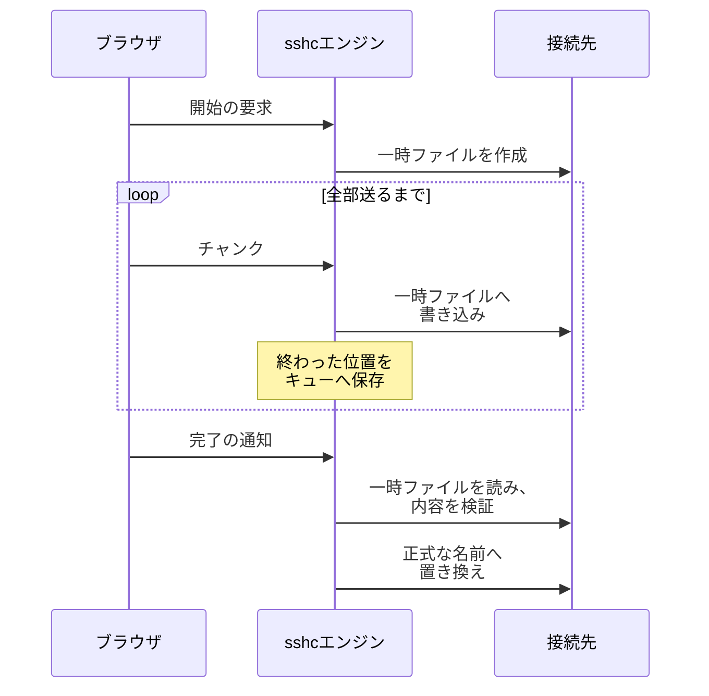
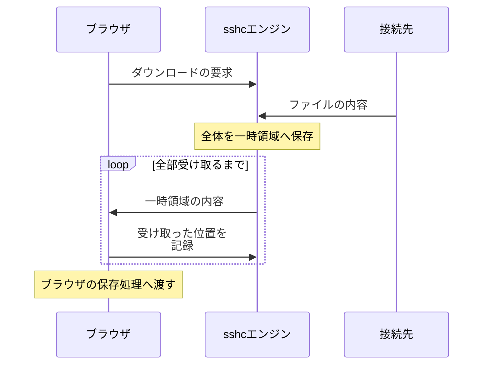
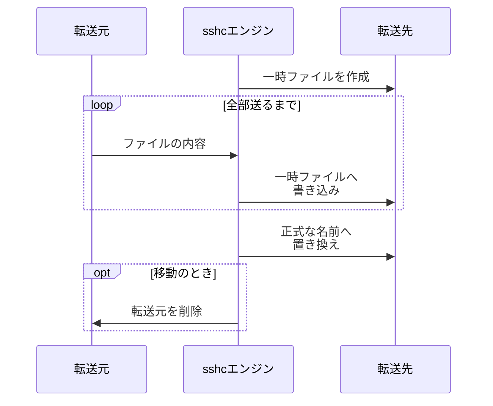
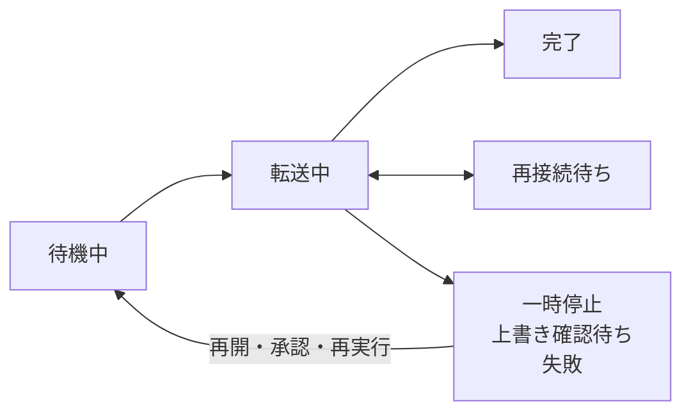
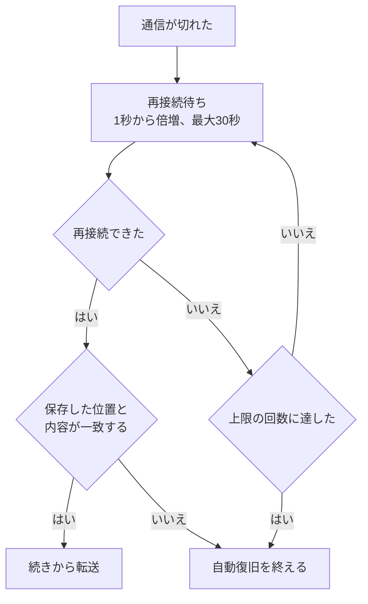

# 転送マネージャー

ファイルとフォルダのアップロード／ダウンロードと、2つのSFTP接続間で行うRemote→Remoteコピー／移動を、1つのキューで管理します。既定では2件、設定により1〜8件を同時に転送できます。


## 表示される情報

転送マネージャーはSFTP画面の下部に固定表示され、通常は転送件数、全体の進捗、速度だけを表示します。クリックして展開すると、ファイルごとの状態と操作を確認できます。

- 全体とファイルごとの進捗
- 転送済み／合計サイズ
- 現在の速度と残り時間
- 名前、送信元から送信先、状態と操作

一時停止、再接続待ち、確認待ち、失敗は転送中とは分けて示します。行末の詳細ボタンで、フルパス、転送開始時の除外ルール、失敗の理由を確認できます。

| 環境 | 一覧の操作 |
| --- | --- |
| デスクトップ | 展開中の上端のグリップを上下へドラッグして高さを変更する。キーボードではグリップへフォーカスし、上下矢印、Home、Endキーで変更する |
| スマートフォン | 件数と進捗を示す下部のバーを押すと、転送一覧を別画面で開く |

高さと折りたたみ状態はブラウザに保存されます。

## 転送の設定

［転送設定］を押すと、キューが空のときや折りたたまれているときも、設定のページへ移動します。速度と復旧、同時実行と完了項目、分割転送、除外ルールをまとめて変更できます。

| 場所 | 内容 |
| --- | --- |
| ［Settings］→［SFTP］ | プリセットごとに選ぶもの |
| ［Settings］→［General］ | どのマシンでも同じもの |

ページは［転送］と［転送の除外］の2つの節に分けて表示します。

- 数値と除外ルールは、入力後にフォーカスを移すと反映されます。
- 選択肢とチェックボックスは、変更時に反映されます。
- 除外ルールは、すべての行が正しい書き方のときだけ反映します。

## 転送の流れ

データの流れは転送の種類で変わります。全体の図は[SFTPの通信の流れ](/features/sftp#通信の流れ)にあります。

### アップロード

データはブラウザからsshcエンジンを通り、転送先のフォルダにあるsshc専用の一時ファイルへ書き込まれます。内容全体を検証してから正式なファイル名へ置き換えるので、途中のファイルが正式な名前で見えることはありません。



- 既存ファイルを上書きする場合は、転送前に確認を表示します。
- 接続が切れた場合は、sshcエンジンに保存された位置から再開できます。
- 再読み込み後に続けるには、元のローカルファイルを選び直してください。名前、サイズ、更新日時が保存済みの転送情報と一致し、リモート側の一時ファイルも利用できる場合は、確認済みのチャンクだけを飛ばして続行します。

### ダウンロード

sshcエンジンは、転送の開始時にファイル全体を一時領域へ読み込みます。再開しても同じ内容を配信するためです。



ブラウザ側に保存した途中までのデータと、転送開始時に記録したリモートファイルの状態が一致する場合は、HTTP Rangeで途中から再開します。

一時領域の空きと場所は[分割転送と一時領域](#分割転送と一時領域)にあります。

### フォルダのZIPダウンロード

リモートフォルダのダウンロードでは、sshcエンジンがZIPを作成してブラウザへ配信します。

- ZIPの途中からは再開できません。一時停止、失敗、再読み込みの後は先頭からやり直します。
- Androidでは完成したZIPをシステムのファイル選択画面へ渡します。

次の名前がフォルダ自身かその中に1つでもあると、そのフォルダはZIPにできず、ダウンロードは失敗します。

| 名前 | sshcエンジンのOS | 理由 |
| --- | --- | --- |
| `:`を含む名前 | Windows | ドライブや代替データストリームの指定になる |
| Windowsの予約名（`CON`、`NUL`、`COM1`など） | Windows | デバイスを指す |
| `\`を含む名前 | すべて | |

sshcエンジン側のフォルダへのダウンロードとCLIの`sshc sftp get`も、Windowsでは同じ名前を断ります。LinuxやmacOSで動くsshcエンジンでは断りません。

### Remote→Remoteのコピー・移動

sshcエンジンが2つのSFTP接続を開いて直接送ります。ブラウザを経由しないので、ブラウザを閉じても続きます。



## 操作

| 操作 | 動作 | 残るもの |
| --- | --- | --- |
| 一時停止 | 新しい読み書きを止める | アップロード先の一時ファイルやダウンロード済みの位置など、再開に必要な情報 |
| 再開 | 転送元と転送先が一時停止前と一致していれば、確認済みの位置から続行する。一致しない場合は、上書き確認またはファイルの再選択が必要 | |
| 再実行 | 失敗したファイルだけを転送する。利用できる再開情報があれば途中から、なければ先頭から | |
| キャンセル | 転送を中止し、sshcが作成した再開用の一時ファイルを削除する | 既存の完成ファイル |
| ［完了分を消去］ | 完了またはキャンセル済みの項目を一覧から削除する | 転送済みのファイル |
| ［一覧から削除］ | 完了、キャンセル、失敗した項目を1件ずつ削除する | |
| ［失敗項目を一覧から削除］ | 失敗した項目だけをまとめて削除する | |
| ［新しい転送の開始を停止］ | 実行中の転送は続き、待機中の項目は「保留中」と表示されて新しく始まらない。［転送キューの処理を再開する］で元に戻る | |
| 行の↑↓ | 待機中の項目の順番を入れ替える。実行中や完了済みの項目は動かせない | |

状態は次のように移ります。



キャンセルは、完了とキャンセル済み以外のどの状態からでもできます。キャンセルと完了が同時に起きた場合は、完了状態を維持したまま正常終了として扱います。

右端のメニューには、現在実行できる一括操作だけが表示されます。操作できる転送がない場合は、メニューを開くボタン自体を表示しません。

［完了した項目］を「残す」以外（30秒後、5分後、1時間後に消す）にすると、完了した項目はその時間が過ぎたあと自動で一覧から消えます。［Settings］→［General］の設定で、どのマシン・どの画面でも同じ値です。

### 一時ファイルが残ったとき

アップロードの一時ファイルを削除できなかった場合は、転送を一覧に残して理由を表示します。接続を回復してからキャンセルまたは削除をやり直せます。

自動復旧を無効にしているコピー、移動、sshcエンジン側のファイルを開いたペインからのアップロードを止めると、転送先に書いていた一時ファイルを、新しいSFTP接続を開いて削除します。次の場合は削除できずに残ることがあります。

- 回線が切れている場合
- ワンタイムコードで認証するため2本目の接続を開けない接続先

エディタの保存が途中で止まって一時ファイルが残った場合も同じです。この一時ファイルは一覧に表示されませんが、残っている間は次の操作が`sftp_conflict`で失敗します。

- 一時ファイルがあるフォルダや、それを含む上のフォルダの削除
- 同じフォルダの別の接続先への移動

最後の書き込みから1日たった一時ファイルは使われていないものとみなし、フォルダの削除や移動のときに一緒に削除します。失敗が続くのは最長で1日です。このとき削除するのはsshcの一時ファイルだけで、ほかのファイルは消えません。

## 分割転送と一時領域

通常ファイルはアップロード、ダウンロードともに512 GiBまで転送できます。初期設定の接続数は1なので、大容量ファイルも分割せず、1つのSFTP接続で処理します。

接続数を2以上にすると、分割転送を始めるサイズ以上のファイルをチャンクに分け、その数までの独立したSFTP接続で処理します。

| 設定 | 初期値 | 指定できる範囲 |
| --- | --- | --- |
| 分割転送を始めるサイズ | 100 MiB | 16〜1024 MiB |
| 接続数 | 1 | 1〜128 |
| チャンクサイズ | 32 MiB | 8〜4096 MiB |

- 実際に使う接続数は未転送チャンク数までです。
- ワンタイムコードで認証するホストは、設定に関わらず1接続で転送します。
- 設定はプリセットに保存され、そのプリセットを使うマシンのWeb画面とCLIで共通して使われます。
- 転送中のファイルは、既定値を変更しても始めたときの設定のまま転送します。
- CLIでは`sshc sftp settings`で既定値を表示・保存できます。`get`／`put`へ同じオプションを付けると、その実行だけ既定値を上書きできます。

分割アップロードでは、転送先に最終サイズの一時ファイルを用意し、各接続が重ならない範囲へ書き込みます。再開に使う完了範囲はsshcエンジンの転送キューへ保存されます。

### ダウンロードの一時領域

対象ファイルと同程度の空き容量を確保してください。

| OS | 場所 |
| --- | --- |
| Linux | `$XDG_CACHE_HOME/sshc/sftp-spool`（未設定なら`~/.cache/sshc/sftp-spool`） |
| macOS | `~/Library/Caches/sshc/sftp-spool` |
| Windows | `%LocalAppData%\sshc\sftp-spool` |
| Android | アプリのキャッシュフォルダにある`sftp-spool` |

| エラー | 起きる条件 |
| --- | --- |
| `sftp_spool_unavailable` | キャッシュの場所が分からないなどで一時領域を使えない。待たずに失敗し、sshcエンジンは起動時に理由をログへ出す |
| `sftp_spool_full` | 空きが対象ファイルの大きさに64 MiBを足した量より少ない。または書き込み中に空きがなくなった |

フォルダをZIPにまとめるダウンロードは別の制限を使用します。

## フォルダの転送と削除が失敗する条件

sshcエンジンが実行するフォルダの転送（ホスト間のコピー／移動と、sshcエンジン側のファイルを開いたペインとの転送）と削除は、次の場合に失敗します。

| エラー | 条件 |
| --- | --- |
| `sftp_traversal_limit` | 転送元のフォルダの配下の項目が20,000を超える |
| `sftp_traversal_limit` | 削除するフォルダの配下の項目が200,000を超えるか、階層が128段より深い。何も削除しない |
| `sftp_name_collision` | 転送元に大文字小文字やUnicodeの正規化だけが違う名前（`README.md`と`readme.md`など）があり、大文字小文字を区別しない転送先（macOSのAPFSやWindowsのNTFSの既定など）では同じ名前になる。上書きを承認していても同じ |
| `sftp_conflict` | 転送先にある同じ名前の項目の種類が違う（フォルダを置く場所にファイルがあるなど）。上書きを承認しても置き換えない |
| `sftp_target_inside_source` | Remote→Remoteで、転送先が転送元のフォルダ自身かその中にある。転送先に何も残さない |
| `sftp_target_is_source` | Remote→Remoteで、転送先が転送元のファイルそのもの。転送元も転送先も変えない |

### 転送先と転送元が重なるとき

`sftp_target_inside_source`と`sftp_target_is_source`は、次の場合も同じです。

- 同じサーバーを別の接続先として登録している場合。転送先に同じ名前の項目があると、先に上書きの確認が表示され、承認したあとで失敗します。
- 転送先のパスの途中にあるシンボリックリンクが転送元を指す場合。途中のリンクをたどってパスを確かめるサーバー（OpenSSHのSFTPサーバーなど）で検出します。

転送先そのものが転送元のファイルを指すシンボリックリンクの場合は失敗せず、上書きを承認するとリンクがファイルに置き換わります。リンクの先にあったファイルの内容は失われません。

::: warning 検出できない重なり
2つの接続先から同じ場所が違うパスに見える場合は、転送先が転送元と重なっていても検出できません。このとき移動の上書きを承認すると、転送元が失われることがあります。

- chrootやbind mountで接続先ごとに見えるパスが違う場合
- 大文字小文字を区別しないサーバー（macOSのAPFSやWindowsのNTFSの既定など）で、大文字小文字だけが違うパスを指定した場合
:::

## 画面を離れた場合

転送キューと状態はsshcエンジンが保存します。待機順、進捗、同時実行数、上書き確認、再開情報は、ブラウザ／WebViewの再読み込み後やsshcエンジンの再起動後にも復元されます。複数の画面を開いた場合も、同じ転送キューが表示されます。

| 転送 | 画面を閉じたとき | 戻ったとき |
| --- | --- | --- |
| ローカルファイルのアップロード | ブラウザ／WebViewがデータを受け渡すので、送受信が止まる。転送の状態はsshcエンジンに残る | 「同じファイルを選択」と表示され、元のファイルを選び直すまで送信しない |
| ローカルファイルへのダウンロード | 送受信が止まる。転送の状態はsshcエンジンに残る | |
| Remote→Remote | 続く | |

同じアプリ内でSFTP画面から移動しても、転送は続きます。

### sshcエンジンを終了したとき

sshcエンジン終了時に転送中だったRemote→Remoteの項目は、再起動時に待機状態へ戻り、自動的に再実行されます。ファイルは転送先の一時名へ書き、完了するまで正式名へ置き換えません。

ただし、転送先への公開や転送元の削除が既に済んでいる可能性がある段階で、結果をsshcエンジンのキューへ記録できなかった場合は再実行されません。この項目には［転送先の確認が必要］と表示され、実行できる操作はキャンセルだけになります。転送先で結果を確かめてから、一覧から外してください。

キューのファイルが壊れていた場合も、sshcエンジンは起動します。壊れた内容は原因調査用としてこのマシン内に退避され、キューは空の状態から始まります。退避した内容は同期の対象になりません。

## 速度上限

［Settings］→［SFTP］の［速度上限］はKiB/sで指定します。1 KiB/sは毎秒1,024バイト、0は無制限です。

- 設定はプリセットに保存され、実行中の転送にも適用されます。
- 並列接続、複数の転送、複数の画面、CLIの転送が同じ上限を共有します。
- 対象はファイル内容の読み書きです。SSHのヘッダ、一覧取得などのメタデータ通信は含みません。
- 転送元の先読みやSSHライブラリの有限のバッファがあるため、瞬間的な回線使用量や表示上の速度が設定値と一致するとは限りません。

| 転送ルート | 上限を適用する箇所 |
| --- | --- |
| ブラウザ／CLIのアップロード | 順次のチャンク・並列の範囲からSFTPへ書き込む内容 |
| ブラウザ／CLIのファイルダウンロード | 順次・並列のSFTP取得と、一時領域からのHTTP配信 |
| sshcエンジン側のファイル↔リモート | SFTPの読み書きと、復旧用の内容検証 |
| Remote→Remoteのコピー・移動 | 内容をコピーするときの受信と送信（合算）と、再開前の内容検証。renameだけの移動はメタデータ通信 |
| ZIPダウンロード | ZIPへ取り込むファイル内容（圧縮前）と、完成したZIPのHTTP配信（ZIPのバイト数） |

順次アップロードでは、チャンク単位でHTTP受信を済ませてからSFTPへ書き込むため、ブラウザ／CLIからsshcエンジンへのHTTP受信そのものは制限しません。上限はSFTPへの書き込みに適用します。並列のアップロードは読み込みながらSFTPへ書き込みます。

## 通信断後の自動復旧

［Settings］→［General］の［通信が切れたとき］の［自動で再開する］を有効にし、［再接続の上限］を1〜10回にすると、通信断だけを対象に再接続します。既定では無効です。



待機中は［再接続待ち］と試行回数を表示します。［一時停止］または［キャンセル］で待機と接続処理を止められます。転送キューの停止、復旧設定の無効化、sshcエンジンの終了でも自動復旧は終了します。

| 転送ルート | 自動復旧と再開 |
| --- | --- |
| sshcエンジン側の単一ファイル↔リモート、Remote→Remoteコピー | SSH接続を作り直します。転送元の内容ハッシュ・メタデータ、転送先のリビジョン、一時ファイルの内容を照合し、一致する部分の続きから転送します。ブラウザを閉じても継続します |
| ブラウザのアップロード | 開いているページが元のファイルを保持している間に復旧します。保存済みの位置／完了範囲と転送先のリビジョンを使います。再読み込み後は同じファイルの再選択が必要です |
| ブラウザのファイルダウンロード | 一時領域が準備済みなら同じ内容を配信し、保存済みの位置から再開します。準備中にSSHが切れた場合は一時領域を先頭から作り直します。内容が変わった場合は自動再開を止めます |
| ブラウザのZIPダウンロード | 先頭から再実行します。途中位置からは再開しません |
| CLIの`get`／`put` | 共通の速度上限が効きます。CLI自身の通信断の自動再試行は行いません |
| sshcエンジンが実行するフォルダ転送、移動、削除 | 自動再試行しません。途中までの結果を確認し、手動で再開または再試行してください |

次の場合は自動再試行しません。

- 認証・ホスト鍵の拒否、権限不足、リビジョンの競合
- 転送先への公開renameの応答が失われた場合。完了したか判断できないためです。転送先を確認してからキャンセルしてください
- 種類・サイズ・更新日時が不明なファイル。エラーを表示します
- ブラウザの場合に、開いたページからsshcエンジンのAPIへ接続できない、または転送の状態を確定できないとき

### 復旧の細かい動作

- 復旧用の一時ファイルは一時停止中に保持し、キャンセルや一覧からの削除で片付けます。片付けに失敗した場合は記録を残します。
- sshcエンジンが続きから再開する転送は通常ファイルだけを扱い、転送元・転送先・一時ファイル自体がシンボリックリンクなら拒否します。
- 内容の検証は固定サイズのバッファで順次行うため、時間がかかることがあります。検証も同じ速度上限を使います。
- 再接続待ちの転送を残してsshcエンジンを終了した場合、次の起動では一時停止として表示します。手動で再開すると、保存済みの内容を照合して続行します。

### CLIからの設定

`--speed-limit`はKiB/sで、このマシンが使うプリセットの速度上限を変えます。`--reconnect-attempts`は全体の設定で、`0`は自動復旧を無効にします。設定変更は他の転送にも適用されます。

```sh
sshc sftp settings --speed-limit 2048 --reconnect-attempts 3
sshc sftp settings --speed-limit 0 --reconnect-attempts 0
```

## 転送するフォルダからの除外

［Settings］→［SFTP］の「転送の除外」で、1行に1つずつ除外パターンを保存できます。初期設定では何も除外しません。

| 指定 | 一致するもの |
| --- | --- |
| `.git`、`node_modules`、`*.log` | その名前の項目。フォルダ内のどの階層でも転送しない。フォルダが一致した場合は、その中へ入らない |
| `build/cache`（`/`を含む） | 選択したフォルダ直下からの相対パス |

| 書き方 | 意味 |
| --- | --- |
| `*` | 同じパス要素内の任意の文字列 |
| `?` | 1文字 |

`**`、否定の`!`、角括弧、バックスラッシュ、絶対パス、`.`／`..`のパス要素は使えません。64件まで、各指定は512バイトまでです。

### 適用する転送

| 適用する | 適用しない |
| --- | --- |
| Webのフォルダアップロード | 明示的に選択した単一ファイル |
| ホスト間のフォルダコピー | 移動 |
| sshcエンジンのローカルディスクとのフォルダ転送 | 削除 |
| フォルダのZIPダウンロード | |
| CLIの`get --recursive`／`put --recursive` | |

除外された項目は転送先に作られず、転送の成功にも含まれません。ブラウザのアップロードは除外した項目数を表示し、sshcエンジンのフォルダ転送には開始時の除外指定を表示します。

### 設定を変えたとき

設定はプリセットに保存されます。キューへ登録されたフォルダ転送は、その時点の指定を使い続けます。待機中や再開前に設定を変更しても、登録済みの転送や作成済みのZIPの内容は変わりません。

CLIは実行開始時の指定を使います。`sshc sftp settings`でも現在の除外指定を確認できます。
